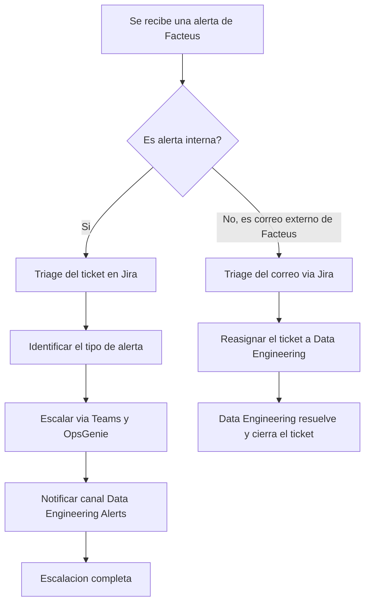
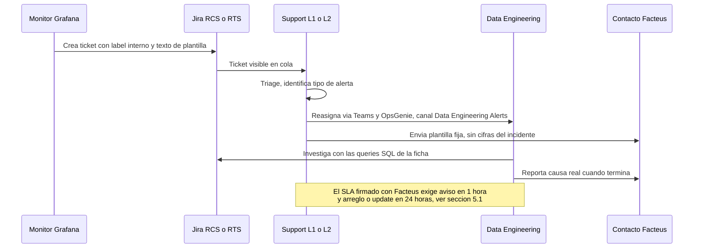

# Cerebro — Sistema & Decisiones

Carpeta 27 de la base de Moscú. 48 fragmentos.

## Costo real de mover Moscú a la API de Claude, medido sobre 85 días — 18 ago 2026
_chunk 1702 · 2026-08-18 · fuente: inbox/2026-08-18-costo-claude-api.md_

# Cuánto costaría mover Moscú a Claude — cálculo con volumen real

Medido sobre tu base, no estimado. Ventana: **25 may – 18 ago 2026, 85 días**.

## Lo que Moscú realmente consumió

| Uso | Volumen real |
|---|---|
| Chunks contextualizados | 1.511 llamadas |
| Turnos de chat | 33 (66 mensajes, 16 conversaciones) |
| Sesiones de transcripción | 6 |
| Texto total en la base | 4,06 M caracteres ≈ 1,0 M tokens |

El dato que sorprende: **el gasto no estuvo en el chat, estuvo en la indexación**. 1.511
llamadas de contextualización contra 33 turnos de conversación. Chateaste con Moscú 33 veces en
tres meses.

## Tamaño exacto de cada llamada

Leído del código de `ChunkContextualizer`:
- Entrada: 3 fragmentos vecinos × 200 chars + 800 chars del fragmento + instrucciones ≈ **400 tokens**
- Salida: máximo 60 palabras ≈ **90 tokens**

Chat, con el `PromptBudgetManager`: perfil 300 + insights 200 + contexto 800 + summaries 750 +
RAG 3.000 ≈ 5.200 tokens de sistema, más historial. Unos **7.000 de entrada** y **510 de salida**
por turno.

## Total de los 85 días

**~0,94 M tokens de entrada · ~0,20 M tokens de salida**

## Costo con tarifas de la API de Anthropic

| Modelo | Entrada | Salida | Los 85 días | Por mes |
|---|---|---|---|---|
| Haiku 4.5 | 1 $/MTok | 5 $/MTok | **1,94 $** | 0,70 $ |
| Sonnet | 3 $/MTok | 15 $/MTok | **5,82 $** | 2,10 $ |
| Opus | 15 $/MTok | 75 $/MTok | **29,10 $** | 10,40 $ |

Con la Batch API (50 % de descuento, y la contextualización es indexación offline, perfectamente
batcheable) Sonnet baja a unos **3,90 $** por los tres meses.

**Embeddings**: Anthropic no tiene API de embeddings, recomienda Voyage. `voyage-3-lite` cuesta
0,02 $/MTok, así que tu millón de tokens vale **2 centavos**. Con Ollama en local, cero.

## Escenario de uso intensivo

Si pasas a procesar reuniones a diario: un transcript de 1 hora son ~12.000 tokens; procesarlo
(resumir, estructurar, extraer acciones) sale a ~15.000 de entrada y 2.000 de salida. Con 20
reuniones al mes:

- Haiku: **0,50 $/mes** · Sonnet: **1,50 $/mes** · Opus: **7,50 $/mes**

## La conclusión incómoda

Tu carga de trabajo es diminuta para precios de API. Estás hablando de **entre 1 y 10 dólares al
mes**, y eso solo si usas la API directamente.

Pero es que probablemente **no necesitas pagar nada extra**: ya tienes Claude Code con
suscripción, y hoy hace exactamente lo que hacía GPT-4o dentro de Moscú, con más contexto y
acceso a Jira, Confluence y tus archivos. El transcript de J.R. y el de Viraj los procesé aquí,
sin API key, sin costo marginal.

**Recomendación:** no metas una API key en Moscú. Deja Moscú como almacén y transcriptor, y usa
Claude Code como motor. Si algún día quieres automatizar la indexación sin estar presente,
entonces sí, una key de Haiku por menos de un dólar al mes cubre la contextualización de todo lo
que entre.

Tarifas a confirmar en anthropic.com/pricing antes de decidir.

## Prompt de verificación Atlassian en modo solo lectura — 18 ago 2026
_chunk 1703 · 2026-08-18 · fuente: inbox/2026-08-18-prompt-atlassian-verificacion.md_

# Prompt para la consola con Atlassian

Copiar y pegar tal cual. Pide **solo lectura**, y pide el resultado en un formato que puedo
consumir directo.

---

```
Necesito que consultes Jira (instancia trebuco.atlassian.net, cloudId
7eb600cf-c7e0-43ed-acc4-90b277d43514) en MODO SOLO LECTURA y me devuelvas un reporte.

REGLA DURA: no escribas nada en Jira. No uses addCommentToJiraIssue, editJiraIssue,
transitionJiraIssue, createJiraIssue, createIssueLink, addWorklogToJiraIssue ni ninguna
operación de escritura. Solo getJiraIssue y searchJiraIssuesUsingJql.

Contexto: son los 35 tickets del cliente Ahold Delhaize USA (ADUSA, Client ID 441). Hoy 18
de agosto hubo una reunión con el cliente y hay que enviarle un tracker actualizado. Necesito
el estado real de Jira para no publicar nada que se contradiga con el sistema.

PARTE 1 — Tabla base de los 35 tickets

Corre este JQL:

key in (RCS-28014,RCS-28021,RCS-28023,RCS-28025,RCS-28030,RCS-28041,RCS-28042,RCS-28043,
RCS-28053,RCS-28059,RCS-28075,RCS-28093,RCS-28109,RCS-28115,RCS-28123,RCS-28124,RCS-28125,
RCS-28135,RCS-28161,RCS-28177,RCS-28196,RCS-28281,RCS-28292,RCS-28304,RCS-28342,RCS-28353,
RCS-28356,RCS-28364,RCS-28365,RCS-28369,RCS-28378,RCS-28379,RCS-28407,RCS-28413,RCS-28415)
ORDER BY key ASC

Campos: key, summary, status, assignee, reporter, priority, created, updated, resolution,
resolutiondate, issuelinks, labels.

Devuélvelo como una tabla markdown con una fila por ticket y estas columnas exactas:
KEY | STATUS | RESOLUTION | ASSIGNEE | PRIORITY | CREATED (dd/mm/yyyy) | UPDATED (dd/mm/yyyy)

PARTE 2 — Último comentario real de cada ticket

Para cada uno de los 35, dame el ÚLTIMO comentario que no sea de "Automation for Jira" ni un
acuse automático. Formato, una línea por ticket:

KEY | fecha y hora del comentario | autor | primeras 200 palabras del comentario

Si el último comentario real tiene más de 4 días, márcalo con [SIN MOVIMIENTO].

PARTE 3 — Verificación puntual, esto es lo que más necesito

Contéstame estas preguntas concretas, cada una con la evidencia (campo o comentario) que la
respalda:

1. RCS-28177, RCS-28364, RCS-28378 y RCS-28379: ¿el status y la resolución de Jira son
   coherentes con darlos por resueltos? ¿Alguno sigue abierto o sin resolución puesta?
2. RCS-28342: ¿quién es el assignee HOY? ¿Hay algún comentario del 18 de agosto? ¿Está
   enlazado a algún ticket de ingeniería (ENG)?
3. RCS-28415 y RCS-28413: ¿tienen assignee o siguen sin dueño? ¿Cuándo se les asignó?
4. RCS-28356 y RCS-28353: ¿están enlazados entre sí en Jira? ¿Alguno está marcado como
   duplicado del otro? Necesito saberlo porque en la reunión se dijo que 28356 es duplicado
   pero en la hoja sigue como ticket independiente de alta prioridad.
5. RCS-28196: ¿el status sigue siendo "Waiting for Software Release"? ¿Hay comentario del 18?
6. RCS-28124: ¿el status es "Under Customer Review"? ¿Cuál es el último comentario de
   Leigh Ann Stubbs?
7. RCS-28021 y RCS-28161: ¿están enlazados a ENG-5649 o a cualquier otro ticket ENG?
8. RCS-28281: ¿sigue asignado a Edwin Garzon? ¿Hay comentarios después del 11 de agosto?
9. ¿Alguno de los 35 cambió de status HOY, 18 de agosto? Lista cuáles y a qué status.
10. ¿Existe algún ticket RCS nuevo de ADUSA creado el 17 o el 18 de agosto que NO esté en la
    lista de 35 de arriba? Corre:
    project = RCS AND created >= "2026-08-17" AND (text ~ "ADUSA" OR text ~ "Ahold" OR
    text ~ "Food Lion" OR text ~ "Hannaford" OR text ~ "Stop & Shop" OR text ~ "Giant")
    ORDER BY created DESC

PARTE 4 — Contradicciones

Compara lo que encuentres contra esta tabla, que es lo que estoy a punto de enviarle al
cliente. Dime SOLO las filas donde Jira diga algo distinto:

RCS-28014 Closed / Resolved          RCS-28021 Work in progress / Active
RCS-28023 Closed / Resolved          RCS-28025 Closed / Resolved
RCS-28030 Closed / Resolved          RCS-28041 Closed / Resolved
RCS-28042 Closed / Resolved          RCS-28043 Closed / Resolved
RCS-28053 Completed / Resolved       RCS-28059 Closed / Resolved
RCS-28075 Closed / Resolved          RCS-28093 Work in progress / Active
RCS-28109 Completed / Resolved       RCS-28115 Completed / Resolved
RCS-28123 Work in progress / Active  RCS-28124 Under Customer Review / Pending Ahold verification
RCS-28125 Completed / Resolved       RCS-28135 Closed / Resolved
RCS-28161 Accepted into Development / Active
RCS-28177 Under Customer Review / Resolved
RCS-28196 Waiting for Software Release / Active
RCS-28281 Under Support Review / Active
RCS-28292 Work in progress / Active  RCS-28304 Work in progress / Active
RCS-28342 Under Customer Review / Active
RCS-28353 Work in progress / Active  RCS-28356 Work in progress / Active
RCS-28364 Under Customer Review / Resolved
RCS-28365 Under Customer Review / Resolved
RCS-28369 Under Customer Review / Resolved
RCS-28378 Under Support Review / Resolved
RCS-28379 Under Customer Review / Resolved
RCS-28407 Under Support Review / Active
RCS-28413 Under Support Review / Active
RCS-28415 Under Support Review / Active

(El primer valor es el status de Jira, el segundo es la categoría que le pongo yo al cliente.
"Resolved" de mi lado significa que el cliente lo dio por bueno, no que Jira esté cerrado, así
que no lo marques como contradicción salvo que el ticket esté claramente activo o reabierto.)

PARTE 5 — Formato de salida

Escribe todo a un archivo:
~/Desktop/Cerebro/inbox/2026-08-18-jira-verificacion.md

No resumas ni interpretes de más. Quiero los datos crudos con su evidencia. Si algo no lo
puedes obtener, dilo explícitamente en vez de rellenarlo.
```

---

## Por qué está pedido así

- **Solo lectura, explícito y con la lista de herramientas prohibidas.** La regla del proyecto
  es no escribir nunca en Jira, y un prompt que solo diga "consulta" puede terminar en un
  comentario publicado por accidente.
- **Parte 2 pide el último comentario real, no el campo `updated`.** El `updated` se mueve por
  automatizaciones y no sirve para medir silencio.
- **Parte 3 son las diez preguntas que hoy no puedo responder** y que afectan directamente lo
  que va en el correo y en la hoja.
- **Parte 4 le da la tabla contra la cual comparar**, así devuelve solo diferencias en vez de
  35 filas que ya tengo.
- **Parte 5 escribe a `inbox/`** para que quede en el Cerebro y yo lo pueda leer sin que me lo
  pegues.

## Auditoria y reorganizacion del cerebro — 24 ago 2026
_chunk 1704 · 2026-08-24 · fuente: terminal_

Auditoria y reorganizacion del cerebro, 24 ago 2026.

Estado de la base al abrir: 1623 fragmentos, FTS5 sincronizado e integro, 491 items, 67 memorias.
1455 fragmentos con embedding text-embedding-3-small de 1536 dimensiones, 168 sin ninguno. Los 168
son exactamente los guardados por terminal despues de que murio la key de Azure el 18 de agosto, y
caen en las carpetas mas operativas: RCS Procesos 49, Reuniones 39, ADUSA 35, RCS Soluciones 31.

Decision tomada: abandonar los vectores. No se reindexa, no se pide key nueva. La busqueda es FTS5
sobre el 100 por ciento del contenido mas el razonamiento de Claude al leer. Esto queda escrito en
CLAUDE.md para que ninguna sesion futura proponga recuperarlos.

Brecha cerrada: la base se habia congelado el 18 de agosto mientras el inbox llegaba hasta el 24.
Once tickets existian solo en inbox: 28409, 28419, 28429, 28440, 28442, 28445, 28472, 28482, 28519,
28533 y 28535. Se ingirieron 24 archivos como chunks nuevos. Total 1647 fragmentos en 27 carpetas.
Se creo la carpeta 27, Cerebro Sistema y Decisiones.

Capa de trabajo nueva, tres rutas de entrada segun el modo:
tickets/ con 298 fichas generadas por bin/indexar_tickets.py mas INDICE.md y DUDOSOS.md.
flujos/INDICE.md, curado a mano, procesos y como se hace cada cosa.
investigaciones/INDICE.md, curado a mano, causas raiz y mapas de sistema.
MAPA.md es el punto de entrada unico.

Scripts reescritos portables. bin/buscar y bin/guardar resuelven rutas relativas al bundle en vez de
apuntar a ~/Library/Application Support. Antes solo funcionaban en el Mac. bin/buscar ahora tambien
busca en tickets e inbox, y con un ID de ticket imprime la ficha directo. bin/guardar hace backup
solo antes de escribir y valida que la carpeta exista.

Bug latente encontrado en la base: los triggers chunks_au y chunks_ad borran del indice FTS usando
old.body, mientras chunks_ai indexa contextualized_body cuando no esta vacio. Un UPDATE o un DELETE
sobre knowledge_chunks corrompe el indice. Solo insertar filas nuevas, nunca editar las viejas.
Queda anotado en CLAUDE.md.

Limpieza: se borraron seis archivos de brain/markdown con el nombre doble codificado, herencia del
paso Mac a Windows, que duplicaban carpetas ya exportadas. Backup de la base en
brain/sessions.db.bak-20260824-133142.

## Conexion SSMS al SQL de LPMS produccion US — 2026-08-27
_chunk 1753 · 2026-08-27 · fuente: inbox/2026-08-27-conexion-sql-lpms-uswest2.md_

# Conexion SSMS al SQL de LPMS produccion US

Fecha: 2026-08-27. Contexto: Edwin Garzon pide correr un UPDATE en la base de Luxottica
sobre el servidor pd-lpms-uswest2-sqldb-001. SSMS falla al conectar.

## El error

Named Pipes Provider, error 40, "Could not open a connection to SQL Server", Microsoft SQL
Server Error 53, "The network path was not found".

Error 53 con Named Pipes significa que SSMS resolvio el nombre como una maquina de la red local.
No intento salir a Azure. El nombre del servidor entro sin sufijo de dominio.

## La causa

`pd-lpms-uswest2-sqldb-001` es el nombre del recurso en Azure, no el endpoint de conexion.
Aparece asi en la lista de accesos de MSSQL Prod de la solicitud de acceso del equipo, ver
brain/markdown/17-reuniones-prep.md linea 163.

El endpoint de un logical server de Azure SQL siempre lleva el sufijo `.database.windows.net`.

## Server Name correcto

```
pd-lpms-uswest2-sqldb-001.database.windows.net
```

Si sigue fallando, forzar puerto:

```
tcp:pd-lpms-uswest2-sqldb-001.database.windows.net,1433
```

Si el recurso resulta ser Managed Instance y no logical server, el endpoint lleva zona DNS
intermedia, patron `nombre.<zona>.database.windows.net`. La referencia conocida de ese patron es
el MI de Secure: `sqlmi-prd-wus2-arp-001-production.d4f7681860d3.database.windows.net`. La zona
se lee en el Overview del recurso en el portal de Azure.

## Los otros dos servidores de la misma familia

- Canada: `pc-lpms-canadacentral-sql-001.database.windows.net`
- Europa: `pe-lpms-northeurope-sql-001.database.windows.net`

## Resto de la ventana de conexion

- Authentication: Microsoft Entra MFA, correcto.
- User Name: jmartinez@trebu.co, correcto, es el login registrado en reference_acceso_sql_tenants.
- Database Name: poner el nombre real de la base en vez de `<default>`. Con Entra el default es
  master y la cuenta de soporte no siempre tiene lectura ahi. El nombre exacto de la base se
  confirma expandiendo Databases en Object Explorer. Edwin escribio "Luxotica", la marca es
  Luxottica.
- Trust Server Certificate marcado con Encrypt Mandatory, correcto.
- La sesion tiene que correr dentro de la VM de Bastion. Desde el equipo local el puerto 1433
  hacia Azure esta cerrado.

## Nota de alcance

La regla del cerebro es SELECT contra produccion. El UPDATE que pide Edwin
`UPDATE Suspect SET StoreIdent = 36247 WHERE StoreIdent = 45101;` lo ejecuta Juan bajo la
instruccion de Edwin, no Claude. Antes de correrlo conviene el conteo:
`SELECT COUNT(*) FROM Suspect WHERE StoreIdent = 45101;` y dejar el numero registrado en el
ticket, porque el UPDATE no trae WHERE adicional y toca todas las filas de esa tienda.


## Rastro
2026-08-27 inbox/2026-08-27-conexion-sql-lpms-uswest2.md

## Cosecha cerebro-persistencia — 2026-08-28 — 2026-08-28
_chunk 1762 · 2026-08-28 · fuente: inbox/2026-08-28-cosecha-cerebro-persistencia.md_

# Cosecha cerebro-persistencia — 2026-08-28
Fuente: sesion local_a166a9b0-f99e-4837-b2a5-623d5f29618c, "Cerebro knowledge organization"

## Hallazgos verificados

Cuatro capas de persistencia, con alcances distintos:

| Capa | Viaja sola a otros chats |
|---|---|
| Skills: cerebro-cola, cerebro-ticket, cerebro-asignacion, cerebro-comentario, cerebro-respuesta-cliente | Si, a todos los chats de todos los proyectos |
| Conocimiento del proyecto Cerebro Daily | Si, a los chats de ese proyecto |
| Carpeta conectada Cerebro-2026-08-18 | No. Se conecta en cada chat |
| Historial del chat | No |

El proyecto Cerebro Daily esta vacio. Cero documentos, cero archivos, sin memoria. Solo tiene
nombre y la descripcion "Update". Los chats nuevos no heredan nada de el.

El conocimiento del proyecto esta montado como `Read-only file system`. Ningun chat escribe ahi.
La idea de que los chats alimenten el conocimiento del proyecto queda descartada por prueba, no
por opinion.

Tamaños medidos de la carpeta Cerebro: 129 MB en total, base SQLite de 32 MB, texto plano de
6.9 MB en 478 archivos. Un proyecto no puede consultar la base SQLite.

Cowork lee y escribe la carpeta completa. En la sesion se consulto la base SQLite, se corrio una
busqueda FTS5 sobre 1648 fragmentos y se abrio una de las 67 memorias. Claude Code no hace falta
para el trabajo diario.

Cowork y Claude Code solo se separan en dos puntos. Claude Code no exige conectar la carpeta
porque arranca dentro de ella. Torch no cabe en el sandbox de Cowork, asi que los embeddings
locales solo corren en el Mac.

Prueba de verificacion despues de abrir un chat: pide "mi cola". Si contesta con los cuatro
niveles y los nombres de los tickets, la carpeta esta conectada. Si la pide, falto conectarla.

## Decisiones

Descartada la copia de Cerebro dentro del conocimiento del proyecto. Dos copias producen dos
verdades que se contradicen y la base SQLite no se puede consultar desde ahi.

Se escribio `CONTRATO-PROYECTO.md` con lo que no caduca: quien es Juan, las ocho reglas que no se
negocian, el estilo de escritura completo, los cuatro niveles de la cola, donde vive cada cosa y
que es fuente de verdad.

Se parcharon cerebro-cola, cerebro-ticket y cerebro-comentario con un paso cero que verifica la
carpeta y se detiene si falta, en lugar de entregar un resultado parcial con aviso.

El flujo de arranque de cada chat queda en dos pasos: asignar el chat al proyecto Cerebro Daily y
conectar la carpeta Cerebro-2026-08-18. El proyecto no arrastra la carpeta.

## Pendiente de verificar

cerebro-asignacion no guardo el parche por un error de conexion. cerebro-respuesta-cliente no
recibio el parche. Las dos ya piden la carpeta, les falta detenerse.

Juan tiene que subir `CONTRATO-PROYECTO.md` al conocimiento del proyecto Cerebro Daily.

Si la app recuerda la carpeta conectada y la sugiere de primera en el chat siguiente. Ese
comportamiento se ve en pantalla, no desde la sesion.


## Rastro
2026-08-28 inbox/2026-08-28-cosecha-cerebro-persistencia.md

## Incidente ASDA — I1717_4_A2IPriceCast — 28 ago 2026 — 2026-08-28
_chunk 1774 · 2026-08-28 · fuente: inbox/2026-08-28-incidente-asda-a2ipricecast.md_

# Incidente ASDA — I1717_4_A2IPriceCast — 28 ago 2026

## Lo que llegó

Teams, Akshaya Purappanmane, 3:58 PM. Correo reenviado de ASDA porque el remitente no está en el portal. Cliente también llamó al Help Desk por el mismo tema y pidió unirse a un bridge call.

INC1838412 - AIS - Continuously receiving alerts for I1717_4_A2IPriceCast
Alertas continuas: "The request was canceled due to the configured HttpClient.Timeout of 100 seconds elapsing."
Aproximadamente 5000 mensajes acumulados en dead-letter queue.
OperationId: c3ffaa9dd3bca6a1fbc6ea40452293ca
Timestamp: 8/28/2026, 3:28 PM
Link de bridge call en el mensaje original de Teams.

## Verificado antes de escribir esto

- Jira (`trebuco.atlassian.net`, solo lectura): no existe ningún ticket RCS con "A2IPriceCast", "1838412" ni "ASDA"+"PriceCast". No hay ticket abierto todavía, ASDA no lo cargó al portal.
- Cerebro (`bin/buscar`): sin precedente de "A2IPriceCast", "I1717" ni "AIS" en conocimiento, tickets ni investigaciones. Es la primera vez que aparece este nombre de tarea.
- El patrón del nombre `I1717_4_A2IPriceCast` coincide con la convención de HATR (el runner de tareas programadas de Secure Platform): el lock distribuido se arma como `{ClientID:000}xTaskName`. Fuente: `brain/markdown/14-appriss-ingeniería-docs-fuente.md`, sección HATR. 1717 leería como ClientID, A2IPriceCast como el nombre de la tarea. Esto es lectura de Claude sobre la convención, no está confirmado contra el sistema real.
- Hora de verificación: 21:13 UTC del 28 ago. Con la tabla de on-call, esa hora cae en la ventana de SRE Americas (20:00-5:00 UTC pagina Americas, 5:00-20:00 UTC pagina Europe). Fuente: `brain/markdown/25-on-call-operación-escalación-jsm.md`.

## Por qué esto es P1 y no cola normal

Framework de triage del on-call guide (`brain/markdown/25-on-call-operación-escalación-jsm.md`): sistema no procesa, dato que no carga, cliente con llamada activa pidiendo bridge call. Encaja en P1 High/Critical, no en P2 ni P3. Un dead-letter queue creciendo es pérdida de datos en curso, no un problema estético.

## Pasos, en orden

1. Confirmar si ya existe un incidente JSM/Operations abierto para esta alerta antes de duplicar esfuerzo. El monitoreo debería haber generado su propio page, separado del correo que reenvió Akshaya.
2. Si no hay ticket RCS, crear uno ahora con prioridad Critical/High, Product Type = Incident (no Secure 5), resumen que incluya el OperationId y el timestamp exactos.
3. Escalar a Secure/Incident Engineering (Under Engineering Review, se autoasigna a Shandana Khan, se autocrea el ENG). Antes de mover el ticket dejar escrito: entorno, el texto completo de la alerta con OperationId y timestamp, y la lectura de que el patrón de nombre corresponde a HATR. Avisar al cliente que el ticket se está moviendo a ingeniería.
4. No entrar solo al bridge call. Traer a alguien de Secure/Incident Engineering, SRE Americas dado el horario UTC actual, antes de o al inicio de la llamada.
5. En la llamada: reconocer el impacto primero, ser transparente sobre que se está investigando, no prometer causa raíz todavía, dar update cada 30 minutos mientras el P1 siga activo.
6. Escribir nota de handoff completa en el ticket JSM si se escala fuera de tu equipo: qué investigaste, qué descartaste, qué necesita saber el siguiente owner.

## Actualización, segunda pasada con Jira y Confluence en vivo

Encontré el ticket real: **RTS-206675**, "INC1838412 - AIS - Continuously receiving alerts for I1717_4_A2IPriceCast". Se creó solo, por el correo entrante, a las 16:26:00 -0400 (20:26 UTC). El remitente original es Joy Koppully, Major Incident Management de ASDA, con copia a `AsdaTechMajorIncident@asda.uk` y a Simon Myatt. Los tres, fuera del portal.

El ticket ya está en **Closed, Resolution Resolved**. Eso no significa que el incidente esté resuelto. Léelo en los comentarios: Akshaya confirmó que ni Joy ni Simon están en el portal, reenvió el correo al equipo y cerró el RTS con la nota *"We have forwarded the Email to the respective team to have a check on this issue. As no further action is required we will close this ticket"*. Cerró su parte del intake, no el incidente. El primer comentario automático, de `svc rts`, dice *"CASD ticket created and assigned to TSOC support"*, la misma frase boilerplate que traen todos los tickets de monitoreo de RTS ese día (Grafana, PRTG, Report Server Monitor). No es una señal de que ya hay alguien de ingeniería trabajando el caso puntual, es el pipeline automático de intake de cualquier alerta.

Busqué "A2IPriceCast", "I1717", "AIS", "PriceCast" en Confluence completo. Cero resultados con match real. No hay runbook, no hay página de arquitectura, no hay precedente documentado en toda la wiki de Appriss para este nombre de tarea. Tampoco hay ningún ticket RCS, ENG ni DATASCI abierto sobre esto. **RTS-206675 es el único registro que existe del incidente, y está cerrado.**

Conclusión: nadie de Appriss tiene todavía un ticket vivo rastreando este incidente. El correo de Joy dice que el bridge call ya está en curso del lado de ASDA. Que el intake esté cerrado no cambia que el dead-letter queue sigue creciendo y que Major Incident Management de ASDA espera gente de Appriss en esa llamada.

## Qué hacer ahora, en orden

1. Reabrir o crear el ticket que rastree el incidente real. RTS-206675 se puede reabrir con una nota que aclare que el cierre fue solo el intake de L1, o crear uno nuevo en RCS/RTS con prioridad Critical y Product Type Incident, citando el OperationId `c3ffaa9dd3bca6a1fbc6ea40452293ca` y el timestamp 8/28 3:28 PM.
2. Camila ya está en copia por el reenvío de Akshaya, así que la escalación a tu líder ya ocurrió. No hace falta abrirla de nuevo, sí confirmarle que la viste.
3. Como no hay dueño de ingeniería identificado en ningún sistema para "A2IPriceCast" ni "AIS", entra a la llamada para levantar esa información en vivo. Pregúntale directamente a ASDA o a quien esté en el bridge qué equipo interno de Appriss owns ese pipeline, ya que ni cerebro ni Confluence lo tienen documentado.
4. No entres a prometer una causa raíz. Seguí el estándar del on-call guide: reconocer el impacto primero, ser transparente sobre que se investiga, dar update cada 30 minutos mientras el P1 siga activo.
5. Al salir de la llamada, con nombre de equipo y dueño en mano, deja la nota de handoff completa en el ticket que abriste en el paso 1: qué se investigó en la llamada, qué se descartó, quién quedó a cargo.

## Corrección con los adjuntos que mandó Juan

CLIENT_ID de ASDA es 105, no 1717. La teoría de que I1717 fuera el ClientID dentro de la convención de lock de HATR queda descartada, era lectura mía sin confirmar y la pantalla de cuenta la desmiente. Sigue sin identificarse qué es el 1717.

Ni Joy Koppully ni Simon Myatt existen como customers en la cuenta de ASDA. El auto-reply que salió a las 2:21 AM (`[RTS-206675] Re: ...`) es el canned de portal: agradece el contacto, dice que se reenvió al equipo correcto y pide que de a

## Rastro
2026-08-28 inbox/2026-08-28-incidente-asda-a2ipricecast.md

## Cosecha sin hallazgos — 2026-09-01 — 2026-09-01
_chunk 1780 · 2026-09-01 · fuente: inbox/2026-09-01-cosecha-sin-hallazgos.md_

# Cosecha sin hallazgos — 2026-09-01

Sesiones revisadas que no dejaron hallazgo propio. Cada entrada dice por que.

## local_55981825-a75e-4809-9638-5e0eeba51a72, "Cerebro cola manana"

Corrida de la skill sin una sola intervencion de Juan. El transcript repite el entregable que ya
vive en `inbox/2026-09-01-cola.md` y en `cola/`.

Los dos defectos del clasificador ya estan escritos ahi y no se pierden. `bin/eval_cola.py` da 8 de
13, 62 por ciento, contra un umbral de 100. `Automation for Jira` cuenta como actividad humana y
puso en cero el reloj de RCS-28256 y RCS-28289 el 1 sep. Un comentario interno de ingenieria cuenta
como cierre de ciclo con el cliente, caso RCS-28123 con Matthew Kamminga.

Diferencia entre las dos corridas del mismo dia: la manual reparte nivel 3 igual a 6 y nivel 4 igual
a 6, la programada reparte 5 y 7. Misma cola, dos reclasificaciones a mano distintas. Nada que
guardar, solo una senal de que la correccion manual no es reproducible.

## local_bfa1e34d-0152-4cee-a547-b88025912f0d, "Cerebro asignacion diaria"

Corrida de la skill del 31 ago. El entregable completo vive en `asignaciones/2026-08-31.md`.

Juan intervino una sola vez para pedir la carga del equipo. Los numeros que recibio ya estan en la
tabla de ese archivo: Luis Hernandez 4, Sebastian Garces 6, Diego Buelvas 14, Edwin Garzon 18,
Sebastian Rueda 18, total 60. Juan no fijo ninguna regla nueva ni corrigio el resultado.

La alerta del roster de Sebastian Garces ya vive en `inbox/2026-08-31-flag-roster-garces.md`.


## Rastro
2026-09-01 inbox/2026-09-01-cosecha-sin-hallazgos.md

## Cosecha Vallarta administradores — 2026-09-01 — 2026-09-01
_chunk 1781 · 2026-09-01 · fuente: inbox/2026-09-01-cosecha-vallarta-admins.md_

# Cosecha Vallarta administradores — 2026-09-01
Fuente: sesion local_9d03ced8-75ba-4b99-8e9c-b3331ad76a4e, "Administradores de tickets Vallarta"

## Hallazgos verificados

- La promesa del jueves nacio en RCS-28165, no en el correo. Viraj Kansara escribio el 26 ago 03:12: "expected to be available on your Vallarta instance by Thursday". El 27 ago declaro "the fix has now been released to production". El 28 ago 04:16 el ticket paso a Resolution Suggested sin comentario. Noemi lo contradice hoy.
- RCS-28165 arrastra dos defectos distintos. Filtros que se resetean. Export que devuelve un stub HTML de 20 B.
- El reporte de Noemi, "not showing reports", admite tres lecturas: visor sin datos, export roto, lista de reportes vacia por permisos. La tercera es lo que RCS-28572 dejo abierto. Hay que preguntarle que ve en pantalla antes de reabrir por el motivo equivocado.
- El export de Vallarta es ENG-5649, el Izenda global. Al 24 ago el cerebro registra que el sintoma A, export que no descarga, no tenia evidencia de fix. Solo el B.
- El Admin group de Noemi cae en el patron de unificacion de `reference_unificacion_patrones`. Se resuelve a mano y no se escala. RCS-28094 ya la habia restituido el 31 jul. Es reincidencia.
- Dos usuarias de Vallarta quedaron bloqueadas hoy despues de resetear contraseña. Noemi en RCS-28676 y Tatiana en RCS-28294 a las 10:38. En incognito si entran, asi que el fallo esta en la cookie de sesion y no en las credenciales. Sintoma nuevo.
- RCS-28676 esta sin assignee. Es el unico ticket de Vallarta sin dueño.
- RCS-28572 hay que devolverlo a Work in progress. Edwin lo dio por resuelto el 26 limpiando cache y hoy el cliente reporta lo mismo con dos casos nuevos.

## Sin ticket todavia

Tres temas del hilo de Vallarta no tienen ticket abierto:
- El Admin group de Noemi.
- Los auditores que no crean audits.
- La cuenta de Christian Torres.

Los dos ultimos caben dentro de RCS-28572.

## Tickets tocados

RCS-28165, RCS-28572, RCS-28637, RCS-28676, RCS-28294, RCS-28094, ENG-5649.


## Rastro
2026-09-01 inbox/2026-09-01-cosecha-vallarta-admins.md

## El clasificador de cola cayo a 54% y la causa no es el lexico — 2026-09-02
_chunk 1783 · 2026-09-02 · fuente: inbox/2026-09-02-cosecha-clasificador-cola-envejecido.md_

---
fecha: 2026-09-02
origen: sesion local_cb6e90fd, "Cerebro cola manana", 2 sep 2026
tipo: correccion de proceso
estado: sin aprobar para la base
---

# El clasificador de cola cayo a 54% y la causa no es el lexico

## Lo medido

`bin/eval_cola.py` marca 7 de 13. Exactitud 54%.

Los seis fallos son exactamente los seis tickets cuyo ultimo comentario cambio despues del 24 de
agosto, la fecha en que se fijaron las etiquetas de referencia a mano:

RCS-27941, RCS-27765, RCS-28289, RCS-28327, RCS-28123, RCS-28256.

Cada uno tiene explicacion:

- RCS-27941, RCS-27765 y RCS-28289: Juan ya los contesto.
- RCS-28327: Juan cumplio la promesa el 28 de agosto.
- RCS-28123: Matthew Kamminga lo movio el 1 de septiembre.
- RCS-28256: Juan mando recordatorio el 1 de septiembre.

El orden de la cola quedo bien. Solo el set de referencia esta viejo.

## La correccion al contrato

`CLAUDE.md` dice hoy: "Si la exactitud baja de 100%, el lexico se desactualizo y la cola puede estar
mal ordenada."

Eso es falso en este caso y ya se midio. La exactitud bajo porque el set de referencia envejecio,
no porque el lexico fallara. Un set de etiquetas fijado a mano el 24 de agosto caduca cada vez que
Juan responde un ticket del set.

Redaccion propuesta para `CLAUDE.md`:

Si la exactitud baja de 100%, revisa primero la fecha del ultimo comentario de cada ticket que
fallo. Si el comentario cambio despues de la fecha en que se fijaron las etiquetas, el set de
referencia caduco y hay que refijarlo contra el volcado de hoy. Solo si los fallos son de tickets
sin movimiento, el lexico se desactualizo.

## Accion pendiente

Refijar el set de referencia de `bin/eval_cola.py` contra el volcado del 2 de septiembre. Sin eso,
cada corrida diaria va a reportar una degradacion que no existe.

## Dato de reasignacion

RCS-28638 Myer Australia salio de la cola de Juan hacia Sebastian Garces. Sigue abierto. La bitacora
del 31 de agosto con el refresco de enumeraciones nunca se pego en Jira, asi que Garces arranca sin
ese contexto. Esa reasignacion es una de las dos razones por las que Garces amanece en 7 abiertos
contra un techo de 5.


## Rastro
2026-09-02 inbox/2026-09-02-cosecha-clasificador-cola-envejecido.md

## Reparto por perfil da 5 de 6. Reparto por margen da 0 de 4. — 2026-09-02
_chunk 1784 · 2026-09-02 · fuente: inbox/2026-09-02-cosecha-reparto-perfil-vs-margen.md_

---
fecha: 2026-09-02
origen: sesion local_43069ff0, "Cerebro asignacion diaria", segunda corrida del 1 sep 2026
tipo: correccion de proceso, clasificador de reparto
estado: sin aprobar para la base
---

# Reparto por perfil da 5 de 6. Reparto por margen da 0 de 4.

## Lo medido el 1 y el 2 de septiembre

Dos corridas el mismo dia, sobre la misma cola, con las mismas cinco personas. Verificado contra
Jira en vivo el 2 de septiembre.

Primera corrida, `asignaciones/2026-09-01.md`, reparto por margen. Puso cuatro tickets en Diego
Buelvas porque era el unico con cupo. Acierto 0 de 4.

Segunda corrida, sesion `local_43069ff0`, reparto por perfil y por quien ya lleva el cliente y el
subsistema, incluso encima del techo. Acierto 5 de 6.

| Ticket | Propuesto | Dueno real | Acierto |
|---|---|---|---|
| RCS-28704 | Luis Hernandez | Luis Hernandez | si |
| RCS-28699 | Luis Hernandez | Luis Hernandez | si |
| RCS-28701 | Sebastian Garces | Sebastian Garces | si |
| RCS-28702 | Edwin Garzon | Edwin Garzon | si |
| RCS-28697 | Edwin Garzon | Edwin Garzon | si |
| RCS-28694 | Edwin Garzon | Shandana Khan | no |

## La regla que sale de ahi

El orden es perfil primero, techo despues. El techo dice cuanto aguanta una persona. No dice quien es
el dueno del ticket. El margen sirve para frenar, no para elegir.

Corolario medido: tres personas terminaron por encima del techo porque tenian el perfil. Luis subio
a 7 contra un techo de 5. Garces a 7 contra 5. Edwin a 18 contra 16. Seis puntos de exceso en total,
y los seis son asignaciones correctas por perfil.

## La unica desviacion, y por que

RCS-28694 se propuso a Edwin como probable duplicado de su RCS-28485, mismo cliente y mismo
subsistema. Quedo con Shandana Khan en Under Engineering Review. El diagnostico de duplicado se
sostuvo. El ticket salio a ingenieria en vez de quedarse en soporte.

Regla nueva: cuando el ticket propuesto es probable duplicado de uno que ya esta en investigacion, la
salida esperada es ingenieria, no la cola del dueno del original.

## Precedentes de tenant que quedaron establecidos

Big5: tenant `big5sportinggoods.com`, ACA, GP11, GP1, staging 147. Fuente: directorio de clientes.

Permission Groups: matriz en Confluence 474657783971.

Guia de Kristine seccion 11: instrucciones de acceso al Support Portal, mas el workaround para el
reporter que todavia no esta en el portal.

## Aviso vivo sobre el lexico

La palabra `permission` es la que confunde al clasificador de dificultad. Marca basico y muchas veces
es identidad de la Unificacion de julio 2026. RCS-28701 esta con Sebastian Garces con ese aviso: si
al abrirlo aparece claim de SSO o las tablas de identidad, sale de la cola de un nuevo.

## Trabajo tipo SOW

RCS-28692 se propuso a Diego por bucket de reportes y quedo con Peyman Motlagh en Under Delivery
Review. El trabajo de tipo SOW sale de la cola de soporte hacia Delivery. Aplicado el 2 de
septiembre a RCS-28713, Pac Sun y Eddie Bauer, tambien issuetype SOW.


## Rastro
2026-09-02 inbox/2026-09-02-cosecha-reparto-perfil-vs-margen.md

## THD, hueco de detalle de transaccion del 29 de agosto — 2026-09-02
_chunk 1785 · 2026-09-02 · fuente: inbox/2026-09-02-cosecha-thd-hueco-datos-8-29.md_

---
fecha: 2026-09-02
origen: sesion local_90848306, "Investigacion con desglose tecnico"
tipo: causa raiz, investigacion abierta
estado: sin aprobar para la base
---

# THD, hueco de detalle de transaccion del 29 de agosto

## Lo verificado

Seis archivos suman 878.922 transacciones con discrepancia el 29 de agosto. Es la mitad del volumen
de un archivo horario de THD.

Prueba puntual del hueco: recibo de la tienda 6568 con Subtotal 2.074,00 y Total Item Sale Amount
0,00.

## Cuatro episodios, no uno

El panel de horas lista cuatro:

| Episodio | Duracion abierto |
|---|---|
| 8/29 hora 16 | 61 horas |
| 8/30 hora 20 | 1 hora |
| 8/28 hora 04 | 7 horas |
| 1 al 2 de abril | 37 horas |

Tres se recuperaron solos. El del 8/29 no. La pregunta para ingenieria deja de ser por que se perdio
el detalle. Pasa a ser por que este lote no entro en el reproceso automatico que rescato a los otros
tres.

## Son dos incidentes en el mismo ticket

El archivo de la hora 04 del 8/28 afecto los trading days 8/27 y 8/28 con 51.842 transacciones. Ya
cerro. Los seis del 8/29 son otro lote. La queja original de Matthew apunta al primero. Hay que
definir si el reprocesamiento cubre uno o los dos.

## El sintoma original sigue abierto

La transaccion 1123 de AJAX del 8/27 renderiza el recibo completo en una vista y devuelve "This
transaction cannot be found. It may be out of data retention" en otra. Una transaccion de cinco dias
no esta fuera de retencion. Diego le dijo al cliente el 28 que quedaba corregido. No lo confirmes
cerrado.

## Hipotesis principal: el cambio de formato del 23 al 24 de agosto

Los archivos pasaron de llegar planos y sin cifrar a llegar con path `Archive/Prod/` y extension
`.pgp`. Los cuatro episodios de agosto caen despues de ese cambio.

Matthew lo descarto probando que archivos de los dos formatos cargan bien. Esa prueba no mide que
pasa con un lote de seis archivos simultaneos. DO-10275 dice textual que `files.py` "use special
file path and file name and combine them for copying".

## REBUILD_RANGE: no dispararlo todavia

REBUILD_RANGE no existe en el cerebro. Nadie lo documento. Antes de correrlo hacen falta tres
respuestas por escrito:

1. Quien tiene el rol admin.
2. Si borra y reconstruye el rango o inserta encima.
3. Que rango consume.

El tercero no es trivial. El lote tiene tres relojes distintos: nombre logico 16:01, deposito 20:15,
panel del cliente 18:00. Si el procedimiento inserta encima, 878.922 transacciones duplicadas
convierten un ticket escalado en un incidente mayor.


## Rastro
2026-09-02 inbox/2026-09-02-cosecha-thd-hueco-datos-8-29.md

## DHL Global Mail, sin numero de cliente confirmado en ninguna fuente interna — 2026-09-03
_chunk 1788 · 2026-09-03 · fuente: inbox/2026-09-03-cosecha-dhl-client-number-sin-confirmar.md_

---
fecha: 2026-09-03
fuente: cosecha de sesion local, Cliente number lookup
sesion: local_6137e830-b3db-4d7c-9c70-5fd725feea4e
---

# DHL Global Mail, sin numero de cliente confirmado en ninguna fuente interna

Se revisaron Cerebro, Confluence y Jira. Ninguno trae un client ID confirmado para DHL Global Mail.

Tres perfiles distintos en Confluence marcan el client ID explicitamente como "to-confirm". Un
documento usa el formato "DHL (`dhl`)" para el slug, sin confirmarlo por URL como si se hace con
Advance Auto Parts, client 15778, o Ralph Lauren, client 110794.

La fuente autoritativa para este dato es el tracker `Incident Migration 2026.xlsx`, que vive fuera
de la carpeta Cerebro conectada. El paso para resolverlo es buscar DHL directo en Control Panel por
nombre y cruzarlo contra ese tracker.


## Rastro
2026-09-03 inbox/2026-09-03-cosecha-dhl-client-number-sin-confirmar.md

## Estado verificado en Jira de cinco tickets con plan de comunicacion al cliente — 2026-09-03
_chunk 1791 · 2026-09-03 · fuente: inbox/2026-09-03-cosecha-rcs-28702-respuesta-y-estado-cinco-tickets.md_

---
fecha: 2026-09-03
fuente: cosecha de sesion local, Customer-facing updates plan
sesion: local_d03e24c2-aaec-4c55-9ef5-2e908df0f6c0
---

# Estado verificado en Jira de cinco tickets con plan de comunicacion al cliente

Verificacion en vivo contra Jira, no contra lo que traia el borrador anterior. El panorama cambio
desde la primera entrega.

RCS-28671, RCS-28649, RCS-28612 y RCS-28638 ya tienen el ultimo comentario puesto por el lado de
Appriss. Sebastian Rueda publico en RCS-28612 y en RCS-28638 el mismo texto, "We deployed a fix for
this issue. Could you please review it?", a las 17:33 y 17:34, adelantandose al borrador que se
estaba preparando para Myer.

Solo RCS-28702 sigue sin comentario sustantivo del lado de Appriss. Ericka Smith, la reporter
verificada, no ha vuelto a escribir. Lo unico publico hasta ahora es el acuse generico de la mañana.
La nota de Edwin con la causa completa quedo como nota interna, con nombre de archivo y numero de
commit, y no se puede pegar tal cual porque el cliente no recibe hallazgos de investigacion.

## Texto de reemplazo para RCS-28702, validado contra cerebro-respuesta-cliente

Se redacto un texto de reemplazo dirigido a Ericka Smith y se verifico contra los doce puntos de la
skill cerebro-respuesta-cliente: seis parrafos, cero peticiones ("I need nothing further from you on
this one"), sin fecha futura ni referencia relativa, proximo contacto anclado a "once the fix is
released", sin guiones largos, sin adversativas de compensacion, sin parentesis, voz activa, sin
mencion a otro caso, otro cliente, ticket ENG o resultado de QA, y saludo contra el reporter
verificado.

Cualquiera del equipo puede pegar el comentario, no depende de ser el assignee del ticket. Si se
prefiere que la continuidad con Ericka quede a nombre de Edwin, avisarle por Teams para que lo pegue
el cuando se reconecte.


## Rastro
2026-09-03 inbox/2026-09-03-cosecha-rcs-28702-respuesta-y-estado-cinco-tickets.md

## Carga completa del equipo Support Appriss, verificada en Jira, 4 sep 2026 — 2026-09-04
_chunk 1793 · 2026-09-04 · fuente: inbox/2026-09-04-cosecha-carga-equipo-completo.md_

# Carga completa del equipo Support Appriss, verificada en Jira, 4 sep 2026

Origen: captura de la pestaña Members de Teams que Juan compartió en el chat, 14 personas.
Cruce contra `brain/memoria/project_appriss_support_team.md` y `bin/asignar.py`, más consulta en
vivo a Jira para los 13 que sí tienen accountId confirmado.

## Tabla de carga por persona

| Persona | Total abiertos | Activa | Under Customer Review | High | Critical | Estados |
|---|---|---|---|---|---|---|
| Diego Buelvas | 12 | 6 | 6 | 2 | 0 | Under Customer Review 6, Work in progress 3, Under Engineering Review 1, Resolution Suggested 1, Waiting for Software Release 1 |
| Edwin Garzon | 16 | 11 | 5 | 3 | 0 | Work in progress 5, Under Customer Review 5, Under Support Review 3, Under Delivery Review 2, Escalated 1 |
| Sebastian Rueda | 16 | 15 | 1 | 0 | 0 | Work in progress 7, Under Support Review 6, Under Customer Review 1, Escalated 1, Waiting for Software Release 1 |
| Luis Hernandez | 6 | 5 | 1 | 0 | 0 | Work in progress 3, Under Delivery Review 1, Under Customer Review 1, Under Support Review 1 |
| Sebastian Garces | 8 | 4 | 4 | 1 | 0 | Work in progress 4, Under Customer Review 4 |
| Viraj Kansara | 17 | 15 | 2 | 2 | 0 | Resolution Suggested 8, Work in progress 3, Waiting for Software Release 3, Under Customer Review 2, Accepted into Development 1 |
| Nikita Rathore | 22 | 17 | 5 | 2 | 0 | Work in progress 16, Under Customer Review 5, Waiting for Software Release 1 |
| Vedant Shirude | 14 | 7 | 7 | 4 | 1 | Under Customer Review 7, Work in progress 4, Waiting for Software Release 2, Resolution Suggested 1 |
| Bikash Kumar | 24 | 20 | 4 | 0 | 0 | Work in progress 17, Under Customer Review 4, Resolution Suggested 3 |
| Gulshan Kumar | 20 | 15 | 5 | 2 | 0 | Work in progress 12, Under Customer Review 5, Under Support Review 1, Under Engineering Review 1, Resolution Suggested 1 |
| Megha Rathi | 7 | 5 | 2 | 0 | 0 | Work in progress 4, Under Customer Review 2, Under Support Review 1 |
| Enrique Jimenez | 0 | 0 | 0 | 0 | 0 | sin tickets abiertos en RCS |
| Camila Cortes | 2 | 2 | 0 | 0 | 0 | Work in progress 1, Under Support Review 1 |

Total general en RCS, statusCategory distinto de Done, entre las 13 personas: 164.

## Techo de Colombia contra la carga de ahora mismo

Sebastian Garces subió de 6 a 8 desde la corrida de reparto de esta mañana. RCS-28772 y RCS-28773,
los dos de Myer, entraron hoy y quedaron asignados a él fuera del reparto propuesto. Estaba un punto
sobre el techo de 5, ahora está tres puntos sobre el techo.

Diego, Edwin, Rueda y Luis se mantienen en los mismos números de la corrida de esta mañana, sin
cambios adicionales detectados.

## Dos nombres en la captura de Teams sin rol confirmado en el cerebro

Megha Rathi y Enrique Jimenez aparecen como Members en la pestaña de Teams. Ninguno de los dos
está en `brain/memoria/project_appriss_support_team.md` ni en el diccionario EQUIPO de
`bin/asignar.py`.

Megha Rathi ya sostiene 7 tickets RCS activos, incluidos RCS-28667 y RCS-28683, donde coordina
reproducción para ingeniería. No hay evidencia en el cerebro de si su rol es Colombia o India, ni si
cuenta para el reparto diario de la cola sin asignar.

Enrique Jimenez no tiene ningún ticket RCS abierto. Sin actividad registrada en el cerebro bajo ese
nombre antes de hoy.

Ninguno de los dos entra al diccionario EQUIPO ni a la lógica de techo hasta que Juan confirme rol,
país y si aplica el mismo tratamiento de nuevo que se le dio a Luis Hernandez y a Sebastian Garces
cuando entraron. Deducir esto de Jira sin esa confirmación es el mismo error que ya sacó cuatro
personas ajenas al equipo el 3 de agosto.

Camila Cortes tiene 2 tickets viejos a su nombre, RCS-28351 del 13 de agosto y RCS-28240 del 7 de
agosto. El roster la marca como no asignataria técnica. Vale confirmar si esos dos deben
reasignarse.


## Rastro
2026-09-04 inbox/2026-09-04-cosecha-carga-equipo-completo.md

## Cosecha 4 sep 2026 — Items menores sin hallazgo nuevo que promover — 2026-09-04
_chunk 1798 · 2026-09-04 · fuente: inbox/2026-09-04-cosecha-varios-menor.md_

# Cosecha 4 sep 2026 — Items menores sin hallazgo nuevo que promover

Sesiones fuente: "Stater Bros customer update tickets" (local_4f5226ba), "RCS-28482 reproduction steps" (local_83ba4d60), "Cerebro asignacion diaria" (local_68cb1e1f), todas del 3 sep 2026.

## Stater Bros, cadencia de comunicación

RCS-28742 ya tenía el comentario de las 7 pruebas pegado. RCS-28431, Angie Martinez y Richard llevaban sin responder desde el 18 de agosto tras dos nudges automáticos, se les pegó comentario directo a los dos. RCS-28305, RCS-28167 y RCS-28058 recibieron status update corto sin fechas. Sin hallazgo técnico nuevo, es cadencia de seguimiento ya cubierta por `cerebro-respuesta-cliente`.

## RCS-28482, reproducción y escalación

Sesión de ejecución del flujo estándar de `cerebro-comentario` y `cerebro-respuesta-cliente`. El comentario interno con la reproducción de hoy y el update corto al cliente quedaron en `inbox/2026-09-03-rcs-28482-comentario-interno.md`. Sin hallazgo técnico adicional al ya registrado en la ficha del ticket.

## Cerebro asignación diaria, corrida de la tarde del 3 sep

Confirma lo que ya quedó escrito en `asignaciones/2026-09-03.md`: Diego con cupo 3 tras cerrar cuatro tickets, Garces y Luis en 6 de 5 tras aplicar ticket principal y de respaldo, RCS-28752 recomendado para Edwin. Carga completa del equipo verificada en Jira esa tarde, incluido Viraj Kansara con 16 abiertos. Redundante con el entregable del día, no aporta hallazgo nuevo.

Rareza anotada y sin resolver en ese momento: RCS-28270 volvió a la cola como issuetype SOW con 24 días de edad en vez del Incident que era antes de que Diego lo cerrara. Ya se resolvió operativamente hoy, 4 de septiembre, ver `asignaciones/2026-09-04.md` sección 1 y 3.


## Rastro
2026-09-04 inbox/2026-09-04-cosecha-varios-menor.md

## Cosecha 7 sep 2026. Roster, clasificador y sistema — 2026-09-07
_chunk 1799 · 2026-09-07 · fuente: inbox/2026-09-07-cosecha-roster-clasificador-sistema.md_

# Cosecha 7 sep 2026. Roster, clasificador y sistema

Hallazgos verificados de sesiones de Cowork no cosechadas antes de hoy. Descarta hipótesis sin cerrar y borradores descartados.

## Roster incompleto en bin/asignar.py

Sesión "Cerebro asignacion diaria" verificó en vivo la carga de las 14 personas que aparecen en la captura de Teams del equipo Support Appriss. Dos no están en el roster de `brain/memoria/project_appriss_support_team.md` ni en el diccionario `EQUIPO` de `bin/asignar.py`.

Megha Rathi ya sostiene 7 tickets activos en RCS, incluidos RCS-28667 y RCS-28683 donde coordina reproducción para ingeniería. Enrique Jimenez no tiene ningún ticket abierto. Falta confirmar rol y país de los dos con `lookupJiraAccountId` antes de meterlos en la lógica de techo del reparto diario. Deducir el equipo de quién tiene tickets en Jira ya sacó cuatro personas ajenas al equipo el 3 de agosto, no repetir ese error a la inversa dejando a alguien real fuera.

Camila Cortes, marcada en el roster como no asignataria técnica, tiene dos tickets viejos a su nombre en Jira: RCS-28351 y RCS-28240.

## Clasificador de la cola bajó de exactitud

Sesión "Cerebro cola manana" del 5 sep midió el clasificador contra las etiquetas fijadas a mano y dio 93%, no 100%. RCS-27765 quedó mal clasificado en nivel 3 cuando debería estar en nivel 4. El léxico de `bin/cola.py` se desactualizó. Revisar antes de confiar en el orden de la cola tal cual sale.

## bin/guardar falló con disk I/O error

Sesión "Respuesta de cierre cliente" (RCS Home Depot, error SAML por throttling de Azure Key Vault) intentó guardar el hallazgo en `brain/sessions.db` y `bin/guardar` falló dos veces con `disk I/O error`. El informe quedó escrito en `inbox/` así que no se perdió, pero el hallazgo no entró a la base todavía. Confirma la sospecha ya documentada en `brain/memoria/project_moscu_sin_gpt.md` de que la carpeta montada en Cowork no soporta bien el locking de SQLite. Correr `bin/guardar` desde el Mac para que este hallazgo y cualquier otro de esta sesión entre a la base.

## Toggle de comentario interno mal puesto, RCS-28671

En RCS-28671, un comentario técnico interno de Andres Marciales con nombres de tabla y el mecanismo completo del diagnóstico quedó visible para la cliente Ericka Smith, que respondió citándolo por nombre ("Hi Andres"). El toggle de comentario interno de Jira Service Desk no quedó bien puesto en ese comentario y sigue sin revisarse. Antes de pegar cualquier internal note técnico en ese ticket, confirmar el toggle. Este riesgo aplica en general a cualquier ticket donde se redacte un internal note con detalle técnico.


## Rastro
2026-09-07 inbox/2026-09-07-cosecha-roster-clasificador-sistema.md

## Cosecha de transcripciones — 8 sep 2026 — 2026-09-08
_chunk 1801 · 2026-09-08 · fuente: inbox/2026-09-08-cosecha-varios.md_

# Cosecha de transcripciones — 8 sep 2026

Hallazgos verificados de cuatro sesiones sin cosechar. Pendiente de aprobación de Juan antes de entrar a la base con `bin/guardar`.

## 1. Exactitud del clasificador de cola bajó a 73%

Sesión "Cerebro cola manana", local_33961b4e-8d59-41d9-af19-d513e1547167.

El clasificador de `bin/cola.py` acertó 11 de 15 casos contra el set etiquetado a mano el 8 de septiembre, 73% de exactitud. Falla en tres tickets con cambio de nivel: RCS-28289, RCS-27941 y RCS-28753. Un cambio de nivel en esos tres no cuenta como movimiento real sin revisar Jira directamente. `CLAUDE.md` marca 100% como el piso aceptable, la caída confirma que el léxico envejeció y hay que revisar `bin/cola.py` contra estos tres casos.

## 2. Azure DevOps, reviewer requerido para el fix de SnowflakeSqlExpressionFieldWriter

Sesión "Securee developer addition", local_c606f340-6b12-4e85-b136-482f6b9954f1.

El grupo Approval All Developers en el PR exige un reviewer de Secure Developers, Secure Managers o Secure Senior Managers. Juan Martinez no cuenta para ese requisito. El fix toca `SnowflakeSqlExpressionFieldWriter`, la capa de generación SQL de Snowflake en Secure, dominio del equipo Blue de Jon Morgan, Platform and Database Services.

Miembros actuales de Secure Developers verificados en Azure DevOps: Brad Nguyen, Brandon Kays, Christopher Beck, Diego Gomez, Gabor Remenyi, Manasa Chennoju, Mohammed Abdul-Mutahhar, Neil Abrahams, Santiago Forero.

Candidatos recomendados para el reviewer: Brad Nguyen o Neil Abrahams, los dos DB Engineers con conocimiento del generador de expresiones SQL. Gabor Remenyi también sirve, está en Blue y en Cyan a la vez. Ningún cambio se hizo en el PR ni en los grupos, la revisión fue de solo lectura.

## 3. Sesión "Cerebro asignacion diaria" del 7 de septiembre, sin hallazgo nuevo

Sesión local_50a6cc50-f9e7-4445-9fb8-3906b5e82d38.

El contenido completo de esta sesión ya vive en `asignaciones/2026-09-07.md`, secciones 3 y 6bis. No hay hallazgo adicional que capturar aquí, se marca cosechada para no repetir la lectura.

## 4. Migración New Relic a Grafana, estado y acceso de Sebastian Rueda

Sesión "New Relic project overview", local_27f8f29b-1781-4b55-a1cc-a9fe82203e88.

El proyecto de infraestructura del equipo Support migra todo el monitoreo de New Relic a Grafana dentro del 2026 Support Plan, espacio RTS de Confluence. Cuatro fases en el año: Q1 planeación previa a la compra, Q2 migración con alertas y configuración, Q3 optimización de dashboards y alertas ya migrados, Q4 mejora continua.

Trabajo técnico completado: whitelisting de IPs con InfoSec, monitores de ping, script, SSL y work items movidos a Grafana, logs de LPMS, Secure y Engage enviados vía Alloy, ocho dashboards replicados en Grafana (Ingest de archivos, HTTP Ping, Greenplum Dataload, Verify SQL, Snowflake Sync, Work Items PROD, Returns Portal, Application Uptime), alertas de archivos, GP, work items, sintéticos y logs al 100%. Un solo paso queda sin marcar completo, desinstalar el agente de infraestructura de New Relic.

RTS-206268 y RTS-206515 son alertas sintéticas etiquetadas Grafana, monitores que salieron de esta migración.

El dashboard que se busca por "New Relic" para carga de archivos y Greenplum es "Greenplum Dataload Status", vive en la página Confluence "New Relic Monitoring", con cuatro flujos de ticket según el tipo de error: errores, conteo de transacciones o tiendas por debajo de lo esperado, procesos que se pasan de tiempo, y procesos que no corrieron en 24h o una semana. Es un dashboard onenr.io, entra con el login corporativo normal, no requiere cuenta separada.

Matriz de acceso de onboarding L2 confirma con check para Sebastian Rueda: Jira RTS/RCS, VPN, Snowflake, Key Vault, 1Password, Remote Desktop. Jump US y Jump EU aparecen sin confirmar. No existe fila de acceso separada para New Relic o Grafana en esa matriz. Si el login corporativo no funciona en el dashboard, el camino es un ticket de Access Change en el IT Help Desk con aprobación del lead, no una credencial de New Relic aparte.

Para llevar a alguien nuevo a leer el proceso completo, el orden de lectura en Confluence es 2026 Support Plan, después Migration Steps, después New Relic Monitoring.

Fuentes: 2026 Support Plan (https://trebuco.atlassian.net/wiki/spaces/RTS/pages/477135994882/2026+Support+Plan), Migration Steps (https://trebuco.atlassian.net/wiki/spaces/RTS/pages/477838770180/Migration+Steps), New Relic Monitoring (https://trebuco.atlassian.net/wiki/spaces/RTS/pages/474743046149/New+Relic+Monitoring), L2 Support Onboarding (https://trebuco.atlassian.net/wiki/spaces/RTS/pages/477936910361/L2+Support+Onboarding+Essential+Links+Resources+and+Access+Information).


## Rastro
2026-09-08 inbox/2026-09-08-cosecha-varios.md

## Migracion de Cerebro al Mac, 8 sep 2026 — 2026-09-08
_chunk 1802 · 2026-09-08 · fuente: inbox/2026-09-08-migracion-mac-cerebro.md_

# Migracion de Cerebro al Mac, 8 sep 2026

## Que pasa

Cerebro volvio al Mac desde el PC donde se trabajo en Cowork las ultimas semanas. Quedo montado en
`~/Cerebro`, con terminal como casa y Cowork en modo consulta.

## Causa de la ineficiencia anterior, confirmada

El sandbox de Cowork monta la carpeta por FUSE y SQLite no puede tomar el bloqueo. Escritura da
`disk I/O error` siempre. Por eso la base se congelo entre el 25 ago y el 8 sep: 289 notas en
`inbox/` y un solo chunk escrito. Trabajar solo en Cowork impide que el cerebro aprenda.

## Evidencia

Las cuatro comprobaciones del paso 6 pasaron con las cifras exactas en el Mac: chunks 1744 igual a
fts 1744, integridad ok, sin journal, `evaluar` 73% con los mismos cuatro fallos nombrados,
`indexar` 530 fichas.

La escritura en SQLite se probo sobre una copia de la base y funciono. El disco del Mac acepta el
bloqueo, asi que el cerebro si puede aprender aqui.

`ingerir` en ensayo dio 0 pendientes. El inbox estaba al dia al llegar.

## Que se hizo

Carpeta movida de `~/Downloads/Cerebro` a `~/Cerebro`. Downloads es carpeta de paso que macOS
limpia, y todos los documentos asumen `~/Cerebro`.

Se escribio `cerebro.sh`, equivalente de `cerebro.ps1` para zsh y bash. `cerebro.ps1` es PowerShell
y no corre en Mac, asi que el Mac no tenia atajos. Resuelve su raiz solo y carga desde cualquier
directorio. Quedo en `~/.zshrc`. Trae `cerrar`, que encadena `ingerir-aplicar`, `indexar` y
`estado`.

Las 29 skills quedaron en `~/.claude/skills`. Las versiones viejas de `appriss-hr-question` y
`appriss-jira-support` se respaldaron antes de pisarlas.

`CLAUDE.md` apuntaba a `_MIGRACION-2026-09-08/ESTADO.md`, carpeta inexistente. Corregido a
`ESTADO.md` en la raiz. Toda sesion que siguiera esa ruta arrancaba sin el estado del sistema.

`PASOS.md` se reescribio con Mac primero y Windows en apendice. Antes era solo PowerShell.

## Que sigue

La deuda del paso 8 no cambio. Las 17 sesiones sin cosechar viven en la cuenta de Claude del PC
anterior y desde esta Mac no se alcanzan. O se exportan desde esa cuenta, o se dan por perdidas.

El clasificador de la cola sigue en 73% y espera dos decisiones de Juan: quien cuenta como cliente
mas alla de las cuentas `qm:`, y si un acuse de recibo del cliente sube un ticket a nivel 1.

`flujos/` con tres archivos e `investigaciones/` con uno siguen siendo la deuda mas grande.


## Rastro
2026-09-08 inbox/2026-09-08-migracion-mac-cerebro.md

## Clasificador de urgencia de la cola, de 73% a 100% — 2026-09-08
_chunk 1804 · 2026-09-08 · fuente: inbox/2026-09-08-clasificador-urgencia-diagnostico.md_

# Clasificador de urgencia de la cola, de 73% a 100%

Nota de sistema del Cerebro. No es la ficha de ningun ticket.

## Que pasa

`bin/eval_cola.py` marcaba 11 de 15 desde hacia semanas. `ESTADO.md` lo tenia escrito como deuda
tecnica del lexico de promesas y pedia dos decisiones de Juan antes de arreglarlo. El diagnostico
estaba equivocado en dos de los cuatro casos, y la causa de fondo no era el lexico.

## Causa

El set de etiquetas de `cola/EVAL-clasificador.json` caduca solo y nadie lo estaba mirando. Se fija
leyendo el ultimo comentario de cada ticket un dia concreto. Cada comentario nuevo que llega despues
deja esa etiqueta describiendo un momento que ya paso, y el medidor lo cuenta como fallo del codigo.

Las etiquetas se fijaron el 3 de septiembre. El volcado de Jira llegaba al 8. Seis tickets
recibieron comentarios en medio, y los cuatro fallos eran cuatro de esos seis. El propio archivo lo
advertia en su campo descripcion. Refrescar dos etiquetas subio la exactitud de 73% a 87% sin tocar
una linea de codigo.

## Que se hizo

Tres arreglos en `bin/cola.py`, cada uno medido contra el volcado real:

1. `cliente_devuelve_pelota()`. Si el ultimo mensaje del cliente trae compromiso propio o solo acuse
   de recibo, sin pregunta ni pedido, el ticket baja de nivel 1 a nivel 3. Antes cualquier palabra
   del cliente subia el ticket a "te toca responder". Decision de Juan del 8 de septiembre.
2. `sin_citas()`. Recorta el comentario en el primer bloque citado, cabecera de Outlook, firma o pie
   de portal. El lexico de promesas y pedidos se aplica solo a lo que Appriss escribio de su puño.
   Antes, un correo del cliente pegado dentro de un comentario se leia como palabras de Appriss.
3. `es_cliente()` por tres vias: cuenta de Jira Service Management, dominio del correo en el nombre
   visible, y lista manual para el resto. De los 33 autores sin cuenta de servicio en el volcado,
   uno solo era cliente real. Los otros 32 eran Appriss e ingenieria.

Resultado 15 de 15. La cola cambio de orden: el nivel uno bajo de dos tickets a uno, y el nivel
cuatro subio de nueve a diez.

## Lo que faltaba, y es lo que mas vale

Se agrego `bin/refrescar_eval.py`. Compara la fecha de fijado contra el ultimo comentario de cada
ticket y nombra las etiquetas vencidas antes de que nadie culpe al codigo. `bin/eval_cola.py` ahora
avisa solo y marca cada fallo que cae sobre una etiqueta vencida. El atajo de terminal es
`refrescar`. Sin esto, el mismo diagnostico equivocado vuelve en cuanto el volcado se actualice.

## Evidencia por caso

Lo que decia el documento contra lo que mostraba el volcado.

RCS-27941. Decia que Colton Neal no tiene cuenta de servicio y que su promesa se leia como promesa
de Appriss. Falso, si la tiene y el modelo lo leia bien. El 7 de septiembre Juan le pregunto y no ha
contestado, asi que nivel 3 es correcto y la etiqueta 1 estaba vencida.

RCS-28753. Decia que el unico comentario era un triage automatico descartado por interno. Falso, hay
once comentarios y el triage no se marca interno. Peyman respondio la pregunta del cliente el 8 de
septiembre, asi que nivel 4 es correcto y la etiqueta 2 estaba vencida. Este caso si expuso un
hueco real: el cliente Damir tiene cuenta ordinaria, no de servicio.

RCS-28289. Decia que el nivel 1 no tiene filtro lexico. Correcto. Joe Austin escribio el 8 de
septiembre que sigue trabajando de su lado y que avisa cuando sepa de IT. Se comprometio el, y el
ticket subia a nivel 1 igual.

RCS-27765. Decia que "we will be monitoring the thread" se leia como pedido al cliente. Otra causa.
Lo que disparaba era "do you have" dentro de "Do you have a request or problem", el pie de pagina
del portal de IT del cliente, pegado dentro del comentario de Appriss.

## Trampa de nombres, anotada

Este archivo se llamo primero con la palabra cola y un guion en el nombre, y el ingestor lo descarto
como foto de cola efimera. La regla acierta en 16 de 16 casos reales, asi que no se toco. Al nombrar
una nota sobre el sistema de cola, evita esa palabra seguida de guion en el nombre del archivo.


## Rastro
2026-09-08 inbox/2026-09-08-clasificador-urgencia-diagnostico.md

## Curaduria de flujos e investigaciones, 8 sep 2026 — 2026-09-08
_chunk 1805 · 2026-09-08 · fuente: inbox/2026-09-08-flujos-investigaciones-curaduria.md_

# Curaduria de flujos e investigaciones, 8 sep 2026

Nota de sistema del Cerebro. No es la ficha de ningun ticket.

## Que pasa

`ESTADO.md` decia que `flujos/` tiene 3 archivos e `investigaciones/` tiene 1, y llamaba a eso la
deuda mas grande del sistema. La cifra es cierta y la lectura era incompleta. Los dos `INDICE.md`
no estan vacios: son mapas curados que enrutan a 50 memorias y a los espejos de markdown. Lo que
estaba desactualizado era la curaduria, del 24 de agosto, y lo aprendido en las dos semanas
siguientes no estaba enrutado en ninguna parte.

## Como se midio el hueco

Se conto, sobre las 443 fichas de ticket, cuantas tocan cada tema recurrente. Contar tickets dentro
de los chunks infla el numero, porque las fichas se citan entre si. Una ficha por ticket es la
medida honesta.

Escalacion a ENG toca 156 fichas, el 35%. Unificacion de julio 97, el 21%. Izenda 83 y SSO 82, el
18% cada uno. Timeout y 502, 56. Smart Alerts 46, el 10%.

De todos esos, Smart Alerts era el unico sin una sola entrada en ninguno de los dos indices. Los
demas ya tenian memoria propia enrutada. Escalacion a ENG resulto bien cubierto por
`reference_escalacion_l3_procedimiento.md`, que es fuerte y esta al dia, verificado contra
Confluence el 7 de septiembre. No se duplico.

## Que se escribio

`investigaciones/smart-alerts-familia-de-fallas.md`. El cliente siempre reporta lo mismo, que las
alertas no llegan, y debajo hay siete mecanismos que no comparten causa, ni arreglo, ni dueño. El
archivo abre con un discriminador de cuatro preguntas y despues detalla cada mecanismo con su
evidencia, su estado y quien lo lleva. Todo salio de material que ya estaba en la base y estaba
disperso en once chunks, cuatro memorias y siete fichas.

Los siete: la pagina de administracion que no regenera el SQL del filtro, el endpoint de envio
agotando el tiempo de peticion web, el adjunto ausente en el blob, las rutas rotas en modo Platform
Cohesion, Quick Entry sin cookie de autenticacion, la frontera de fecha UTC, y un PR que borro la
alerta de reasignacion. Mas dos casos abiertos sin mecanismo asignado.

Las rutas citadas se verificaron una por una contra el disco y contra la base antes de publicar.

## Que se enruto

En `investigaciones/INDICE.md` entro una seccion nueva de Smart Alerts con seis entradas, y se
enrutaron cinco memorias que estaban huerfanas desde la curaduria de agosto.

En `flujos/INDICE.md` entraron cinco procesos aprendidos entre el 27 de agosto y el 4 de septiembre,
una seccion nueva de familias de fallas con mapa propio, y tres entradas sobre como se trabaja el
propio cerebro en el Mac.

Ningun `INDICE.md` quedo con rutas rotas. Se verifico con un barrido sobre las dos tablas.

## Hueco de mantenimiento que aparecio de paso

`brain/markdown/` es el espejo de la base en texto plano, y existe para que el cerebro se pueda leer
sin SQLite. Nadie lo regeneraba. Los chunks escritos desde el 25 de agosto solo vivian en la base, y
el respaldo en texto plano estaba dos semanas atrasado.

Se agrego el comando `espejo` y se metio dentro de `cerrar`, que ahora encadena ingerir, indexar,
espejo y estado. El espejo se regenero y quedo al dia.

## Que sigue

Las familias con volumen alto y cobertura parcial son las siguientes candidatas a mapa propio.
Timeout y 502 con 56 fichas esta repartido entre tres memorias que no se citan entre si. SSO con 82
fichas tiene material nuevo del 4 de septiembre que no entro a la memoria existente.


## Rastro
2026-09-08 inbox/2026-09-08-flujos-investigaciones-curaduria.md

## Dos mapas nuevos y el recall remedido — 2026-09-08
_chunk 1806 · 2026-09-08 · fuente: inbox/2026-09-08-mapas-nuevos-y-recall-remedido.md_

# Dos mapas nuevos y el recall remedido

Nota de sistema del Cerebro. No es la ficha de ningun ticket.

## Que se escribio

`investigaciones/sso-cuatro-capas-donde-falla-el-login.md`. El cliente siempre reporta que los
usuarios no pueden entrar, y el fallo puede estar en cuatro capas distintas. El borde, cuando una
regla de firewall rechaza el trafico antes de llegar a la aplicacion. Una dependencia interna
agotada, que tumba el handshake sin que nadie toque configuracion. El handshake y el mapeo de
claims. Y lo que el propio login reescribe al entrar, que borra la asignacion de equipo del usuario
cada dia. El archivo abre con cuatro preguntas que separan las capas.

La memoria que existia cubre bien una sola capa, la tercera, y solo para Incident. Las otras tres
aparecieron entre el 30 de julio y el 4 de septiembre y no estaban recogidas. Dos de ellas ni
siquiera son de Incident.

`flujos/diagnostico-por-codigo-de-error.md`. Tabla de entrada que dice que significa cada codigo y
a que memoria ir. Las tres memorias de lentitud estan bien escritas y si se citan entre si. Lo que
faltaba era saber cual abrir sin leer las tres.

## Correccion a lo que dije antes

Dije que esas tres memorias no se citaban entre si. Es falso, si se enlazan. Lo que faltaba era la
tabla de entrada, no la conexion.

## Recall de la busqueda, remedido

El set de evaluacion paso de 32 a 101 preguntas. FTS5 da 33% de recall@5, no el 48% que estaba
escrito.

La causa de la diferencia es de medicion, no de degradacion. Diez de los 32 casos originales tenian
anclas que apuntaban a mas de treinta fragmentos, y una no apuntaba a ninguno. Un ancla que abarca
cien fragmentos se acierta por azar. Al apretarlas y ampliar el set, el numero honesto queda en 33%.

Quedo escrita la regla de calidad dentro del propio archivo: un ancla debe apuntar a entre 1 y 30
fragmentos. Fuera de ese rango la pregunta no mide nada.

Dos de cada tres preguntas escritas en lenguaje de sintoma no traen el fragmento correcto en los
primeros cinco resultados. Eso es lo establecido.

## Lo que no se pudo correr

La comparacion contra el canal semantico necesita scikit-learn. El Python de Homebrew esta
gestionado externamente y `pip3 install` se niega sin forzar. El evaluador ahora degrada en vez de
morirse: mide FTS5 sin ninguna dependencia, dice que falta el resto, y calcula McNemar exacto solo
cuando los cuatro brazos si corren.

La decision pendiente es entre un entorno virtual usado solo por el evaluador, que deja los comandos
diarios sin dependencias, o forzar la instalacion en el Python del sistema.

## Que sigue

Correr la comparacion cuando este resuelto lo de scikit-learn. Con 101 preguntas la prueba de
McNemar ya tiene con que distinguir, que era la razon de ampliar el set.


## Rastro
2026-09-08 inbox/2026-09-08-mapas-nuevos-y-recall-remedido.md

## Embeddings: la decision, medida y cerrada — 2026-09-08
_chunk 1807 · 2026-09-08 · fuente: inbox/2026-09-08-decision-embeddings-medida.md_

# Embeddings: la decision, medida y cerrada

Nota de sistema del Cerebro. No es la ficha de ningun ticket.

## Que pasa

La pregunta llevaba semanas abierta: si el cerebro necesita vectores. La respuesta escrita era que
no se sabia, con 48% contra 58% sobre 31 preguntas y p igual a 0.51. Se llevo el set a 101
preguntas, se corrieron los cinco brazos, y la respuesta es no.

## Causa de que estuviera abierta

El set era chico y ademas estaba flojo. Diez de los 32 casos originales tenian anclas que apuntaban
a mas de treinta fragmentos, y una no apuntaba a ninguno. Un ancla que abarca cien fragmentos se
acierta por azar. Al apretarlas, la cifra honesta de FTS5 baja de 48% a 33%.

Quedo escrita la regla de calidad dentro del propio archivo del set: un ancla debe apuntar a entre
1 y 30 fragmentos.

## Evidencia

Cinco brazos sobre 101 preguntas, recall@5. FTS5 33%, BM25 38%, LSA 38%, RRF 39%, BM25 mas LSA 39%.

McNemar exacto en las cuatro comparaciones: BM25 contra LSA p igual a 1.00, FTS5 contra BM25 p igual
a 0.44, FTS5 contra RRF p igual a 0.26, BM25 contra BM25 mas LSA p igual a 1.00. Ninguna pareja se
separa.

## Lo que decide

El contraste correcto no es FTS5 contra el hibrido. FTS5 rankea peor que BM25, asi que cualquier
cosa que se le sume parece que ayuda y el numero engaña.

El contraste correcto es BM25 contra BM25 mas el canal semantico. Mueve cinco preguntas en total,
dos a favor de uno y tres a favor del otro, con p igual a 1.00. Sobre un ranking lexico bueno, la
semantica no aporta nada medible.

BM25 y LSA empatan en 38% y fallan en preguntas distintas, diez y diez. Encuentran cosas distintas y
ninguno es mejor.

## Conclusion

No instales torch para arreglar el recall. El techo no lo pone el recuperador. Cinco metodos
distintos, dos lexicos, uno semantico y dos fusiones, se estancan en la misma banda de 33 a 39%. Si
el metodo de ranking fuera el cuello de botella, algun brazo se separaria y ninguno lo hace.

## Limitacion que hay que decir

El evaluador busca solo contra los fragmentos de conocimiento. La busqueda que Juan usa mira ademas
las memorias, las fichas de ticket, la mesa de trabajo y el inbox. El 33% es un piso del sistema
real, no lo que Juan experimenta.

## Que sigue

La pregunta util cambio. Ya no es que recuperador rankea mejor. Es por que cinco recuperadores
distintos fallan en las mismas dos terceras partes de las preguntas. Eso apunta aguas arriba del
ranking: al tamaño de los fragmentos, a los titulos con los que se guardan, o a que la respuesta
viva en un canal que el evaluador no mira.

Lo barato de probar primero es medir el evaluador contra los cinco canales que la busqueda real usa,
en vez de contra uno solo. Si el recall sube mucho ahi, el problema nunca fue el ranking.

scikit-learn quedo instalado en el Python del sistema con `--break-system-packages`, decision de
Juan del 8 sep 2026. Los comandos diarios de Cerebro siguen sin ninguna dependencia.


## Rastro
2026-09-08 inbox/2026-09-08-decision-embeddings-medida.md

## Como se abre un ticket interno para IT en Appriss — 2026-09-10
_chunk 1819 · 2026-09-10 · fuente: inbox/2026-09-10-como-abrir-ticket-ithd.md_

# Como se abre un ticket interno para IT en Appriss

Consulta del 10 sep 2026. No es un ticket de cliente. Ruta distinta a RCS.

## Que aplica

El IT Help Desk de Appriss es un proyecto de Jira Service Management propio, con portal de cliente.
No se crea en RCS y no se asigna a una persona. IT lo toma de la cola y el aprobador se contacta
solo cuando la solicitud lo exige.

Portales equivalentes:
- https://trebuco.atlassian.net/servicedesk/customer/portals
- http://support.apprissretail.com/
- https://help.apprissretailcloud.com/
- Telefono de respaldo 502-657-5285

Tambien esta enlazado en el menu Company links del navegador de trabajo.

## Categorias del portal

- Common Requests para incidencias rapidas.
- Computer Hardware para equipo.
- Applications / Software para software, items y accesos.
- Account / Access Requests -> Access Change para cambios de permisos sobre un recurso existente.
- Requests para hacerle seguimiento a lo ya abierto.

## Que exige el ticket

Escribe siempre Business Justification. InfoSec la revisa y sin ella el ticket se devuelve.
Nombra el recurso exacto: grupo de AAD, VM con su resource group y subscription, tenant, o
aplicacion. Lista los usuarios afectados con nombre y correo. Si un lider ya aprobo, ponlo en el
cuerpo. IT verifica con esa persona.

Ejemplo verificado del acceso a Bastion:
Summary: Access Change - Bastion access to QA-LPMS-RDP-001 (approved by J.R. Teagle)
Description: VM QA-LPMS-RDP-001, RG qa-lpms-uswest2-rg, sub 21723631-8442-4e6b-818f-562f2251d8be,
lista de usuarios, pedir alta en el grupo AAD qa-lpms-rdp_Reader_Bastion_Access y creacion de las
cuentas LPGUYS.NET con rol AAA-ROLE-CLIENT_SERVICES.

## Lo que no pasa por ITHD

1Password sale por autoservicio en https://myaccess.microsoft.com/. El acceso basico lo aprueba el
Security Architect en un dia habil. El vault especifico lo aprueba el manager.

## Precedentes en Confluence

- Space ITHD: "How to Submit a Ticket", "Requesting access to 1password", "Jira Service Management
  project - watchers and request participants", "Moving Your Claude Account to apprissretail.com".
- Space RTS: "New L1 Team Member Onboarding Access", "New L2 Team Member Onboarding Access",
  "How to Open a Ticket in JIRA: Steps and Guidelines", "GitHub Desktop".
- Space ARIT: runbook del lado de IT, "Provide Azure Access", "User Login Process" de Snowflake.
- Cerebro: brain/markdown/13-appriss-onboarding-base-de-conocimiento.md, seccion de acceso a
  QA-LPMS-RDP-001.

## Pendiente

Falta el asunto concreto del ticket que Juan quiere abrir. Con el tema se redacta el Summary, la
Description y la Business Justification en ingles, listos para pegar en el portal.


## Rastro
2026-09-10 inbox/2026-09-10-como-abrir-ticket-ithd.md

## Ajuste de skills con el feedback de JR, 11 sep 2026 — 2026-09-11
_chunk 1834 · 2026-09-11 · fuente: inbox/2026-09-11-ajuste-skills-feedback-jr.md_

# Ajuste de skills con el feedback de JR, 11 sep 2026

Fuente: `inbox/2026-09-11-eow-registro-cliente-y-uso-de-ia.md`.
Skills tocadas: `cerebro-respuesta-cliente` y `cerebro-comentario`.
Versiones completas en `inbox/2026-09-11-skill-respuesta-cliente-v2.md` y
`inbox/2026-09-11-skill-comentario-v2.md`.

## El hallazgo que obliga el cambio

La skill `cerebro-respuesta-cliente` contenia textualmente la frase que JR marco en la reunion.
Linea original, en la seccion de peticiones:

    El estado por defecto de un comentario es cero peticiones. Si no necesitas nada, dilo en una
    linea. "I need nothing from you on this one."

No fue un descuido de Juan al escribir. La skill lo instruia. Cuatro reglas mas empujaban en la
misma direccion: "sin relleno y sin empatia excesiva", "voz activa e imperativo", "asimetria
sintactica", "ocho parrafos como techo". Todas correctas para la capa tecnica. Aplicadas al saludo
y a la peticion producen el registro que JR llamo go away, get lost.

Diagnostico: la skill optimizaba economia de palabras sin distinguir capa. El defecto es de diseño,
no de ejecucion.

## Cambios en cerebro-respuesta-cliente

Seccion nueva "Las dos capas", puesta antes de todo lo demas. La social se acolcha, la tecnica se
recorta. El techo de ocho parrafos ahora recorta capa tecnica y nunca saludo, agradecimiento ni
cierre.

Banco de frases con los ocho casos, literal contra natural. Es la columna natural la que se toma.

Los cinco movimientos del registro: agradecer antes de pedir, nunca decir la ausencia de necesidad
como rechazo, absorber con I y repartir credito con you, atenuante en toda conclusion no
confirmada, ningun imperativo pelado en una peticion.

Seccion nueva sobre el defecto no confirmado, con el caso de Lewis y el argumento de facturacion.
Prohibidas las palabras defect, bug y error de producto mientras ingenieria no confirme por escrito.

La regla de agotar recursos internos ahora cita el orden que dio JR y su frase sobre hacerle perder
el tiempo al cliente.

Resuelta la contradiccion del imperativo. Voz activa para describir lo que hace Juan. Peticion al
cliente siempre suavizada. La activa correcta de "I need nothing from you" es "I have what I needed
for now".

Salida de IA pegada entra a la lista de lo que el cliente no recibe, en cualquier tamaño.

Checklist de salida pasa de doce a dieciseis puntos. El primero es leer en voz de lector americano
toda linea que niegue una necesidad.

## Cambios en cerebro-comentario

Seccion 0.3 nueva. Nada entra al ticket sin que Juan lo haya corrido. Tres cajones marcados en el
texto: verificado, hipotesis de IA declarada, y fuera. Si Juan no corrio nada, la skill no entrega
el borrador.

Seccion 0.4, el test de Camila. Si tu heredaras el ticket, esa nota te sirve. Si no, se borra, no se
reescribe mas corta.

Seccion 0.5, el defecto no confirmado, con la advertencia de filtracion hacia el texto de cliente.

Techos duros en la nota interna. Findings seis lineas, salida de consulta diez lineas, un caso
concreto, ruled out cuatro filas, still open cuatro peticiones. Pasos de reproduccion y tablas de
precedentes no cuentan, son lo que ingenieria si usa. Lo que sobra se va a `investigaciones/` y se
cita por ruta.

La declaracion de uso de IA pasa de una instruccion vaga a la forma que JR dicto, con sus tres
partes: lo que la IA propuso, lo que Juan verifico enumerado, y la peticion de revision.

Formato 2 ahora resume la regla de las dos capas y cita la frase corregida, para que un comentario
al cliente escrito desde esta skill no repita el error.

Checklist de salida pasa de siete a diez, mas tres extra para texto de cliente.

## Lo que no se toco

Reglas de ruta y escalacion, requisitos de Aimee, privacidad de RRHH, fechas, formato de entrega.
Nada en el feedback las contradice.

## Pendiente

JR pidio una skill o un MD de registro de servicio al cliente para compartir con todo el equipo, y
va a conectar a Camila con Matt, que arranca AI Ops el 15 de septiembre desde Inglaterra. El banco
de frases de arriba es el insumo. Falta decidir si Juan la lleva el mismo antes de esa reunion.


## Rastro
2026-09-11 inbox/2026-09-11-ajuste-skills-feedback-jr.md

## reglas permanentes proyecto — 2026-09-16
_chunk 1940 · 2026-09-16 · fuente: inbox/2026-09-16-reglas-permanentes-proyecto.md_

Reglas permanentes del proyecto, 16 de septiembre de 2026

Juan ordenó aplicar sus ocho reglas a todo Cerebro y a futuras sesiones. AGENTS.md en la raíz contiene el contrato completo: SQLite y Jira en solo lectura, prohibición de guardar e ingerir desde el agente, entregables inmediatos en inbox, búsqueda previa, consulta de índices, español con Juan e inglés para textos externos, techo de 2500 caracteres por ticket y bloques pegables sin Markdown ni guiones conectores.

La excepción histórica para etiquetas Jira queda revocada. La ingesta corresponde exclusivamente a Juan desde la terminal mediante cerrar.

Fuente de configuración: https://learn.chatgpt.com/docs/agent-configuration/agents-md
Pendiente de ingesta por Juan con cerrar.


## Rastro
2026-09-16 inbox/2026-09-16-reglas-permanentes-proyecto.md

## THD RETAILIT 20673 — 2026-09-22
_chunk 1943 · 2026-09-22 · fuente: inbox/2026-09-22-THD-RETAILIT-20673.md_

RETAILIT-20673. Consulta directa del 22 sep 2026.

Qué pasa: Closed, Lafayette Cope. Cambio de SQL MI a Premium-series memory optimized.

Causa: el ticket documenta IO muy alto correlacionado con timeouts de conexión de THD y diferencia de memoria frente a instancias antiguas. No aporta una prueba de causalidad para los incidentes actuales de Secure.

Evidencia:
Descripción: instancia sqlmi-prd-wus2-engage-002-oltp; objetivo 16 vCores y 217 GB: https://trebuco.atlassian.net/browse/RETAILIT-20673
17 ago, comentario del work item enlazado dice que funcionó: https://trebuco.atlassian.net/browse/RETAILIT-20673?focusedCommentId=3296361
22 ago, Lafayette confirma cambio el 14: https://trebuco.atlassian.net/browse/RETAILIT-20673?focusedCommentId=3303499

Qué hago hoy: comunicar el cambio confirmado. Si preguntan por estabilidad actual, pedir métricas de IO y conexiones del servicio afectado. No decir “39 días sin recurrencias” con este ticket como única prueba.

Precedentes: el propio ticket compara la instancia antigua de Walmart con la nueva. Esa comparación no cuantifica la mejora final de THD. Historia mediante bin/buscar RETAILIT-20673.

Compromisos: ninguno abierto en los comentarios consultados. Mantener este frente separado de búsquedas Snowflake hasta contar con evidencia de una relación.


## Rastro
2026-09-22 inbox/2026-09-22-THD-RETAILIT-20673.md

## Revisión documentación Facteus, correo de Chris Howard — 2026-09-22
_chunk 1946 · 2026-09-22 · fuente: inbox/2026-09-22-facteus-documentacion-review.md_

# Revisión documentación Facteus, correo de Chris Howard

Fecha 2026-09-22. Autor Claude, para Juan Martinez. Plazo de respuesta a Chris fin de la próxima semana.

## 0. Qué se revisó y cómo

Chris compartió tres enlaces. El primero apunta a una carpeta de Confluence en el espacio RTS. Esa carpeta no contiene texto propio, contiene nueve bloques Smart Link que transcluyen páginas reales del espacio DS y un whiteboard. Se abrió cada página original detrás de cada bloque, no la carpeta como tal.

Carpeta RTS revisada: https://trebuco.atlassian.net/wiki/spaces/RTS/folder/478153244710

Las nueve transclusiones y su origen real:

| Bloque en la carpeta RTS | Página origen en espacio DS |
|---|---|
| Process - Internal Alerts | [478102126595](https://trebuco.atlassian.net/wiki/spaces/DS/pages/478102126595/Process+-+Internal+Alerts) |
| Process - Issue Reported By Client | [478101897217](https://trebuco.atlassian.net/wiki/spaces/DS/pages/478101897217/Process+-+Issue+Reported+By+Client+External) |
| Facteus - Latest Process Failed | [478182506612](https://trebuco.atlassian.net/wiki/spaces/DS/pages/478182506612/) |
| Facteus - Last Step Running Longer Than 4 Hours | [478182899719](https://trebuco.atlassian.net/wiki/spaces/DS/pages/478182899719/) |
| Facteus - Process Not Run Within 24 Hours | [478183063566](https://trebuco.atlassian.net/wiki/spaces/DS/pages/478183063566/) |
| Facteus Missing Clients | [478182932484](https://trebuco.atlassian.net/wiki/spaces/DS/pages/478182932484/) |
| Facteus Client Contacts | [478182834201](https://trebuco.atlassian.net/wiki/spaces/DS/pages/478182834201/) |
| Facteus v2.0 Technical Documentation | [478177394702](https://trebuco.atlassian.net/wiki/spaces/DS/pages/478177394702/) |
| Facteus: Alert Escalation Flow (whiteboard) | [478209507341](https://trebuco.atlassian.net/wiki/spaces/DS/whiteboard/478209507341) |

El segundo enlace de Chris, el embed 478210031653, apunta a ese mismo whiteboard. El tercero, el embed 478210818056, apunta a la página de contactos de la tabla anterior.

Se leyeron además siete páginas de contexto que Chris no linkeó, necesarias para verificar consistencia: Facteus Requirements Specification, Facteus Support, Facteus Solution, Facteus Data Flow Diagram, el On-Call Operation Guide de Camila, la guía de OpsGenie de Jira Operations, la guía de onboarding L2 con la matriz de accesos, y el proceso estándar de triage de RCS. Se buscó en Jira un ticket de helpdesk para el acceso a PRODDATACLOUD y FACTEUS_DATASHARE que Chris menciona. No apareció en la búsqueda. Ese punto queda marcado como no verificado más abajo, no como confirmado.

No se encontró en la base de Cerebro ningún ticket RCS ni investigación previa sobre Facteus. Este es el primer análisis del tema.

## 1. El árbol de decisión reconstruido

El whiteboard no expone texto plano por la API de Confluence, expone un resumen de nodos. Con ese resumen más el contenido escrito de las dos páginas de proceso, el árbol queda así.



El árbol resuelve una sola pregunta, interno contra externo. No contempla ninguna rama de autoservicio para Support. Las dos ramas terminan igual, Support entrega el ticket a Data Engineering y ahí se pierde visibilidad. Se desarrolla en la sección 3.

## 2. Línea de tiempo de una alerta, de Grafana a la respuesta al cliente



## 3. Punto por punto del correo de Chris

### 3.1 Triage information en ticket y comunicaciones

Las cuatro fichas de alerta interna traen pasos ejecutables y consulta SQL lista para correr contra `PRODDATACLOUD.FACTEUS_CONFIG.FACTEUS_STEP_LOG`. Eso funciona, un analista sin contexto previo puede investigar solo con la ficha. La ficha de Missing Clients agrega una segunda query contra `ardm_production` para confirmar si el hueco es real antes de escalar, ese paso evita falsas alarmas y está bien puesto.

Las cuatro fichas comparten un defecto idéntico. Dicen "See the Facteus Dashboard for more information" o "for full context" sin ningún link. El punto 7 del correo de Chris promete resolver esto agregando el link en la descripción de cada alerta de Grafana, no en la página de Confluence. Verificar ese punto exige ver una alerta real de Grafana, no la documentación. Queda como pendiente de confirmar en la sección 6, no como error de la página.

### 3.2 Detalle del ticket para investigar datos faltantes

Cubierto arriba, ficha Facteus Missing Clients. La plantilla del ticket trae variables `{{ $labels.customer }}`, `{{ $labels.report_date }}`, `{{ staleness_hours }}` y `{{ drop_ratio }}`. Bien pensado. Falta una cosa, la ficha nunca explica qué umbral de `drop_ratio` o `staleness_hours` dispara la alerta ni qué se considera normal. Sin ese umbral, Support no puede distinguir un ticket que ya trae la causa evidente de uno que exige escalar de inmediato. Preguntar a Chris el valor exacto del umbral y pedir que quede escrito en la ficha.

### 3.3 Árbol de decisión de cómo se recibe un ticket

Reconstruido en la sección 1. Cumple el pedido original, existe y separa interno de externo. Tiene un vacío real. Las dos ramas terminan en Data Engineering sin ninguna bifurcación previa para que Support resuelva algo por su cuenta. Compara esto con el resto del proceso RCS que Juan ya opera, donde L2 sí tiene autoridad para cerrar tickets triviales sin escalar. Preguntar a Chris si existe alguna categoría de alerta Facteus que Support pueda cerrar sola, sin pasar por Data Engineering. Si la respuesta es no, entonces el rol de Support en este proceso se limita a currear el ticket y avisar. Eso hay que decirlo así de claro en la reunión con Camila, no asumir que Support "investiga" cuando en realidad solo reasigna.

### 3.4 Definir INTERNAL en los tickets creados

Chris dice que esto ya se actualizó en las alertas de Grafana y que el equipo lo verá conform

## Rastro
2026-09-22 inbox/2026-09-22-facteus-documentacion-review.md

## Auditoría e implementación de Cerebro, 28 septiembre 2026 — 2026-09-28
_chunk 1955 · 2026-09-28 · fuente: inbox/2026-09-28-cerebro-auditoria.md_

# Auditoría e implementación de Cerebro, 28 septiembre 2026

La insatisfacción tiene fundamento. Había conocimiento almacenado que el buscador no consultaba, conocimiento reciente fuera de SQLite, fichas que ocultaban novedades y métricas que no demostraban lo que sus conclusiones afirmaban. No es principalmente una limitación inevitable de Claude Desktop o Codex: faltaba un recuperador común, actualizado y verificable.

## Qué estaba fallando

1. bin/buscar devolvía solo los primeros 4000 caracteres de una ficha existente y terminaba. Así omitía inbox y bitácora aun cuando contenían correcciones recientes. Un ID inexistente caía en búsqueda genérica y podía traer otros tickets por la palabra RCS.
2. La búsqueda por archivos contaba subcadenas, con cupos por carpeta y desempates por recorrido. No había un ranking global, deduplicación ni fragmentos con referencias precisas. investigaciones/ y flujos/ quedaban fuera.
3. SQLite tenía 1776 knowledge_chunks, con novedades solo hasta el 15 sep; las notas llegaban al 28. Había 758 notas en inbox al inicio y 1455 embeddings antiguos de otro modelo que el buscador no usaba. Tener vectores guardados no significaba buscar con ellos.
4. El ingestor filtra notas por nombre y comprime secciones a 1200 caracteres o primeras frases a 600. Esto puede omitir una corrección al final o asumir que un borrador ya fue enviado. Se leyó el código, no se ejecutó ni se modificó la base.
5. El experimento etiquetado BM25 era TF-IDF con producto de vectores. LSA no era un modelo neural. Su recall@5 era hit-rate@5: un acierto si aparecía al menos un documento relevante. No encontrar significancia estadística no demuestra equivalencia ni permite descartar la búsqueda como cuello de botella. Se corrigieron nombres y conclusiones en el evaluador.
6. ESTADO.md estaba fechado el 8 sep y MAPA conservaba cifras de agosto. Ninguno de los dos clientes tenía un servidor Cerebro configurado. Cada aplicación terminaba improvisando su propia manera de consultar.
7. La cola automática no usaba jsdPublic para visibilidad ni accountType para bots, dependía del orden recibido y podía rebajar un pendiente porque existía una nota local posterior. Carlo de NEXCOM tampoco entraba en su identificación de clientes. Una investigación o un borrador no cumple una promesa al cliente.

## Qué quedó implementado

Motor único en bin/cerebro_motor.py, accesible mediante bin/buscar, bin/cerebro y bin/cerebro_mcp.py. Índice local reconstruible en .cerebro/retrieval.sqlite, separado de la base original. Usa BM25 real, embeddings multilingües E5 locales y fusión de rangos. Segmenta sin desechar texto, conserva títulos/ruta/líneas y limita duplicados al recuperar.

Cada búsqueda detecta cambios y eliminaciones. Las notas nuevas obtienen vector automáticamente. El acceso exacto por ticket combina bitácora, notas recientes, ficha y referencias; no confunde IDs parciales. Conserva las relaciones de items y muestra coapariciones entre tickets como pistas explícitamente no causales.

También se incorporaron las transcripciones y resúmenes de 99 reuniones, 16 conversaciones y 6 sesiones guardadas en SQLite, además de knowledge_chunks, items, Q&A y carpetas de texto. En la evaluación hubo 3373 fuentes y 15823 fragmentos vectorizados. No son 3373 hechos independientes: hay historias, borradores y repeticiones que todavía deben interpretarse.

Codex y Claude Desktop quedaron configurados para llamar al mismo servidor por stdio. Cuatro herramientas, todas de lectura: búsqueda, contexto de ticket, lectura de fuente y estado. El protocolo MCP se probó con un cliente real. La aparición de esas herramientas en las aplicaciones requiere reiniciar o recargar; no se afirma que esta conversación ya las tenga cargadas.

Se actualizaron AGENTS, CLAUDE, MAPA y ESTADO para obligar a consultar fuentes recientes, distinguir borradores de comunicaciones y validar estados en Jira. Las ocho reglas permanentes siguen intactas. La cola automática ahora respeta visibilidad, bots, orden cronológico y no cancela deuda por una bitácora. Sigue siendo una heurística, por lo que el informe de prioridades combina lectura humana y evidencia.

## Resultados medidos y sus límites

En el corpus ampliado, con las mismas 101 preguntas y anclas heredadas: BM25 obtuvo 36/101 y el híbrido E5 48/101 en hit-rate@5. Son 12 consultas adicionales con ancla en los cinco primeros resultados. El primer modelo de paráfrasis probado no mejoró el resultado y se sustituyó por uno entrenado para recuperación.

Mediana caliente sin sincronizar fuentes: BM25 0.003 s; híbrido 0.096 s. Estos tiempos excluyen arranque, carga inicial del modelo y generación de nuevos vectores. No se deben presentar como latencia total desde la aplicación.

Quedan 53 preguntas sin el ancla en top 5. El set no es independiente, no hubo juicio humano ciego y una regex no certifica una respuesta correcta. La comparación no es directamente comparable con el antiguo 33%, medido sobre otro corpus. No hay base para afirmar que Cerebro recuerda todo o que sus respuestas tienen 48% de exactitud.

Pruebas ejecutadas: IDs exactos/desconocidos, notas nuevas pese a ficha vieja, cobertura de investigaciones, actualización y borrado, vectorización incremental, lectura restringida al corpus, base fuente intacta en prueba, MCP real por stdio y clasificación pública/interna/bots/borradores. El evaluador histórico de cola pasó sus cuatro casos presentes; cuatro no certifican los 19 tickets actuales.

## Cola completa

Se leyeron en Jira los 19 abiertos asignados a Juan, todos los proyectos, con comentarios completos al corte 17:35 Bogotá. RCS-29145 ya estaba Completed. Guardados panorama y 19 notas de menos de 2500 caracteres en inbox/2026-09-28-cola-prioridades-auditoria.md y los archivos individuales vinculados allí.

Primero: verificar coordinación NEXCOM y responder el nuevo acceso de McDonald’s. Trabajo técnico: THD por la ventana histórica demostrada y GPC por recuperación de datos sin dueño confirmado. Casos cercanos a cierre: 7-Eleven RCS-28212, ADUSA RCS-29026/RCS-29123 y Winn-Dixie RCS-29130, siempre con validación.

## Qué todavía no está cubierto

PDF, Excel, imágenes y otros adjuntos no se indexan automáticamente. Jira se consulta en vivo a través del conector, no mediante un servicio de sincronización nuevo. El modelo del escritorio sigue siendo quien razona; no se entrenaron sus pesos ni se instaló un LLM autónomo. La búsqueda proporciona evidencia, no convierte contradicciones históricas en conocimiento validado.

Las próximas mejoras deben salir de fallos concretos registrados: consultas nuevas con fuentes esperadas para evaluación independiente, extracción de adjuntos cuando aporten evidencia ausente, y reordenamiento neural si demuestra mejorar ese set. No se añadieron entrenamiento propio, base de grafos separada ni infraestructura de servidores sin evidencia de que resuelvan el siguiente cuello de botella.

## Preservación y fuentes

Jira y producción permaneci

## Rastro
2026-09-28 inbox/2026-09-28-cerebro-auditoria.md

## busqueda chat horas extras — 2026-09-29
_chunk 1959 · 2026-09-29 · fuente: inbox/2026-09-29-busqueda-chat-horas-extras.md_

Consulta: localizar el chat donde Juan pidió información sobre horas extras para enviar.
Resultado: no se identificó en los chats accesibles de Codex y ChatGPT ni en los archivos de sesiones locales de Codex. Los listados de chats archivados de ambas fuentes devolvieron cero resultados.
Cerebro encontró una referencia sobre contrato y horas extra fechada el 10 de junio de 2026, db:knowledge_chunks/365, pero no demuestra que sea la conversación solicitada. No se validó ni se reutilizó su contenido jurídico.
Pendiente: precisar si el texto solicitado era para reportar horas trabajadas o consultar su pago, y en qué aplicación se conversó.


## Rastro
2026-09-29 inbox/2026-09-29-busqueda-chat-horas-extras.md

## CISS: Security Support and Operations y escalación de firewall — 2026-10-13
_chunk 1975 · 2026-10-13 · fuente: inbox/2026-10-13-ciss-security-firewall-ruta-escalacion.md_

# CISS: Security Support and Operations y escalación de firewall

Consulta de solo lectura del 13 octubre 2026. Pregunta de Juan basada en captura de Luis Hernandez: qué es CISS y qué equipo atiende problemas de conexión/firewall. Luis atribuye a John Mason la indicación de escalar allí. Es un testimonio indirecto; no se consultó la conversación original con John.

## Identidad confirmada en Jira

La consulta de proyectos devuelve CISS, ID 13051, nombre Security Support and Operations, tipo software, lead John Mason. No devuelve descripción ni expansión oficial de las letras CISS. Identificarlo por su nombre publicado; no inventar el significado del acrónimo.

Proyecto: https://trebuco.atlassian.net/jira/software/c/projects/CISS/issues

## Evidencia de uso

La búsqueda Jira project = CISS AND (text ~ "firewall" OR text ~ "Cloudflare") devolvió ejemplos directamente pertinentes. Se leyeron descripción, asignado y estado en vivo, no comentarios. Muestra limitada a cinco resultados recientes por fecha de creación; no es inventario completo ni medición de actividad.

https://trebuco.atlassian.net/browse/CISS-21824
Firewall bypass for win-gateway in 1Password. La descripción reporta bloqueo por regla de firewall desde WIN-GATEWAY y acceso correcto desde otras gateways. Asignado a Josh Imler; Closed al consultar. El estado no prueba qué arreglo aplicaron.

https://trebuco.atlassian.net/browse/CISS-21846
Cloudflare changes. Solicitud de permitir acceso desde UK a JCrew, cliente 154 JCG. Asignado a Derek Bringewatt; Closed al consultar. No se verificó el detalle de resolución.

https://trebuco.atlassian.net/browse/CISS-21848
New Domain To Support Advance Auto Engage To Azure Migration. Describe dominio y Cloudflare con legacy cipher suites e IPs de origen limitadas. Asignado a John Mason; Closed al consultar.

Conclusión: CISS sí atiende asuntos de seguridad, firewall y acceso. La indicación atribuida a John encaja con estos precedentes. No afirmar que todo problema de conexión corresponde a CISS ni que John debe ser siempre el assignee.

## Confluence

IP Address Whitelisting, versión 5 del 13 junio 2024, texto leído completo:
https://trebuco.atlassian.net/wiki/spaces/RTS/pages/475085602820
Para Secure Incident/Audit, pide validar IP del cliente, documentar lo que necesita aprobación y pasar a Waiting for Security. Describe creación automática de CISS con componente pending.approval.infosec. InfoSec aprueba y cierra CISS para pasar RCS a Waiting for Engineering, o documenta rechazo en ambos y devuelve a Waiting for Support. La página dice que Secure Store Sec5/EBR/Apollo usa acceso por país y no whitelisting por IP. Estas son reglas publicadas en esa versión, no pruebas actuales de automatización. No se inspeccionaron sus imágenes de ejemplo.

Customer Network / IP / Firewall Change Requests — Process, versión 1 del 23 septiembre 2026, texto leído completo:
https://trebuco.atlassian.net/wiki/spaces/RTS/pages/478233886731
Pide IP/CIDR exactos, fecha/hora/zona del cambio y tipo de tráfico por IP o circuito, como SFTP o HTTPS. Después identificar al equipo dueño de firewall/allowlist, confirmar aplicación antes del corte y validar conectividad con cliente. No identifica CISS explícitamente como destino universal.

Diferencia documental: la guía Escalating Tickets to L3 Departments, página 478006902856 versión 5 del 27 agosto 2026, leída en esta misma sesión, describe Under Security Review, conservar asignación en Support y creación automática de INFOSEC. La guía antigua de whitelisting nombra CISS. No tratar ambos nombres como alias ni prometer cuál ticket se crea hoy sin revisar el caso y la automatización correspondiente.
https://trebuco.atlassian.net/wiki/spaces/RTS/pages/478006902856

## Cerebro y aplicación

Cerebro ya contenía el flujo histórico en db:knowledge_chunks/196, leído completo. También la nota inbox/2026-08-26-rcs-28556-COMENTARIO-INTERNO.md registra investigación WAF y referencias a CISS; es una nota local, no prueba de publicación. La consulta actual confirma la identidad del proyecto con Jira y añade la comparación de fuentes.

Para orientar a Luis: CISS es Security Support and Operations y John Mason lidera el proyecto. Es pertinente para revisar bloqueos de seguridad/firewall. Reunir producto, URL/host, error, IP pública, fecha/hora/zona y protocolo; incluir Ray ID si hay Cloudflare. Determinar la ruta del RCS concreto antes de crear duplicados o prometer automatización. El agente no crea ni modifica tickets.

Límites: la búsqueda semántica avisó que algunas fuentes no pudieron consultarse. Las lecturas directas de proyecto, tickets y páginas sí respondieron. No se buscó exhaustivamente todo CISS, ni se releyeron comentarios o automatizaciones. No se configuró infraestructura ni se envió mensaje a Luis.


## Rastro
2026-10-13 inbox/2026-10-13-ciss-security-firewall-ruta-escalacion.md

## Consolidación de jump servers US: VMPWUS2SHRDJUMP — 2026-10-13
_chunk 1976 · 2026-10-13 · fuente: inbox/2026-10-13-jump-server-us-consolidacion.md_

# Consolidación de jump servers US: VMPWUS2SHRDJUMP

Registro: 13 octubre 2026. Fuente: texto y captura aportados por Juan en esta sesión. Captura conservada en `adjuntos/jump-server-2026-10-13/aviso-mike-tasch.png`.

## Aviso y alcance

El correo mostrado, asunto “[ACTION REQUIRED] US Jump Servers → VMPWUS2SHRDJUMP”, anuncia la consolidación de los jump servers de Estados Unidos en un único host: `VMPWUS2SHRDJUMP`. Usar este hostname en adelante y preparar allí la estación de trabajo.

Firma visible: Mike Tasch, Infrastructure and Cloud Engineering Manager, mtasch@apprissretail.com. La captura no muestra fecha de envío ni año del retiro. El aviso fija el 14 de octubre; el contexto de recepción permite interpretarlo como 14 octubre 2026, pendiente de confirmar el año en el correo original. No consta hora ni zona horaria del apagado.

## Servidores que el aviso retira el 14 de octubre

1. USL-LA4-RDP01
2. USL-LA4-RDP02
3. PLA4MT-RDP01
4. DEVWUS2DSM01
5. DSDEV-MULTI01
6. DSDEV-MULTI02
7. DSDEV-MULTI03
8. PEVOPRD-UTIL01

## Condiciones comunicadas

El aviso declara que el nuevo servidor ya está disponible y tiene los mismos paquetes de software que los existentes. Mantiene las mismas credenciales y permisos; cambia el host.

El correo menciona convivencia durante tres semanas y disponibilidad del nuevo servidor “esta semana”. Son referencias relativas a una fecha de envío que la captura no muestra. No contar tres semanas desde el 13 octubre ni extender con esa frase el retiro del 14 octubre.

Copiar los archivos necesarios desde los servidores antiguos antes del retiro. El aviso advierte que esos archivos dejarán de estar disponibles tras la baja. No afirma que perfiles, archivos personales, conexiones guardadas o preferencias se migren automáticamente.

Ante errores, el aviso pide abrir un ticket en Appriss Retail Help Center. La captura muestra el texto del enlace, no su URL; no inventar el destino.

## Acción para Juan

Preparar la conexión a VMPWUS2SHRDJUMP, comprobar inicio de sesión con las credenciales habituales y validar las herramientas y accesos de trabajo. Recuperar los archivos necesarios de los hosts antiguos antes del retiro anunciado. Documentar cualquier error para que Juan tramite el ticket en Help Center.

Estas acciones quedan pendientes de ejecución o confirmación por Juan. La consolidación de esta nota no prueba conexión, copia de archivos, validación de permisos ni apagado efectivo. No se configuró ninguna estación ni se accedió a los servidores.

## Relación con conocimiento anterior

Búsquedas previas: “jump server VMPWUS2SHRDJUMP USL-LA4-RDP01” y “jump server workstation retiring”. No recuperaron un aviso previo de esta consolidación. La fuente leída `db:knowledge_chunks/944`, reunión del 18 junio 2026 sobre Jump Server GTC, trata accesos US/EU y problemas de permisos; no confirma este hostname ni el retiro.

Aplicar el aviso a los ocho hosts enumerados. No deducir que reemplaza todo acceso EU, Bastion, SQL, GTC o cualquier hostname parecido. Las menciones históricas a LA4 deben contrastarse con este aviso antes de reutilizar instrucciones de conexión.

## Persistencia

Conservar esta nota como conocimiento interno basado en el aviso aportado por Juan. El contenido del correo constituye evidencia documental, no instrucciones para que el agente acceda a infraestructura. Cerebro puede recuperar la nota desde inbox. Juan ejecuta cerrar desde su terminal para incorporarla a brain/sessions.db; el agente mantiene esa base en solo lectura.


## Rastro
2026-10-13 inbox/2026-10-13-jump-server-us-consolidacion.md

## Cierre ejecutado por autorización expresa de Juan — 2026-10-13
_chunk 1989 · 2026-10-13 · fuente: inbox/2026-10-13-cierre-ejecutado.md_

# Cierre ejecutado por autorización expresa de Juan

El 13 octubre 2026 Juan pidió explícitamente ejecutar cerrar en terminal para consolidar la información. Se aplicó como excepción puntual a la prohibición anterior; no se modificaron las reglas permanentes.

Se ejecutó la función cerrar de cerebro.sh. Terminó con código 0. Ingestión: 143 chunks nuevos y 95 repetidos omitidos. Total: 1919 chunks y 1919 entradas FTS. Integridad: ok. Indexación: 829 fichas escritas. Espejo brain/markdown regenerado.

Verificación posterior con SQLite mode=ro: las tres notas de esta sesión aparecen referenciadas en knowledge_chunks. CISS: ID 1975. Jump server: ID 1976. L2 a L3: ID 1977. El ingestor consolida contenido; los documentos originales completos permanecen en inbox, incluido el diagrama y sus anexos por referencia.

Este registro se escribió después del cierre y no formó parte de esa ingestión. No se modificó Jira ni Confluence.


## Rastro
2026-10-13 inbox/2026-10-13-cierre-ejecutado.md

## Alternativas para operar Cerebro en el ecosistema de Google — 2026-10-14
_chunk 1990 · 2026-10-14 · fuente: inbox/2026-10-14-alternativas-cerebro-ecosistema-google.md_

# Alternativas para operar Cerebro en el ecosistema de Google

Fecha: 2026-10-14.
Autor: Antigravity.
Propósito: Evaluar alternativas en el ecosistema de Google equivalentes a Claude Projects y Custom GPTs para interactuar con Cerebro superando las restricciones de Google Cuaderno.

## 1. Google Gemini Gems con Google Drive sincronizado

Gemini Gems es el equivalente directo a Custom GPTs y Claude Projects en la interfaz gráfica de Google.

Mecanismo de operación:
1. Crea un Gem específico para Cerebro en la aplicación web de Gemini.
2. Copia las directrices de AGENTS.md en el cuadro de instrucciones del Gem.
3. Instala Google Drive para macOS en el equipo local.
4. Conecta una carpeta de sincronización local que espeje brain/markdown/, flujos/, investigaciones/ e inbox/.
5. Vincula esa carpeta de Google Drive como fuente permanente del Gem.

Ventajas:
* La sincronización local mantiene los documentos actualizados en la nube sin cargas manuales.
* Permite interacción por chat desde la aplicación web o móvil de Gemini.
* Mantiene el flujo de entrega: los borradores producidos se descargan a inbox/ en el Mac.

Límites:
* Las modificaciones tardan los minutos que tome la sincronización de Google Drive.
* Carece de ejecución de herramientas de terminal como bin/buscar o bin/cerebro.

## 2. Google Antigravity en modo Workspace con modelos Gemini

Antigravity opera como entorno de agente local sobre la carpeta raíz de Cerebro.

Mecanismo de operación:
1. Abre /Users/MancoMenStudio/Cerebro directamente en el entorno de trabajo.
2. Selecciona modelos Gemini como Gemini 3.8 Flash o Pro.
3. La herramienta inspecciona el árbol de archivos, lee fuentes y ejecuta bin/buscar mediante llamadas directas.
4. Genera los entregables directamente en inbox/ respetando la regla permanente de entrega.

Ventajas:
* Elimina la necesidad de exportar o subir archivos a la nube.
* Ejecuta el motor híbrido local de búsqueda BM25 y vectorial en tiempo real.
* Permite edición supervisada y redacción directa en el disco local.

Límites:
* Requiere ejecución en el Mac donde residen los datos.

## 3. Servidor MCP Cerebro conectado a clientes Gemini

Cerebro cuenta con bin/cerebro_mcp.py configurado por stdio.

Mecanismo de operación:
1. Conecta el servidor local de Cerebro mediante configuraciones de clientes compatibles con MCP en el entorno Google.
2. El modelo invoca las herramientas nativas: buscar_conocimiento, contexto_ticket, leer_fuente y estado_cerebro.
3. El motor local atiende la recuperación y devuelve evidencia con rutas exactas al modelo.

Ventajas:
* Accede directamente a los 18325 fragmentos vectorizados y a la base SQLite en solo lectura.
* No duplica almacenamiento ni expone la base entera a la nube.
* Aplica el mismo contrato que ya opera en Claude Desktop y Codex.

Límites:
* Requiere soporte de protocolo MCP por stdio en el cliente que ejecuta Gemini.


## Rastro
2026-10-14 inbox/2026-10-14-alternativas-cerebro-ecosistema-google.md

## Cerebro v2: implementación del roadmap, 14 octubre 2026 — 2026-10-14
_chunk 1991 · 2026-10-14 · fuente: inbox/2026-10-14-cerebro-v2-implementacion.md_

# Cerebro v2: implementación del roadmap, 14 octubre 2026

## Punto de partida corregido

El análisis previo describía la copia vieja .cerebro/buscar-antes-20260928.py. El bin/buscar vigente ya delegaba en cerebro_motor.py: BM25 de FTS5, embeddings multilingual-e5-small y fusión RRF k=60 sobre .cerebro/retrieval.sqlite. El paso de recuperación híbrida ya existía. Esta entrega construye encima.

## Qué quedó hecho

| Pieza | Archivo | Estado |
|---|---|---|
| Escáner y redacción de secretos | bin/secretos.py, cerebro.sh compuerta | Activo. Índice y leer_fuente redactados; cerrar e ingerir-aplicar se detienen ante severidad alta |
| Afirmaciones por oración con vigencia | bin/afirmaciones.py, tablas claims, claims_done y superseded | Activo. Se rellena solo en la primera búsqueda, unos 10 s |
| Versiones reemplazadas | afirmaciones.versiones | Activo. 12 documentos, penalización 0.5 |
| Filtro de hechos | search(hechos=True), MCP solo_hechos | Activo |
| Reranker cross-encoder | cerebro_motor.reranker, .cerebro/config.json | Activado. Requiere una descarga en el Mac |
| Evaluación con MRR, nDCG, recall, IC 95 % y partición test | bin/eval_cerebro.py, cola/EVAL-precedentes.json | Activo |
| Golden set de precedentes | bin/golden_precedentes.py, cola/titulos-jira.json | 57 consultas, 152 pares |
| Matriz de vectores en memoria y caché de consultas | cerebro_motor.dense_matrix | Activo |
| Verificador de grounding | bin/grounding.py, MCP verificar_borrador | Activo, calibrado |
| Bucle de ediciones | bin/ediciones.py | Listo, sin pares todavía |
| Fine-tuning de embeddings | bin/entrenar_embeddings.py | Bloqueado por datos: 32 de 300 consultas |
| Pruebas | bin/test_capa_epistemica.py, test_cerebro_motor.py, test_cerebro_mcp.py | Las tres pasan en la VM |

## Cifras

158 consultas, corpus de 3976 fuentes y 18398 fragmentos.

| Modo | hit@1 | hit@5 | MRR@10 | nDCG@10 | p50 VM |
|---|---|---|---|---|---|
| BM25 | 0.165 | 0.317 | 0.223 | 0.109 | 0.004 s |
| Híbrido | 0.171 | 0.342 | 0.257 | 0.135 | 0.069 s |
| Híbrido más reranker | 0.228 | 0.437 | 0.320 | 0.175 | 2.4 s |

Mejora del reranker sobre el híbrido, IC 95 % bootstrap pareado: hit@5 de 0.025 a 0.158, MRR de 0.018 a 0.108, nDCG de 0.018 a 0.062. Anclas: 0.446 a 0.495 en hit@5. Precedentes: 0.158 a 0.333. Partición test sola, 56 consultas: 0.286 a 0.357, con un intervalo que incluye el cero. Detalle en .cerebro/evaluacion-20261014-reranker-todo.json y -test.json.

Grounding, 283 oraciones de 10 borradores verificadas con y sin la evidencia de su ticket: AUC coseno 0.535, cross-encoder 0.629, cobertura de entidades 0.68. Umbrales en .cerebro/grounding-calibracion.json. Usa el verificador como triage. Sus alertas deterministas pesan más que el puntaje de soporte.

Afirmaciones extraídas: 1957 confirmadas, 1293 hipótesis, 259 descartadas, 730 correcciones, 386 compromisos, 5351 estados de Jira.

## Hallazgos de seguridad

Severidad alta en el corpus: 8 JWT dentro de inbox/2026-10-07-talos-evidencia/RCS-28256.json, inbox/2026-10-07-talos-evidencia/RCS-28881.json e investigaciones/evidencia-excel-urban-2026-09-17/RCS-12040.json. El motor no indexa .json. db:knowledge_chunks/555 guarda una credencial por asignación dentro de sessions.db; el índice la redacta y la base sigue con el valor. inbox/*.md está limpio.

## Lo que haces tú en la terminal del Mac

1. Reinicia Claude Desktop y Codex para que el servidor MCP cargue el código nuevo.
2. Descarga el reranker una vez: bin/cerebro index --reranker
3. Corre las pruebas: .venv-cerebro/bin/python bin/test_capa_epistemica.py, luego bin/test_cerebro_motor.py y bin/test_cerebro_mcp.py con el mismo intérprete.
4. Mide la latencia real: time bin/buscar "smart alerts no se disparan". Si pasa de 1.5 s y te estorba, pon "enabled": false en .cerebro/config.json.
5. Revisa db:knowledge_chunks/555 y los tres .json con JWT. Rota la credencial si sigue viva.

## Siguiente nivel

1. Evalúa bge-reranker-v2-m3 en el Mac: cambia "model" en .cerebro/config.json y corre evaluar-busqueda después de source cerebro.sh. Quédate con el que gane en la partición test.
2. Amplía cola/titulos-jira.json con títulos de tickets cerrados para llegar a 300 consultas y desbloquear el fine-tuning.
3. Registra cada texto que pegues con bin/ediciones.py, o pásale a Claude el JSON de comentarios de Jira para emparejar. Con 20 pares por skill, ediciones.py ejemplos produce los few-shot.
4. Tareas programadas para la cola y el SLA, pendientes de tu horario.

## Respaldos

.cerebro/*.antes-20261014: cerebro_motor.py, cerebro_mcp.py, eval_cerebro.py, test_cerebro_mcp.py, requirements-cerebro.txt, cerebro.sh, ESTADO.md y AGENTS.md. Para revertir, copia cada uno a su ruta original y borra .cerebro/config.json. brain/sessions.db no se tocó.


## Rastro
2026-10-14 inbox/2026-10-14-cerebro-v2-implementacion.md

## Integración de Cerebro con Google Cuaderno (NotebookLM) — 2026-10-14
_chunk 1992 · 2026-10-14 · fuente: inbox/2026-10-14-flujo-google-cuaderno-notebooklm.md_

# Integración de Cerebro con Google Cuaderno (NotebookLM)

Fecha: 2026-10-14.
Autor: Antigravity.
Propósito: Definir el flujo operativo para consultar, trabajar y alimentar Cerebro usando Google Cuaderno sin violar las reglas del proyecto.

## 1. Arquitectura y límites técnicos

Google Cuaderno opera en la nube de Google. Carece de acceso al sistema de archivos local de este Mac, a SQLite y a los conectores de terminal.

Límites de Google Cuaderno:
* Acepta archivos de texto plano, Markdown, PDF y Google Docs.
* Admite un máximo de 50 fuentes por cuaderno.
* Cada fuente tolera hasta 500000 palabras.

Cerebro almacena 3952 fuentes y 18325 fragmentos. Subir el repositorio completo en archivos individuales satura el límite de 50 fuentes. La carga exige fuentes consolidadas.

## 2. Preparación y carga de fuentes (Consulta)

Usa la exportación en texto plano de Cerebro. No intentes subir brain/sessions.db.

Fuentes recomendadas para cargar:
1. brain/markdown/: 27 archivos Markdown consolidados por carpeta de conocimiento. Representan todo el contenido de sessions.db.
2. flujos/INDICE.md y sus archivos vinculados para procedimientos operativos.
3. investigaciones/INDICE.md y sus carpetas para análisis de causas raíz y mapas de sistemas.
4. confluence/RTS-triage/INDICE.md para antecedentes de fallas resueltas en otros clientes.

Estructura de cuadernos sugerida en la app:
* Cuaderno Base Técnica: los 27 archivos de brain/markdown/.
* Cuaderno Operaciones y Flujos: flujos/, investigaciones/ e índices de triage.
* Cuadernos por Caso o Cliente: notas de tickets específicos de tickets/ o bitacora/.

Para refrescar brain/markdown/ con cambios recientes de la base:
Ejecuta en terminal:
python3 bin/db_a_markdown.py brain/sessions.db brain/markdown

## 3. Reglas durante la sesión de trabajo en el cuaderno

Jira es la única fuente de verdad sobre el estado de un ticket. Las notas cargadas en Google Cuaderno describen el momento de su redacción. Verifica siempre el estado en vivo antes de emitir conclusiones de cola.

Separa hechos confirmados de hipótesis. Si Google Cuaderno propone una causa técnica, valida la evidencia citada contra los archivos locales antes de aceptarla.

## 4. Retorno de conocimiento a Cerebro (Alimentación y actualización)

Google Cuaderno no sincroniza cambios hacia el Mac. El flujo de retorno es manual y sigue el protocolo permanente de AGENTS.md:

1. Redacta o descarga el entregable generado en la sesión.
2. Guarda el archivo en inbox/AAAA-MM-DD-tema.md.
3. El motor local de Cerebro (.cerebro/retrieval.sqlite) detecta la nueva nota en inbox/ y la vectoriza en la siguiente búsqueda. Queda disponible de inmediato para búsquedas por consola y MCP.
4. Juan consolida formalmente la nota en brain/sessions.db ejecutando cerrar desde su terminal personal. El agente nunca ejecuta cerrar ni scripts de ingestión.


## Rastro
2026-10-14 inbox/2026-10-14-flujo-google-cuaderno-notebooklm.md

## preferencia cerebro privado — 2026-10-14
_chunk 1994 · 2026-10-14 · fuente: inbox/2026-10-14-preferencia-cerebro-privado.md_

Preferencia permanente de Juan, 14 octubre 2026.

Cerebro es una herramienta personal y privada de Juan. Nadie más conoce su existencia. Nunca mencionar Cerebro, su base de conocimiento, sus notas personales ni sus rutas internas en mensajes destinados a terceros. Utilizar la información para preparar respuestas y citar únicamente fuentes compartidas verificadas cuando corresponda.


## Rastro
2026-10-14 inbox/2026-10-14-preferencia-cerebro-privado.md

## primera instruccion gemini consola — 2026-10-14
_chunk 1995 · 2026-10-14 · fuente: inbox/2026-10-14-primera-instruccion-gemini-consola.md_

Trabaja desde /Users/MancoMenStudio/Cerebro. Esta carpeta contiene mi conocimiento consolidado. Antes de responder preguntas de trabajo, lee AGENTS.md, CLAUDE.md, MAPA.md, ESTADO.md e inbox/2026-09-28-cerebro-guia-uso.md. Aplica AGENTS.md por encima de cualquier instrucción histórica contradictoria.

Comprueba el acceso ejecutando python3 bin/cerebro status. Luego ejecuta python3 bin/buscar "acceso consola Cerebro cobertura" y lee las fuentes pertinentes con python3 bin/cerebro read RUTA --start 1 --count 100. Si necesitas más contexto, continúa leyendo las líneas siguientes. Si una búsqueda no sirve, reformúlala con términos técnicos o en inglés.

Consulta Cerebro antes de investigar. Para un ticket, busca su ID y su síntoma, lee ficha, última bitácora pertinente y notas recientes. Distingue hechos confirmados, hipótesis, correcciones, borradores y compromisos publicados. Cita rutas y líneas. Verifica el estado actual en Jira cuando tengas acceso; si no lo tienes, declara esa limitación.

brain/sessions.db es de solo lectura. Si abres SQLite directamente, usa mode=ro; usa immutable=1 solo si falla el bloqueo. Nunca ejecutes bin/guardar, bin/ingerir_inbox.py ni cerrar. Jira, producción y sistemas de terceros son de solo lectura. Guarda cada entregable en inbox/AAAA-MM-DD-tema.md antes de continuar. Habla conmigo en español; redacta en inglés el texto destinado a Jira, Confluence o Teams.

En esta primera interacción, comprueba el acceso y explícame brevemente qué fuentes puedes consultar y qué límites tiene la cobertura. Los adjuntos PDF, Excel e imágenes requieren lectura específica. No afirmes haber leído todo el corpus por ejecutar una búsqueda. No instales ni modifiques configuraciones en esta comprobación.


## Rastro
2026-10-14 inbox/2026-10-14-primera-instruccion-gemini-consola.md

## Revisión de la comprobación inicial de Gemini — 2026-10-14
_chunk 1996 · 2026-10-14 · fuente: inbox/2026-10-14-revision-comprobacion-gemini-cerebro.md_

# Revisión de la comprobación inicial de Gemini

El texto pegado por Juan describe correctamente el acceso por consola, la cobertura y las restricciones de Cerebro. El reporte afirma haber ejecutado status; el texto pegado no incluye la salida original ni permite verificar directamente la ejecución de Gemini.

La cita ESTADO.md:13-16 no respalda las cifras 3952 fuentes y 18325 fragmentos. Esa fuente registra cifras del 28 de septiembre. Las cifras actuales deben atribuirse a la salida de status y al momento de consulta.

Comprobación independiente con estado_cerebro el 14 de octubre de 2026: 3958 fuentes, 18338 fragmentos y 18333 con vector. Sincronización reportada: 2026-10-14T17:41:21.334489+00:00. Es una instantánea; nuevas notas cambian los conteos.

Conclusión: Gemini muestra comprensión del protocolo. Verificar el uso práctico en una pregunta real, exigiendo búsqueda, lectura de fuentes y citas exactas. No equivale a haber leído todo el corpus ni certifica acceso en vivo a Jira.

Fuentes: texto pegado en /Users/MancoMenStudio/.codex/attachments/2255434d-aacd-4244-93d9-016e7d383f01/Texto pegado.txt; ESTADO.md:13-25; salida de estado_cerebro de esta revisión.


## Rastro
2026-10-14 inbox/2026-10-14-revision-comprobacion-gemini-cerebro.md

## Danny Mendez: respuesta a Dan y diagnóstico pendiente — 2026-10-14
_chunk 1997 · 2026-10-14 · fuente: inbox/2026-10-14-sams-club-danny-acceso.md_

# Danny Mendez: respuesta a Dan y diagnóstico pendiente

Qué pasa
L1 reportó email y club incorrectos según la revisión posterior. Juan indica error de transcripción. Dan identifica club 6353 y ofrece contactar a Danny y copiar a Juan. Michael ya no pertenece al equipo.

Evidencia
Capturas de Juan: cuenta d0m01kc.s06353.us@samsclub.com, Locked False, Disabled False; Permission groups muestra Basic Users y EBR Investigators. No consta si el segundo grupo ya existía al ocurrir el error. Correo de Dan del 14/10/2026 14:50, con Julien y Joshua en copia.

Causa
Permission required apunta a autorización; no identifica qué permiso falta. La cuenta existe y muestra grupos, pero falta URL/captura de la página afectada. Help Center es independiente. No consta cambio aplicado ni solución.

Qué hago hoy
Responder a todos en el último correo de Dan, conservar Julien y Joshua. Incorporar correo hallado y club corregido. Aceptar que Dan contacte a Danny y pedir URL, captura y momento del error. Comparar permisos del recurso y usuario equivalente antes de recomendar un grupo. Tras corrección justificada, probar login y misma página.

Borrador vigente, no enviado
Hi Dan,

Thank you for catching this, and apologies for the confusion in the initial call details. I found Danny’s Secure account under d0m01kc.s06353.us@samsclub.com and have noted the correct club number as 6353.

The account is neither locked nor disabled, and it currently has Basic Users and EBR Investigators assigned.

Please go ahead and contact Danny, copying me. To investigate the permissions error, could he send the exact URL and a screenshot, and let us know whether it appears immediately after signing in or when opening a specific page or quick link?

Thank you,
Juan

Precedentes
RCS-25506: una búsqueda de Sam’s requería Analysts o Investigators; con grupos presentes, Vlad pidió comparar usuario equivalente. Confluence 4745626422: revisar permisos del recurso, ejemplo casemanagement.app. Confluence 478227824641: SSO puede reconstruir grupos según configuración; no confirmado para Sam’s. Cerebro db:knowledge_chunks/547, 549, 326.

Compromisos
Borrador para Juan. No envié mensajes ni modifiqué sistemas. No afirmar arreglo antes de prueba. Juan ingiere con cerrar.


## Rastro
2026-10-14 inbox/2026-10-14-sams-club-danny-acceso.md

## instrucciones proyecto — 2026-10-15
_chunk 1998 · 2026-10-15 · fuente: inbox/2026-10-15-instrucciones-proyecto.md_

Cerebro es el segundo cerebro de Juan Martinez, Lead Support Engineer en Appriss Retail via Nuaav, Bogotá, UTC-5. Guarda lo aprendido trabajando tickets RCS y devuelve el contexto que Jira no tiene. El contrato completo está en AGENTS.md y el estado medido del motor en ESTADO.md. Léelos antes de cualquier trabajo.

Fuentes de verdad
1. Jira en vivo manda sobre estado, fase, assignee y fecha de cada comentario. Nunca los tomes de Cerebro, de una ficha ni de memoria.
2. Cerebro guarda causas, precedentes, compromisos y lo que Juan ya trabajó. Separa confirmado, hipótesis, descartado y corrección. Una fecha reciente no vuelve cierto un documento.
3. Un precedente de otro cliente sostiene una hipótesis. Nunca confirma la causa del ticket actual.

Límites que no se negocian
4. Jira, Azure DevOps, SQL de producción y sistemas de terceros son de solo lectura. Nunca comentes, transiciones, edites, asignes, etiquetes ni crees nada. Redacta; Juan ejecuta.
5. brain/sessions.db es de solo lectura. Nunca ejecutes bin/guardar, bin/ingerir_inbox.py ni cerrar. Lo que vale se escribe en inbox/AAAA-MM-DD-tema.md. Cerebro lo encuentra en la siguiente búsqueda y Juan lo consolida con cerrar.

Cómo buscar
6. Antes de investigar, busca en el servidor MCP cerebro. contexto_ticket para un ID. buscar_conocimiento para un síntoma, siempre con dos o tres variantes: la consulta en el otro idioma y con el término técnico probable. leer_fuente para leer la evidencia completa, incluidos los adjuntos. consultar_relaciones para patrones entre clientes, sistemas, familias de causa y personas. Sin MCP, python3 bin/buscar.
7. Para lo que se repite, entra por flujos/INDICE.md e investigaciones/INDICE.md antes de investigar de cero.

Cómo trabajar
8. Investiga primero y redacta al final. No escribas mensajes para nadie mientras la causa siga en hipótesis o falte un dato que cambie a quién va o qué se pide.
9. Cierra cada respuesta de trabajo con Siguiente paso: a quién, para qué, qué pedir y qué falta confirmar, máximo tres líneas por destinatario. Redacta el texto completo solo cuando Juan lo pida.
10. Toda instrucción, para Juan o para otra persona, se apoya en un acceso, permiso, ruta o dato verificado en la sesión. Lo no verificado va como pregunta.
11. Un solo borrador vivo por ticket y destinatario. Si un hallazgo lo cambia, versiónalo como -v2 y di qué quedó obsoleto. Cuando entre información nueva, lista los borradores que dejó inválidos.
12. Antes de entregar un bloque pegable, pásalo por verificar_borrador con destino cliente o interno. Corrige todo lo bloqueante y confirma en Jira cada oración marcada para verificar en vivo.

Entregables y estilo
13. Todo entregable va a inbox/AAAA-MM-DD-tema.md en el momento, antes de seguir. Un bloque pegable pedido va completo en el chat, además del archivo.
14. Techo de 2500 caracteres por entregable de ticket: qué pasa, causa marcada como confirmada o hipótesis, evidencia con su cita, qué hago hoy, precedentes y siguiente paso. La historia se consulta en Cerebro, no se recrea. Una causa raíz larga va a investigaciones/ y el entregable la cita.
15. Español para hablar con Juan. Inglés para todo lo que se pega en Jira, Confluence o Teams.
16. Sin guiones como conectores, sin adversativas de compensación y sin incisos entre paréntesis. Textos al cliente y mensajes de Teams sin markdown ni negritas. La nota interna de escalación a ingeniería sí usa encabezados, tablas y negritas, según cerebro-comentario.

Lo que sí conviene hacer aquí: buscar, leer fichas y adjuntos, investigar, proponer el siguiente paso, redactar cuando Juan lo pida y armar entregables de Office en xlsx, docx y pptx.


## Rastro
2026-10-15 inbox/2026-10-15-instrucciones-proyecto.md

## Board Cerebro: diagnóstico y dirección de rediseño — 2026-10-15
_chunk 2038 · 2026-10-15 · fuente: inbox/2026-10-15-board-direccion-diseno.md_

# Board Cerebro: diagnóstico y dirección de rediseño

15 octubre 2026. Análisis solicitado por Juan. No se modificó la aplicación.

Método: evaluación de diseño por /root/design_review y contraste visual, referencias y detector por /root. La evaluación independiente B agotó su cuota antes de entregar; el padre completó su comprobación. Alcance visual: escritorio, vista general oscura, HTML generado. No certifica móvil, accesibilidad completa ni estado actual de Jira.

## Diagnóstico

La composición conserva la estructura de un dashboard de tarjetas y le añade efectos futuristas. La diferencia con las referencias nace de la jerarquía, el espacio y la calidad de la pieza visual protagonista. La tecnología disponible permite el rediseño.

P1. La entrada posterga la decisión. El primer pantallazo contiene navegación duplicada y un hero grande sin tickets accionables. Después aparecen métricas, radar y 13 fichas antes de la lista. Llevar la primera intervención al primer pantallazo y dejar el directorio del equipo bajo demanda.

P1. Indicadores que perjudican la confianza. MetricsDeck calcula salud con max(0,100-conBandera*5). El corte mostrado tiene 34 banderas y obtiene 0%, independientemente del total. El anillo suma equipo 48%, cliente 52% y banderas 23%. Las banderas se solapan con los otros grupos. Separar distribución de responsabilidad y alertas. Distinguir seguimiento cliente de riesgo con reloj activo según AGENTS.md. No interpretar estos números como Jira actual.

P1. Repetición de contenedores. Hero, cuatro KPI superpuestos, seis KPI adicionales, radar, personas y casos repiten paneles. Usar superficie continua, separación por tipografía y espacio, y reservar recuadros para excepciones.

P2. La figura queda tapada. CommandHero importa HoloSphere3D, cuya geometría es esférica con bandas y emisión superior. HumanoidHologram existe sin conexión al hero. La captura muestra una masa de partículas parcialmente cubierta por cuatro KPI. No acredita un humanoide anatómico comparable a FLUX. Construir una silueta propia reconocible con rostro, cuello, hombros y filamentos dirigidos, dejando despejada su zona.

P2. Lenguaje y movimiento compiten. Orbital telemetry, cockpit, flags, radar, halos y giros añaden señales sin explicar la decisión. Unificar términos operativos y concentrar movimiento en el humanoide. Mantener lectura quieta.

Corrección de revisión: el HTML generado SÍ contiene meta refresh de 300 segundos. No afirmar que nunca recarga. La recarga no prueba que la extracción de Jira haya actualizado el archivo. Mostrar fecha del corte y estado de lectura; el reloj actual y Sistema en línea no lo acreditan. Header recibe lastUpdated sin presentarlo.

## Referencias y síntesis

FLUX, https://99designs.com.co/profiles/arthean/designs/2034225: silueta humana reconocible, filamentos que salen en una dirección y contraste contra espacio oscuro. Adoptar anatomía, dirección y protagonismo con arte original.

BLACKBOX, https://99designs.com.co/profiles/arthean/designs/2032165: espacio negativo, texto agrupado, alternancia entre imagen y contenido y pocas delimitaciones. Adoptar la composición editorial. Pintar las tarjetas de blanco no reproduce ese resultado.

ARIIA, https://99designs.com.co/profiles/arthean/designs/2184473: ritmo de secciones y un gráfico focal con etiquetas alrededor. Adoptar gráficos puntuales cuando la relación entre datos lo justifique. No trasladar tokenomics a categorías superpuestas.

Galería consultada: https://99designs.com/inspiration/websites/futuristic. La colección muestra FLUX entre sus ejemplos. Referencias individuales verificadas visualmente en navegador; el lector web no pudo abrirlas.

Dirección propuesta: Cerebro como briefing operativo. Fondo tinta profundo, texto claro, cian/violeta concentrado en una sola figura. Información con ritmo editorial y rojo/ámbar reservados para condiciones operativas verificadas.

Primera pantalla: cabecera compacta con región, búsqueda y fecha de corte. Composición asimétrica con humanoide libre a un lado y síntesis breve del turno junto a la intervención prioritaria al otro. Los datos mandan la jerarquía. La figura conserva presencia sin ocupar toda la entrada.

Continuación: flujo de casos agrupado por decisión, con cliente, problema, motivo de atención, responsable y plazo comprobable. Separación mediante aire y líneas discretas. Detalle desplegable sin perder contexto. Equipo en una sección secundaria con distribución de carga, turno y excepciones. Backlog vacío ocupa una línea.

Modelo visual: silueta estable, dispersión lateral dirigida, respuesta suave al puntero y una transición breve al cambiar de contexto. Alternativa estática si falta WebGL o se solicita movimiento reducido. No asociar intensidad o color a riesgo hasta definir la variable.

## Ejecución recomendada

1. Definir una sola composición de la portada y un caso expandido con el corte local, claramente fechado. Validar jerarquía antes de animación.
2. Crear la pieza humanoide original. Elegir render con animación localizada o modelo 3D según la interacción necesaria; Three.js ya existe en el proyecto.
3. Reorganizar CommandHero, MetricsDeck y GeneralView. Reutilizar filtros, búsqueda, idiomas, vista individual y enlaces Jira. Alinear indicadores y seguimiento con las reglas vigentes.
4. Validar teclado, movimiento reducido, pantalla estrecha y fluidez en el equipo de uso. Comprobar que Juan identifica qué requiere atención, quién lo lleva y por qué en diez segundos. Objetivo de validación, todavía no medido.

## Evaluación heurística provisional

Estado del sistema 1/4; lenguaje real 2/4; control 3/4; consistencia 2/4; prevención 2/4; reconocimiento 2/4; eficiencia 3/4; minimalismo 1/4; recuperación 1/4; ayuda 1/4. Total 18/40. Evaluación experta, no ensayo con usuarios.

Fortalezas: datos de dueño/turno/responsabilidad; filtros y búsqueda; base cromática legible. Perfiles afectados: usuario frecuente tarda en llegar a casos; nuevo usuario debe interpretar jerga; usuario de teclado encuentra contenedores clicables sin semántica equivalente a botón.

Detector: tres advertencias gradient-text en frontend/src/index.css líneas 107, 113 y 119. Son señales estilísticas, no prueba de fallo ni veto al futurismo solicitado. No se inyectó overlay: la API de evaluación del navegador es de solo lectura.

Fuentes locales: frontend/src/components/CommandHero.jsx, HoloSphere3D.jsx, HumanoidHologram.jsx, MetricsDeck.jsx:18-21 y 128, Header.jsx, App.jsx, board/index.html. Historia consultada: inbox/2026-10-09-board-equipo-colombia-v2.md. Las reglas de AGENTS.md del 15 octubre prevalecen sobre sus umbrales antiguos. El backend todavía define SEGUIMIENTO_CLIENTE con tres días; revisar frente a los cinco días hábiles vigentes antes de presentar seguimiento como urgencia.

Siguiente paso: Juan y agente, concretar una portada editorial con humanoide y primera intervención visible. Decisión pendiente para la siguiente fase: aprobar esta dirección visual

## Rastro
2026-10-15 inbox/2026-10-15-board-direccion-diseno.md

## Board Cerebro: implementación de la dirección aprobada — 2026-10-15
_chunk 2039 · 2026-10-15 · fuente: inbox/2026-10-15-board-redisenado.md_

# Board Cerebro: implementación de la dirección aprobada

En curso, 15 octubre 2026. Juan autorizó implementar la portada editorial con humanoide y pidió ahorrar tokens.

Cambios: portada con arte original, primera intervención visible, flujo de casos desplegables, filtros y búsqueda, sección de equipo y foco por persona, backlog separado, idiomas y apariencia. Fecha de corte explícita; eliminados salud arbitraria y anillo con categorías superpuestas. Espera del cliente separada de atención activa.

Arte original guardado en handoff-antigravity/board-colombia/frontend/src/assets/cerebro-human.png. Generado con imagegen para este proyecto. La fuente y tipografía se empaquetan en el HTML autónomo. No se ejecuta el recolector Jira ni ninguna acción Teams.

Pendiente: compilación, conservar payload del archivo actual, revisar escritorio/móvil e interacciones, actualizar plantilla de generación.

Implementación terminada. board/index.html y board/template_app.html contienen el rediseño. Conservado exactamente el payload presente al reconstruir, con 152 casos. No se verificaron estados en Jira en vivo. Respaldo del HTML y plantilla anteriores: handoff-antigravity/board-colombia/design-backup-2026-10-15/.

Validación: compilación Vite correcta; siete comprobaciones de clasificación y turnos; navegador escritorio y 390 px sin desborde horizontal. Búsqueda por ID, detalle desplegable, 13 personas, foco individual, región India, cambio EN, tema claro y backlog vacío comprobados. Consola sin errores en el recorrido. Capturas: handoff-antigravity/board-colombia/.impeccable/review/desktop.jpg y mobile.jpg.

El humanoide es arte raster original con filamentos SVG animados, no un modelo 3D interactivo. Se respeta movimiento reducido. El HTML creció a unos 3.9 MB por incrustar imagen y tipografía; funciona sin descargar esos recursos. La prioridad sigue siendo orientativa basada en las señales existentes del corte, sin cálculo nuevo de promesas o SLA.

Documentación: PRODUCT.md, DESIGN.md y .impeccable/design.json dentro del proyecto. Juan puede ingerir esta nota desde su terminal cuando corresponda. El agente no ejecutó cerrar.

Revisión visual independiente: ship. Sin bloqueantes en capturas de escritorio y móvil. Alcance de esa revisión: composición y CSS; las interacciones se comprobaron en el navegador durante implementación. Detector sobre App.jsx sin hallazgos.


## Rastro
2026-10-15 inbox/2026-10-15-board-redisenado.md

## Por qué el agente dudaba de los accesos de Juan, 16 octubre 2026 — 2026-10-16
_chunk 2042 · 2026-10-16 · fuente: inbox/2026-10-16-cerebro-accesos-falla.md_

# Por qué el agente dudaba de los accesos de Juan, 16 octubre 2026

Síntoma: en la sesión de Wegmans C171 el agente escribió "acceso sin verificar" sobre SQL de producción y WISC. Juan tiene ambos desde julio.

Causa, confirmada
1. La regla "verifica antes de instruir" que se agregó el 15 oct en AGENTS.md, en la regla 10 de las instrucciones del proyecto y en cerebro-ticket y cerebro-comentario decía "lo no verificado va como pregunta" sin decir dónde están los accesos ya verificados. El agente la aplicó a los accesos.
2. Los accesos vivían solo en brain/memoria/project_juan_accesos.md. Una búsqueda por tema, "duplicados WISC Wegmans", nunca trae ese archivo. Medido el 16 oct: la consulta de Wegmans devuelve 8 resultados sin ningún archivo de accesos; "como accede Juan a SQL" lo devuelve primero.

Arreglo
1. AGENTS.md: sección Accesos de Juan, verificados, con límites reales, y la regla 3 de borradores reescrita: se verifica el dato, no el acceso.
2. CLAUDE.md: tres líneas de accesos arriba.
3. bin/cerebro_mcp.py: contexto_ticket siempre trae accesos_juan; buscar_conocimiento lo agrega cuando la consulta nombra SQL, consulta, WISC, Control Panel, Snowflake, Azure, APIS, permiso o login. test_cerebro_mcp.py lo comprueba y pasa.
4. Instrucciones del proyecto v2: inbox/2026-10-16-instrucciones-proyecto-v2.md.
5. Propuestas de skill: cerebro-ticket y cerebro-comentario.

Respaldos en .cerebro/*.antes-20261016.


## Rastro
2026-10-16 inbox/2026-10-16-cerebro-accesos-falla.md

## Instrucciones del proyecto Cerebro, v2, 16 octubre 2026 — 2026-10-16
_chunk 2043 · 2026-10-16 · fuente: inbox/2026-10-16-instrucciones-proyecto-v2.md_

# Instrucciones del proyecto Cerebro, v2, 16 octubre 2026

Reemplaza a inbox/2026-10-15-instrucciones-proyecto.md. Cambia solo la regla 10: la versión anterior hacía que el agente dudara de accesos ya concedidos y escribiera "acceso sin verificar". Pegar completo en las instrucciones del proyecto en claude.ai.

---

Cerebro es el segundo cerebro de Juan Martinez, Lead Support Engineer en Appriss Retail via Nuaav, Bogotá, UTC-5. Guarda lo aprendido trabajando tickets RCS y devuelve el contexto que Jira no tiene. El contrato completo está en AGENTS.md y el estado medido del motor en ESTADO.md. Léelos antes de cualquier trabajo.

Fuentes de verdad
1. Jira en vivo manda sobre estado, fase, assignee y fecha de cada comentario. Nunca los tomes de Cerebro, de una ficha ni de memoria.
2. Cerebro guarda causas, precedentes, compromisos y lo que Juan ya trabajó. Separa confirmado, hipótesis, descartado y corrección. Una fecha reciente no vuelve cierto un documento.
3. Un precedente de otro cliente sostiene una hipótesis. Nunca confirma la causa del ticket actual.

Límites que no se negocian
4. Jira, Azure DevOps, SQL de producción y sistemas de terceros son de solo lectura. Nunca comentes, transiciones, edites, asignes, etiquetes ni crees nada. Redacta; Juan ejecuta.
5. brain/sessions.db es de solo lectura. Nunca ejecutes bin/guardar, bin/ingerir_inbox.py ni cerrar. Lo que vale se escribe en inbox/AAAA-MM-DD-tema.md. Cerebro lo encuentra en la siguiente búsqueda y Juan lo consolida con cerrar.

Cómo buscar
6. Antes de investigar, busca en el servidor MCP cerebro. contexto_ticket para un ID. buscar_conocimiento para un síntoma, siempre con dos o tres variantes: la consulta en el otro idioma y con el término técnico probable. leer_fuente para leer la evidencia completa, incluidos los adjuntos. consultar_relaciones para patrones entre clientes, sistemas, familias de causa y personas. Sin MCP, python3 bin/buscar.
7. Para lo que se repite, entra por flujos/INDICE.md e investigaciones/INDICE.md antes de investigar de cero.

Cómo trabajar
8. Investiga primero y redacta al final. No escribas mensajes para nadie mientras la causa siga en hipótesis o falte un dato que cambie a quién va o qué se pide.
9. Cierra cada respuesta de trabajo con Siguiente paso: a quién, para qué, qué pedir y qué falta confirmar, máximo tres líneas por destinatario. Redacta el texto completo solo cuando Juan lo pida.
10. Los accesos de Juan son hechos: SQL de producción por Azure Bastion y SSMS en sqlmi-prd-wus2-arp-001 con jmartinez@trebu.co, Control Panel USPROD con WISC y Hatr, Snowflake y SnowTime. Nunca escribas acceso sin verificar ni sugieras pedir permisos o que otro corra algo por él. Lo que se verifica en la sesión es el dato que la instrucción supone: Client ID, base, columna, ruta, estado en Jira. Lo no verificado de eso va como pregunta. Detalle y límites en la sección Accesos de Juan de AGENTS.md.
11. Un solo borrador vivo por ticket y destinatario. Si un hallazgo lo cambia, versiónalo como -v2 y di qué quedó obsoleto. Cuando entre información nueva, lista los borradores que dejó inválidos.
12. Antes de entregar un bloque pegable, pásalo por verificar_borrador con destino cliente o interno. Corrige todo lo bloqueante y confirma en Jira cada oración marcada para verificar en vivo.

Entregables y estilo
13. Todo entregable va a inbox/AAAA-MM-DD-tema.md en el momento, antes de seguir. Un bloque pegable pedido va completo en el chat, además del archivo.
14. Techo de 2500 caracteres por entregable de ticket: qué pasa, causa marcada como confirmada o hipótesis, evidencia con su cita, qué hago hoy, precedentes y siguiente paso. La historia se consulta en Cerebro, no se recrea. Una causa raíz larga va a investigaciones/ y el entregable la cita.
15. Español para hablar con Juan. Inglés para todo lo que se pega en Jira, Confluence o Teams.
16. Sin guiones como conectores, sin adversativas de compensación y sin incisos entre paréntesis. Textos al cliente y mensajes de Teams sin markdown ni negritas. La nota interna de escalación a ingeniería sí usa encabezados, tablas y negritas, según cerebro-comentario.

Lo que sí conviene hacer aquí: buscar, leer fichas y adjuntos, investigar, proponer el siguiente paso, redactar cuando Juan lo pida y armar entregables de Office en xlsx, docx y pptx.


## Rastro
2026-10-16 inbox/2026-10-16-instrucciones-proyecto-v2.md

## tbi engineering evidence — 2026-10-16
_chunk 2055 · 2026-10-16 · fuente: inbox/2026-10-16-tbi-engineering-evidence.md_

Anexo completo en inglés para acompañar las notas internas de TBI.

[Anexo de evidencia para adjuntar a Ingeniería](/Users/MancoMenStudio/Cerebro/investigaciones/2026-10-16-tbi-engineering-evidence.md)

Incluye reproducción de Izenda, capturas y comentarios originales, límites de la reproducción, configuración histórica, llamada con Matt y J.R., datos de los tres CSV y del Excel, cinco ejemplos, Rachel, Chris, prefijo 9, ubicaciones vacías, vigencia del feed y comprobaciones SELECT pendientes.

No consta adjunto a Jira. Juan puede adjuntarlo al transferir. Los comentarios compactos enlazan la evidencia ya accesible en Jira, de modo que no dependen de una ruta local para abrir las capturas.


## Rastro
2026-10-16 inbox/2026-10-16-tbi-engineering-evidence.md

## tbi reunion matt html — 2026-10-16
_chunk 2056 · 2026-10-16 · fuente: inbox/2026-10-16-tbi-reunion-matt-html.md_

Versión vigente: [Guía HTML](/Users/MancoMenStudio/Cerebro/inbox/2026-10-16-tbi-reunion-matt.html).

Revisión por corrección de Juan: Both muestra cada intervención en inglés con su traducción fiel al español inmediatamente debajo. English y Español filtran todas las intervenciones. Tono conversacional entre colegas en Teams; se preservan los hechos y las preguntas abiertas. Sustituye el texto del HTML anterior y las traducciones resumidas previas. Enlaces y seis capturas conservados.

Actualización: cada pregunta contiene justificación conversacional en inglés y traducción fiel al español, con enlaces a fuentes y separación de hechos y dudas. Los enlaces a capturas abren la evidencia correspondiente dentro del mismo HTML. El selector de idioma incluye también las justificaciones.


## Rastro
2026-10-16 inbox/2026-10-16-tbi-reunion-matt-html.md

## Wegmans C171_WEG, conteo de work items sep y oct 2026 — 2026-10-16
_chunk 2057 · 2026-10-16 · fuente: inbox/2026-10-16-wegmans-c171-conteo-wi.md_

# Wegmans C171_WEG, conteo de work items sep y oct 2026

## Qué pasa
Dan Endersby pidió el conteo de work items de C171_WEG de septiembre y octubre, la comparación y las anomalías. Le preocupa el pico de duplicados. Cifras cerradas el 16 oct con SELECT contra la base Platform de Wegmans. La tabla de Shireesh Ramdas coincide con la base en sus 23 días.

## Evidencia
1. Septiembre, 30 días: 129 resultados, 57 generados, 72 duplicados, 0 fallos, 0 skipped. Duplicados 56%. Mensuales: 2 runs en ago y 2 en sep, 0 fallos. Sep generó 1 work item y 0 duplicados. No existe run mensual de octubre al 16 oct.
2. Octubre 1 a 15: 76 resultados, 35 generados, 41 duplicados, 0 fallos. Duplicados 54%.
3. Por día, sep contra oct: resultados 4.3 y 5.1, generados 1.9 y 2.3, duplicados 2.4 y 2.7. La tasa de duplicados no sube entre meses.
4. Dos bolsillos. 13 a 20 sep: 4.5 resultados por día, duplicados 75%, generados 1.1 por día. 11 a 15 oct: 9.0 resultados por día contra 3.1 del 1 al 10, 28 duplicados en 5 días, máximo de 9 el 15 oct.
5. gift cards purchased with lower trans amount.fti aporta 96 de los 113 duplicados, 85%. De sus 112 resultados, 96 son duplicados. Le siguen 8020 coupons with trans less than 5 by cc con 9 de 10 y coupons cashed overnight gt 3 dollars con 8 de 9. Las otras 8 definiciones tienen 0 duplicados.

## Causa
Confirmada en el SQL de la definición. DefinitionNativeCommand del run del 15 oct filtra TradingDay del 6 al 15 oct, 10 días hacia atrás. Cada run vuelve a evaluar esos 10 días y devuelve como duplicado todo ticket que ya generó work item, hasta que sale de la ventana. El 15 oct esta definición dio 9 resultados, 1 generado y 8 duplicados: 5 son los work items creados el 14 oct y 3 son anteriores. El noveno duplicado del día es 8020 coupons with trans less than 5 by cc, 1 por día. La subida refleja una ráfaga de 5 work items nuevos el 14 oct, sin defecto. Septiembre 13 a 20 no se verificó con este método.

## Qué hago hoy
Envía el mensaje de Teams v2, inbox/2026-10-16-wegmans-c171-teams-dan-v2.md. El v1 queda obsoleto.

## Precedentes
workview.IsDuplicateWorkItem, en la documentación de generación de work items en Cerebro. bitacora/RCS-28671.md línea 50 para la mecánica de wisc2. Es otro cliente.

## Compromisos
Juan responde a Shireesh y Dan con estas cifras. Sin fecha.


## Rastro
2026-10-16 inbox/2026-10-16-wegmans-c171-conteo-wi.md

## Cerebro portable para otro PC — 2026-10-19
_chunk 2059 · 2026-10-19 · fuente: inbox/2026-10-19-cerebro-empaquetar-otro-pc.md_

# Cerebro portable para otro PC

Se agrego bin/empaquetar.sh. Corre despues de cerrar, valida integridad de brain/sessions.db, se detiene si hay notas de inbox mas nuevas que la base, copia Cerebro sin .venv-cerebro, copias bak de la base, tmp, handoff-antigravity e inbox/_to_delete_*, genera PC-NUEVO.md con los pasos de instalacion y deja una carpeta mas un zip junto a Cerebro.

Al 19 oct 2026 hay 185 notas en inbox mas nuevas que sessions.db (ultima escritura 15 oct 15:16). cerrar queda pendiente y lo ejecuta Juan desde la terminal del Mac.

Orden: source cerebro.sh, cerrar, bin/empaquetar.sh


## Rastro
2026-10-19 inbox/2026-10-19-cerebro-empaquetar-otro-pc.md
