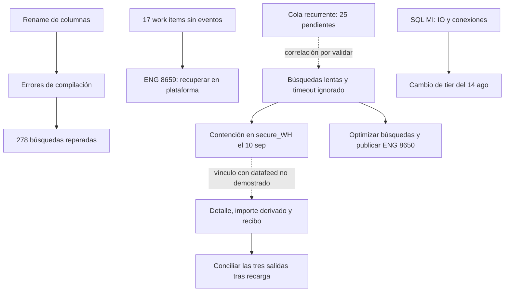

# THD. Guía para la reunión del 22 de septiembre

Corte: 11:55 Bogotá. Revisé las tres hojas del Excel local, correos y capturas de Juan, la investigación del 21 y 22 tickets en Jira. El original de Camila queda intacto.

## Lo que necesitas tener claro

Camila ya corrigió por correo que la recarga es temporal. El Excel todavía invita a cerrar el caso y presenta como pendiente una reparación de búsquedas que Simon realizó en agosto. Corrige esas dos cosas antes de usarlo.

| Frente | Situación comprobada | Lo que falta |
| --- | --- | --- |
| Alertas HDC/050 del 6 y 7 de agosto | Monitoreo antiguo tras migración. Cuatro tickets cerrados. | Los comentarios piden desactivar alertas; no prueban ajuste de umbrales. |
| Rename de columnas THD/085 | Causa original confirmada. Simon reparó 278 búsquedas; Corey confirmó mejora. | Simon dejó seis bloqueadas por otro bug. No encontré su cierre. |
| 17 work items sin eventos | La fuente ARDM está completa. Falta recuperar los eventos en plataforma. | ENG-8659 sigue en Backlog, sin asignado ni versión. |
| Búsquedas lentas y timeout | SNR1/SNR3 bloqueaban otros trabajos el 18. ENG-8650 tiene desarrollo terminado. | Versión prevista para el 24, todavía sin publicar. Confirmar optimización de las 18 búsquedas dependientes. |
| Cola de work items | Último registro: 25 pendientes, noche del 21 en Bogotá. RTS-207712 sigue abierto. | Confirmar cola actual. Los 25 pendientes no equivalen a los 17 históricos ni a 25 casos nuevos cada día. |
| SQL Managed Instance | Cambio a memoria optimizada el 14 de agosto. RETAILIT-20673 cerrado. | El ticket no acredita 39 días de estabilidad medida. |
| Total Item Sale Amount | Hoy Matthew vuelve a reportar falsos positivos. Camila comunica recarga del 20 al 22 y solución permanente sin ETA. | Mecanismo técnico, validación posterior y próxima actualización con responsable. |

Fuentes y acciones: [rename](/Users/MancoMenStudio/Cerebro/inbox/2026-09-22-THD-RTS-206667.md), [17 work items](/Users/MancoMenStudio/Cerebro/inbox/2026-09-22-THD-RCS-28671.md), [rendimiento](/Users/MancoMenStudio/Cerebro/inbox/2026-09-22-THD-RCS-28799.md), [cola](/Users/MancoMenStudio/Cerebro/inbox/2026-09-22-THD-RTS-207712.md), [SQL MI](/Users/MancoMenStudio/Cerebro/inbox/2026-09-22-THD-RETAILIT-20673.md), [importes](/Users/MancoMenStudio/Cerebro/inbox/2026-09-22-THD-RCS-28968.md), [precedente y SOP](/Users/MancoMenStudio/Cerebro/inbox/2026-09-22-THD-RCS-28649.md).

## Cómo se relacionan

La flecha punteada marca una relación pendiente de prueba. No tenemos una RCA única. HDC/050 de principios de agosto y THD/085 de finales de agosto son referencias distintas; evita describirlas como un único corte.

## Durante la llamada

Primera media hora con Corey y Ericka: explica qué búsquedas recibieron reparación, qué falta recuperar y qué sigue lento. Pídeles validar el impacto actual y priorizar. La fecha del arreglo la debe aportar Appriss.

Con Matthew a las 3:30 PM ET, 2:30 PM Bogotá: reconoce que el reporte perdió utilidad para distinguir faltantes reales de importes desactualizados. Pide validar las transacciones ya aportadas después del rebuild. No solicites otra vez los mismos ejemplos.

Antes de terminar, acuerda dueño y siguiente actualización para tres cosas: recuperación de los 17, validación del timeout y conciliación del datafeed. El 24 de septiembre es una previsión del timeout, no una promesa para Total Item Sale Amount.

## Lo que muestran las capturas

La primera muestra cuatro nombres distintos de archivo, cada uno repetido dos veces. Eso no demuestra ingestión duplicada. La ruta de archivo dice 22 de septiembre y el nombre fuente contiene 20260921_200118; son marcas distintas, no prueba de retraso.

La segunda permite tomar como control el Secure ID 2609210101525048961, tienda 8918, registro 51, 21 de septiembre a las 4:15:06 PM según pantalla. No muestra importes, zona horaria ni resultado posterior al rebuild. Concilia el Subtotal, el detalle elegible según la regla de negocio, Total Item Sale Amount y el recibo de esa misma transacción.

## Lo que debes aclarar con Camila

Su comentario público del 21 a las 16:24 Bogotá mezcla una solución permanente para transacciones suspendidas con la corrección de importes del 19 y 20. Las cifras de aproximadamente 750 mil, 4% y 84% corresponden a suspendidas. No prueban la solución de Total Item Sale Amount. Falta el respaldo técnico que delimite ambos arreglos.

Juan confirmó que no existe otro mensaje técnico de hoy en Jira. La recarga del 20 al 22 solo consta en el correo aportado; el comentario de ayer acredita la comunicación de una corrección del 19 y 20. Falta el mecanismo del importe derivado y la evidencia posterior. Verifica también el 19, reportado por Matthew y fuera de ese nuevo rango. El SOP de recargas y recibos prometido el 10 sigue sin cierre documentado en las fuentes revisadas.

[Cambios exactos al Excel y texto de reemplazo](/Users/MancoMenStudio/Cerebro/inbox/2026-09-22-THD-correcciones-excel.md). La cifra inicial también cambia: 16 tickets de migración y compute, más uno de SQL MI.

## Alcance

No ejecuté pruebas en producción ni consultas a Snowflake. No leí el hilo técnico completo de Teams ni la versión de SharePoint. La búsqueda interna tuvo cobertura parcial; una búsqueda JQL adicional no localizó un ENG actual para el importe derivado. Eso no prueba su inexistencia. Los pendientes identificados requieren evidencia antes de anunciarlos como confirmaciones.

Archivo revisado: /Users/MancoMenStudio/Downloads/Home_Depot_Call_Prep_Sep22.xlsx. Historia: inbox/2026-09-21-THD-conclusiones-cruzadas.md. Juan puede ingerir estas notas desde su terminal con cerrar.
