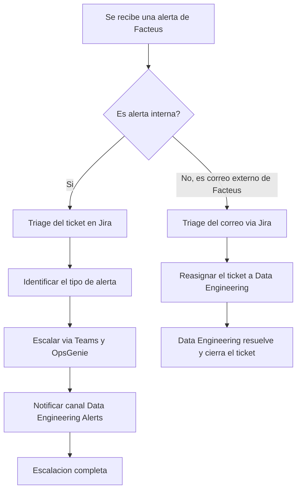
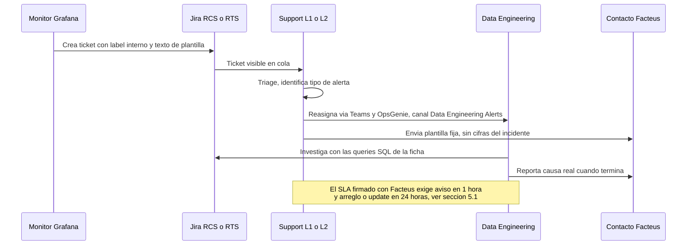

# Revisión documentación Facteus, correo de Chris Howard

Fecha 2026-09-22. Autor Claude, para Juan Martinez. Plazo de respuesta a Chris fin de la próxima semana.

## 0. Qué se revisó y cómo

Chris compartió tres enlaces. El primero apunta a una carpeta de Confluence en el espacio RTS. Esa carpeta no contiene texto propio, contiene nueve bloques Smart Link que transcluyen páginas reales del espacio DS y un whiteboard. Se abrió cada página original detrás de cada bloque, no la carpeta como tal.

Carpeta RTS revisada: https://trebuco.atlassian.net/wiki/spaces/RTS/folder/478153244710

Las nueve transclusiones y su origen real:

| Bloque en la carpeta RTS | Página origen en espacio DS |
|---|---|
| Process - Internal Alerts | [478102126595](https://trebuco.atlassian.net/wiki/spaces/DS/pages/478102126595/Process+-+Internal+Alerts) |
| Process - Issue Reported By Client | [478101897217](https://trebuco.atlassian.net/wiki/spaces/DS/pages/478101897217/Process+-+Issue+Reported+By+Client+External) |
| Facteus - Latest Process Failed | [478182506612](https://trebuco.atlassian.net/wiki/spaces/DS/pages/478182506612/) |
| Facteus - Last Step Running Longer Than 4 Hours | [478182899719](https://trebuco.atlassian.net/wiki/spaces/DS/pages/478182899719/) |
| Facteus - Process Not Run Within 24 Hours | [478183063566](https://trebuco.atlassian.net/wiki/spaces/DS/pages/478183063566/) |
| Facteus Missing Clients | [478182932484](https://trebuco.atlassian.net/wiki/spaces/DS/pages/478182932484/) |
| Facteus Client Contacts | [478182834201](https://trebuco.atlassian.net/wiki/spaces/DS/pages/478182834201/) |
| Facteus v2.0 Technical Documentation | [478177394702](https://trebuco.atlassian.net/wiki/spaces/DS/pages/478177394702/) |
| Facteus: Alert Escalation Flow (whiteboard) | [478209507341](https://trebuco.atlassian.net/wiki/spaces/DS/whiteboard/478209507341) |

El segundo enlace de Chris, el embed 478210031653, apunta a ese mismo whiteboard. El tercero, el embed 478210818056, apunta a la página de contactos de la tabla anterior.

Se leyeron además siete páginas de contexto que Chris no linkeó, necesarias para verificar consistencia: Facteus Requirements Specification, Facteus Support, Facteus Solution, Facteus Data Flow Diagram, el On-Call Operation Guide de Camila, la guía de OpsGenie de Jira Operations, la guía de onboarding L2 con la matriz de accesos, y el proceso estándar de triage de RCS. Se buscó en Jira un ticket de helpdesk para el acceso a PRODDATACLOUD y FACTEUS_DATASHARE que Chris menciona. No apareció en la búsqueda. Ese punto queda marcado como no verificado más abajo, no como confirmado.

No se encontró en la base de Cerebro ningún ticket RCS ni investigación previa sobre Facteus. Este es el primer análisis del tema.

## 1. El árbol de decisión reconstruido

El whiteboard no expone texto plano por la API de Confluence, expone un resumen de nodos. Con ese resumen más el contenido escrito de las dos páginas de proceso, el árbol queda así.

El árbol resuelve una sola pregunta, interno contra externo. No contempla ninguna rama de autoservicio para Support. Las dos ramas terminan igual, Support entrega el ticket a Data Engineering y ahí se pierde visibilidad. Se desarrolla en la sección 3.

## 2. Línea de tiempo de una alerta, de Grafana a la respuesta al cliente

## 3. Punto por punto del correo de Chris

### 3.1 Triage information en ticket y comunicaciones

Las cuatro fichas de alerta interna traen pasos ejecutables y consulta SQL lista para correr contra `PRODDATACLOUD.FACTEUS_CONFIG.FACTEUS_STEP_LOG`. Eso funciona, un analista sin contexto previo puede investigar solo con la ficha. La ficha de Missing Clients agrega una segunda query contra `ardm_production` para confirmar si el hueco es real antes de escalar, ese paso evita falsas alarmas y está bien puesto.

Las cuatro fichas comparten un defecto idéntico. Dicen "See the Facteus Dashboard for more information" o "for full context" sin ningún link. El punto 7 del correo de Chris promete resolver esto agregando el link en la descripción de cada alerta de Grafana, no en la página de Confluence. Verificar ese punto exige ver una alerta real de Grafana, no la documentación. Queda como pendiente de confirmar en la sección 6, no como error de la página.

### 3.2 Detalle del ticket para investigar datos faltantes

Cubierto arriba, ficha Facteus Missing Clients. La plantilla del ticket trae variables `{{ $labels.customer }}`, `{{ $labels.report_date }}`, `{{ staleness_hours }}` y `{{ drop_ratio }}`. Bien pensado. Falta una cosa, la ficha nunca explica qué umbral de `drop_ratio` o `staleness_hours` dispara la alerta ni qué se considera normal. Sin ese umbral, Support no puede distinguir un ticket que ya trae la causa evidente de uno que exige escalar de inmediato. Preguntar a Chris el valor exacto del umbral y pedir que quede escrito en la ficha.

### 3.3 Árbol de decisión de cómo se recibe un ticket

Reconstruido en la sección 1. Cumple el pedido original, existe y separa interno de externo. Tiene un vacío real. Las dos ramas terminan en Data Engineering sin ninguna bifurcación previa para que Support resuelva algo por su cuenta. Compara esto con el resto del proceso RCS que Juan ya opera, donde L2 sí tiene autoridad para cerrar tickets triviales sin escalar. Preguntar a Chris si existe alguna categoría de alerta Facteus que Support pueda cerrar sola, sin pasar por Data Engineering. Si la respuesta es no, entonces el rol de Support en este proceso se limita a currear el ticket y avisar. Eso hay que decirlo así de claro en la reunión con Camila, no asumir que Support "investiga" cuando en realidad solo reasigna.

### 3.4 Definir INTERNAL en los tickets creados

Chris dice que esto ya se actualizó en las alertas de Grafana y que el equipo lo verá conforme se creen tickets. Esta ficha no se puede verificar leyendo Confluence, exige ver el primer ticket real que Grafana genere. Márcalo como pendiente de confirmación en vivo, sección 6.

### 3.5 EXTERNAL como correo directo de Facteus

La página Process - Issue Reported By Client describe el flujo completo y fija el compromiso en 1 día hábil. El correo de Chris aclara que la creación manual del ticket se sumará "once Facteus emails the support desk", es decir, este flujo nunca se ha probado con un correo real. Un proceso sin una sola ejecución real no es un proceso confirmado, es un borrador razonable. Pedir a Chris un ensayo controlado antes del handover completo, un correo de prueba desde Facteus para confirmar que el ticket se crea, se triagea y llega a Data Engineering como está escrito.

### 3.6 Accesos de Support antes del handover

Esto es lo más débil de todo el paquete. Chris dice que ya existe un ticket de helpdesk para dar a Support acceso de lectura a PRODDATACLOUD y a FACTEUS_DATASHARE, y que ese ticket ya se compartió con JR. Se buscó ese ticket en Jira y no apareció en los resultados de búsqueda disponibles desde esta sesión.

Hay un dato más duro todavía. La matriz de acceso del equipo L2, mantenida en la página de onboarding, tiene una fila para Camila Cortes y una fila para Juan Martinez. Las dos filas están completamente vacías, sin marca en Jira RTS/RCS, VPN, Snowflake, Key Vault ni Remote Desktop. Fuente: https://trebuco.atlassian.net/wiki/spaces/RTS/pages/477936910361/ sección 8. El acceso puntual a PRODDATACLOUD y FACTEUS_DATASHARE que pide Chris se apoya sobre una base de acceso general a Snowflake que hoy no está documentada como concedida para ninguno de los dos. No des por hecho este punto en la conversación con Camila. Pide a Chris el número del ticket de helpdesk y confirma con JR directamente antes de aceptar el handover.

### 3.7 Contactos de Facteus por ticket

La ficha trae cinco contactos con nombre y correo, Lorn Davis, Meg Poehler, Rohit Kumar, Kathy Kirkland, Heer Kalra. https://trebuco.atlassian.net/wiki/spaces/DS/pages/478182834201/. No indica rol de cada uno ni a cuál escribir según el tipo de alerta. Las cuatro plantillas de correo a Facteus usan genéricamente "To: <Facteus Contacts>" sin distinguir a quién de los cinco. Pedir a Chris un criterio de a quién escribir primero, o confirmar si de verdad da igual y basta con broadcast a los cinco.

### 3.8 Dashboard enlazado en cada documento

Como se explicó en 3.1, el mecanismo real vive en la plantilla de la alerta de Grafana, no en Confluence. Las páginas de Confluence en su estado actual no traen el link. Este punto se confirma o se refuta viendo la próxima alerta real, no leyendo más páginas.

## 4. Documentación técnica adicional, no pedida por Chris pero relevante

Facteus v2.0 Technical Documentation enlaza a un README en Azure DevOps y a dos subpáginas, Facteus UPC Catalog y Facteus Data Flow Diagram. https://trebuco.atlassian.net/wiki/spaces/DS/pages/478177394702/. El Data Flow Diagram lista 17 tareas del pipeline con su tipo y su selector dbt, útil como referencia técnica pero no aporta nada al proceso de soporte, es documentación de ingeniería de datos, no un runbook de Support.

Facteus Requirements Specification, https://trebuco.atlassian.net/wiki/spaces/DS/pages/477211557894/, es el documento que sí importa comparar contra lo nuevo. Su sección 5.3 fija el SLA real firmado con Facteus, aviso en una hora tras el error por respuesta automatizada, arreglo en 24 horas o un update detallado si no se puede arreglar. Las cuatro páginas de proceso que escribió Chris fijan el compromiso de Support en "within 1 business day", solo entre semana, solo en horario laboral. El aviso automático de una hora se cumple porque lo dispara Grafana sin intervención humana. El arreglo o el update en 24 horas no tiene ninguna garantía si la alerta cae un viernes en la noche o en fin de semana, porque las páginas de Chris no mencionan ninguna cobertura de fin de semana para Facteus específicamente. Comparar esto contra la guía de OpsGenie de Camila, sección 2, que sí define una ventana de escalación de fin de semana para "Data Issues tickets" en general. Confirma con Chris si las alertas de Facteus caen dentro de esa categoría general de Data Issues o si quedan fuera y sin cobertura de fin de semana. Es la brecha de mayor riesgo real de todo el paquete, porque compromete un SLA ya firmado con un tercero.

## 5. Resumen de veredictos

| Punto del correo | Veredicto | Motivo en una línea |
|---|---|---|
| 1. Triage info en ticket y comunicaciones | Bien | Pasos ejecutables y SQL listo en las cuatro fichas |
| 2. Detalle para investigar datos faltantes | Ajustar | Falta el umbral numérico que dispara la alerta |
| 3. Árbol de decisión | Ajustar | Existe, pero no da a Support ninguna salida propia |
| 4. INTERNAL en tickets de Grafana | Pendiente de verificar | Solo se confirma viendo un ticket real |
| 5. EXTERNAL por correo directo | Pendiente de probar | Nunca se ha ejecutado con un correo real de Facteus |
| 6. Accesos de Support antes del handover | No verificado, riesgo alto | Ticket de helpdesk no aparece en Jira, matriz de acceso de Juan y Camila vacía |
| 7. Contactos de Facteus por ticket | Ajustar | Cinco contactos sin rol ni criterio de a quién escribir |
| 8. Dashboard enlazado en cada documento | Pendiente de verificar | El mecanismo vive en Grafana, no en Confluence |
| Extra, SLA de 24h contra el compromiso de 1 día hábil | Riesgo abierto | Sin cobertura de fin de semana confirmada para Facteus |

## 6. Lo que falta antes de aceptar el handover completo

Pide a Chris el número del ticket de helpdesk de accesos y confirma tú mismo con JR, no des el punto 6 por cerrado con la palabra de Chris.

Pide un ensayo real, un correo de prueba desde Facteus y una alerta de prueba de Grafana, antes de dar por probado el árbol de decisión completo.

Pide el umbral numérico de la alerta de Missing Clients y el criterio de a quién de los cinco contactos escribir primero.

Pregunta directo si las alertas Facteus quedan dentro de la categoría "Data Issues" de la guía de OpsGenie para cobertura de fin de semana, o si quedan sueltas y sin cobertura, dado que el SLA firmado exige respuesta en 24 horas todos los días.

Blocker real para escalar a Chris si hace falta: no se pudo confirmar en Jira el ticket de acceso a PRODDATACLOUD y FACTEUS_DATASHARE. Todo lo demás de este análisis se resolvió con la documentación disponible.
