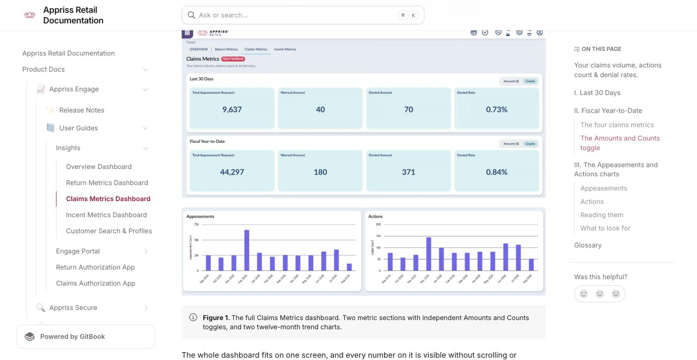
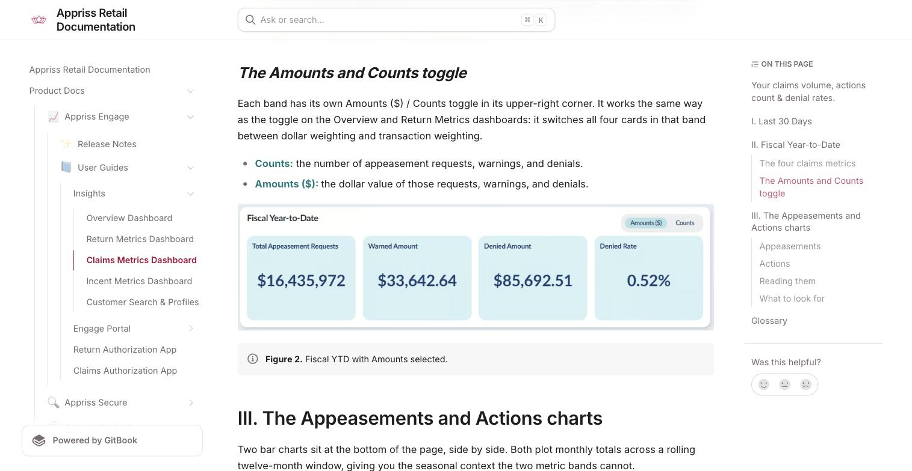
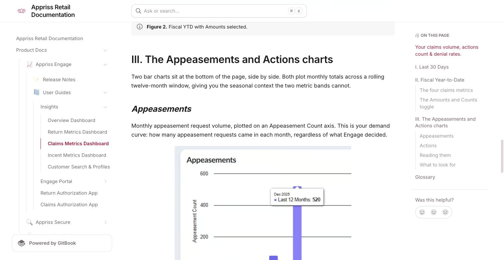

# Claims Metrics Dashboard

Source: https://docs.apprissretail.com/products/product-docs/appriss-engage/user-guides/engage-insights/claims-metrics-dashboard

**Your claims volume, actions count & denial rates**

Claims Metrics is the third dashboard in Engage Insights, and the place to go when you need to understand appeasement request volume and how often those requests are being warned or denied.

Claims Metrics answers a narrower set of questions than the Overview and Return Metrics dashboards, and it answers them quickly. Four metrics, two fixed time periods, one toggle, and two twelve-month trend charts. There is very little to configure, which makes it a fast read, and it is designed that way on purpose for this release.

> **This dashboard requires a Claims Data integration.** It depends on claims data flowing into Engage. If your organization has not integrated claims data, this tab will not show in your platform. Contact your CSM to learn more about how integrating claims data can further enrich your Engage performance.

The page is built in three horizontal sections, read top to bottom:

| Section | What it answers |
|---|---|
| I. Last 30 Days | What has claims activity looked like recently? |
| II. Fiscal Year-to-Date | How does that compare with the year so far? |
| III. Appeasements and Actions charts | How has monthly volume moved across the last twelve months? |

*Figure 1. The full Claims Metrics dashboard. Two metric sections with independent Amounts and Counts toggles, and two twelve-month trend charts.*

The whole dashboard fits on one screen, and every number on it is visible without scrolling or configuring. That is the defining characteristic of this release: it is a status board rather than an investigation tool. Claims Metrics presents the same four metrics twice, over two fixed windows. Neither is adjustable in this release.

## I. Last 30 Days

A rolling thirty-day window ending today. This is your recent-behavior view — short enough that a change in claims handling or a spike in abuse shows up clearly, and it moves forward automatically each day.

## II. Fiscal Year-to-Date

Everything from the start of your current fiscal year through today. Because this window keeps growing as the year progresses, it behaves like a running average; it moves slowly, and it is the right figure to quote when someone asks how the claims program is performing overall.

### The four claims metrics

Both bands show the same four cards, in the same order. Each card is a single figure; there is no drill-in, no trend chip, and no click-through in this release.

| Card | What it measures | Why it matters |
|---|---|---|
| Total Appeasement Requests | Every appeasement request Engage evaluated in the period. | Your denominator, and your demand signal. Rising requests with a flat denial rate means more volume, not more abuse. |
| Warned Amount | Requests where Engage surfaced a warning but allowed the appeasement. | Shoppers trending toward abuse who have not yet been stopped. The early-warning population. |
| Denied Amount | Requests Engage declined. | The sharp end of claims decisioning, and the numerator of your denial rate. |
| Denied Rate | Denied divided by total appeasement requests. | The headline claims metric. This is the figure to track over time and the one most likely to be asked for by name. |

> **How Denied Rate is calculated.** Denied Rate is Denied Amount ÷ Total Appeasement Requests, calculated in whichever weighting the toggle is set to. It is derived from the two cards to its left, so the three always reconcile; a useful sanity check if a figure looks wrong.

### The Amounts and Counts toggle

Each band has its own Amounts ($) / Counts toggle in its upper-right corner. It works the same way as the toggle on the Overview and Return Metrics dashboards: it switches all four cards in that band between dollar weighting and transaction weighting.

- **Counts:** the number of appeasement requests, warnings, and denials.
- **Amounts ($):** the dollar value of those requests, warnings, and denials.

*Figure 2. Fiscal YTD with Amounts selected.*

## III. The Appeasements and Actions charts

Two bar charts sit at the bottom of the page, side by side. Both plot monthly totals across a rolling twelve-month window, giving you the seasonal context the two metric bands cannot.

**Appeasements:** Monthly appeasement request volume, plotted on an Appeasement Count axis. This is your demand curve: how many appeasement requests came in each month, regardless of what Engage decided.

*Figure 3. Hovering a bar in the Appeasements chart shows the month and its exact value.*

**Actions:** Monthly action volume, plotted on an Action Count axis. This is what Engage did — the warnings and denials it applied each month.

**Reading them:**
- Hover any bar for a tooltip with the month and its exact value. Use the tooltip rather than estimating against the axis; the bars are close together and the axis is coarse.
- Both charts are count-based only. The Amounts and Counts toggle on the metric bands above does not affect them, and there is no dollar-weighted version of either chart in this release.
- The window is a rolling twelve months, which is why the series is labeled "Last 12 Months" in the tooltip. It is not tied to your fiscal year, so it will not align with the Fiscal Year-to-Date band above.

**What to look for:**
- **Seasonality:** a pronounced peak in the post-holiday months is normal for most retailers. Knowing your own shape means you can tell a seasonal peak from a genuine problem.
- **Divergence between the two charts:** this is the most valuable comparison on the page. Appeasement requests rising faster than actions means more claims are passing through unchallenged. Actions rising faster than requests means Engage is intervening on a larger share of the same volume.
- **A single outlier month:** points at an event rather than a trend. A promotion, a product recall, a policy change, or a system issue.

## Glossary

| Term | Definition |
|---|---|
| Appeasement | A concession granted to a shopper outside standard policy (a refund, credit, replacement, or adjustment) typically in response to a complaint or service issue. |
| Appeasement request | A request for that concession, evaluated by Engage against your configured claims rules. |
| Claim | Used interchangeably with "appeasement request" across Engage Insights. |
| Warned | Engage flagged the request and surfaced a warning, but allowed the appeasement. |
| Denied | Engage declined the appeasement request. |
| Denied Rate | Denied divided by total appeasement requests, in whichever weighting the toggle is set to. |
| Action | Any intervention Engage makes on an appeasement request; a warning or a denial. |
| Fiscal Year-to-Date | From the start of your organization's configured fiscal year through today. |
| Last 30 Days | A rolling thirty-day window ending today, which advances automatically each day. |
| Last 12 Months | The rolling twelve-month window plotted by both charts, and the series name shown in their tooltips. |
| Amounts / Counts | The toggle that switches a band between dollar weighting and transaction weighting. |

**Need Help?** If you have questions about Engage Insights, your access, or how to apply it to your programs, contact your Customer Success Manager.
