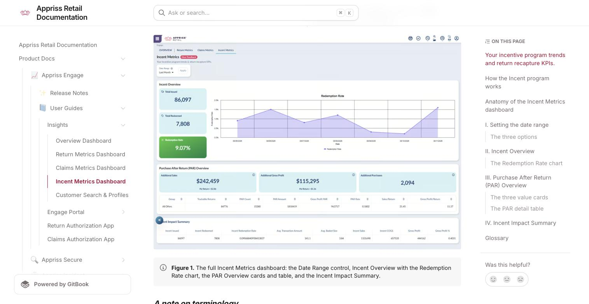
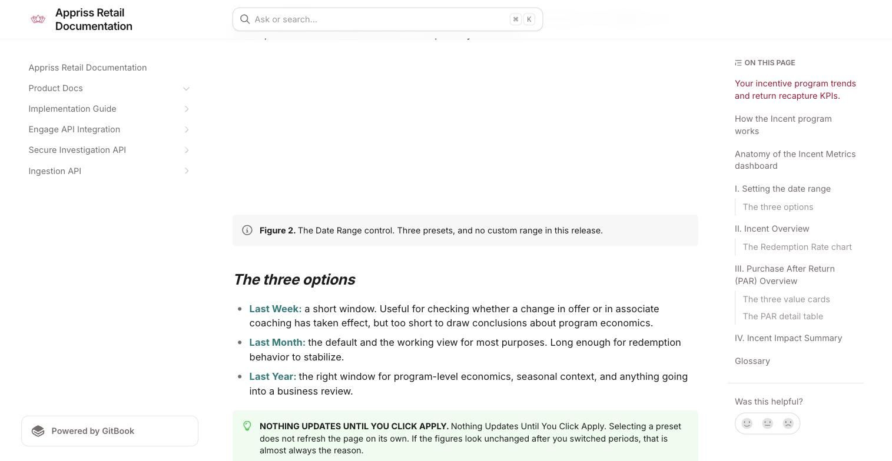
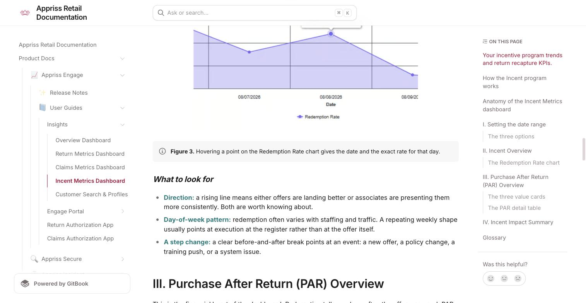
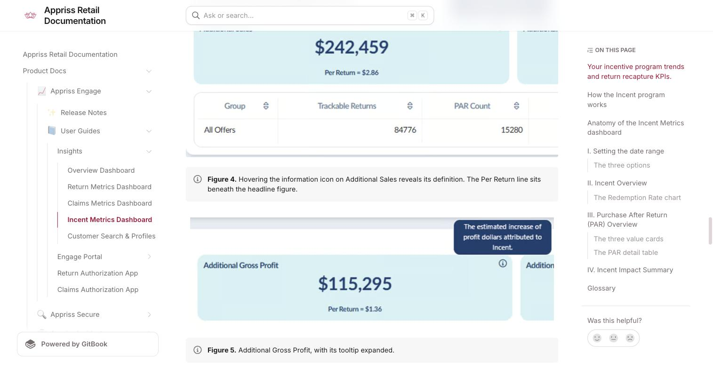
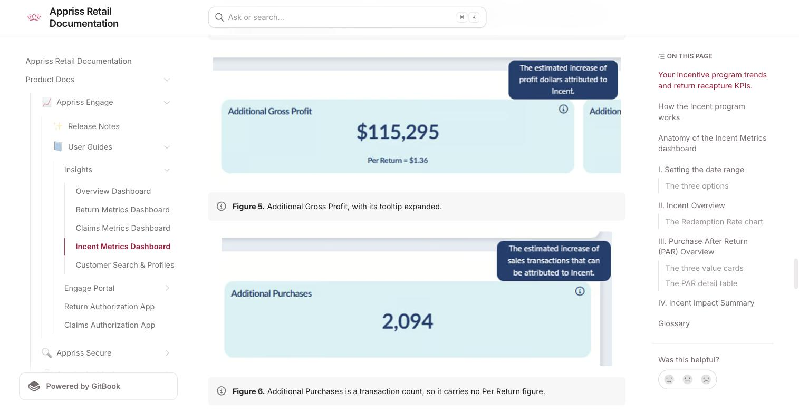
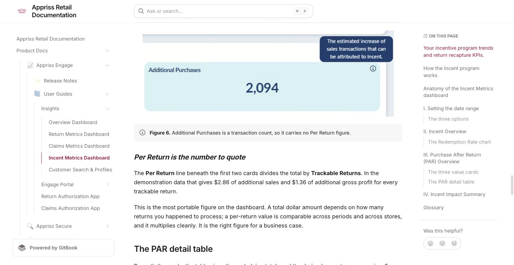
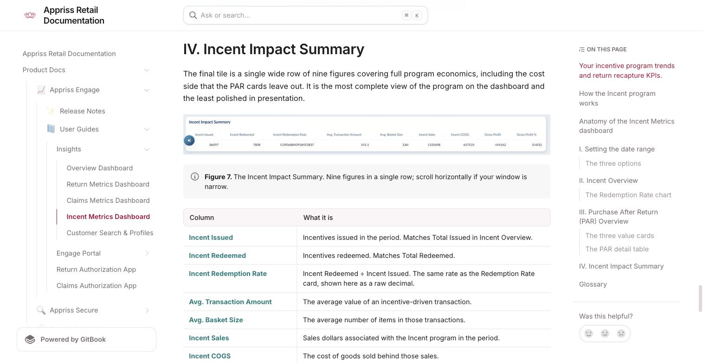

# Incent Metrics Dashboard

Source: https://docs.apprissretail.com/products/product-docs/appriss-engage/user-guides/engage-insights/incent-metrics-dashboard

**Your incentive program trends and return recapture KPIs**

The Incent Metrics dashboard is the fourth dashboard in Engage Insights, and the only one that measures money coming in rather than losses going out.

Every other dashboard in Engage Insights is about reducing and controlling returns. Incent Metrics is about recapturing them: taking a return that has already happened and converting it into a new purchase before the shopper leaves the store. This dashboard tells you how often that worked and what it was worth.

Because it measures upside rather than avoided loss, it reads differently from the others. There are no denial rates and no abuse signals here. Instead there are issuance and redemption figures, incremental sales and gross profit, and a set of per-return economics that let you express the whole program as a value per return.

> Requires Incent implementation.

## How the Incent program works

Every metric on this dashboard describes one specific in-store moment. Understanding that moment makes the rest of the dashboard read naturally:

1. A shopper completes a return in store, and it is approved.
2. They receive a printed return receipt, exactly as they would normally.
3. Printed at the bottom of that receipt is a time-boxed incentive: an offer to buy something new, valid for a short window.
4. Before handing the receipt over, the associate circles the offer with a highlighter and points it out to the shopper.
5. The shopper is already in the store, already at the counter, and now holding a highlighted offer. If they act on it, the return becomes a new purchase in the same visit.

That mechanic explains the shape of this dashboard:
- An incentive is **issued** on the return receipt. That is what Total Issued counts.
- The shopper **uses** it. That is what Total Redeemed counts, and the ratio between the two is your Redemption Rate.
- A purchase made after a return is a **Purchase After Return**, abbreviated **PAR** throughout the dashboard. Not every purchase after a return is caused by the incentive, which is why the dashboard reports both total PAR activity and the estimated incremental portion attributable to Incent.

## Anatomy of the Incent Metrics dashboard

Select Incent Metrics from the tab bar at the top of Engage Insights. The page opens on the Last Month date range with every tile populated.

| Zone | What it answers |
|---|---|
| I. Date Range | Which period am I measuring? |
| II. Incent Overview | How many incentives went out, how many came back, and how is redemption trending? |
| III. Purchase After Return (PAR) Overview | How much additional revenue and profit did the program generate, and what is that worth per return? |
| IV. Incent Impact Summary | What are the full program economics, including basket size and cost of goods? |

*Figure 1. The full Incent Metrics dashboard: the Date Range control, Incent Overview with the Redemption Rate chart, the PAR Overview cards and table, and the Incent Impact Summary.*

**A note on terminology:** The dashboard uses "Incent" and "Incentive" interchangeably and abbreviates "Purchase After Return" to PAR in most places. Trackable Returns (the denominator behind most of the per-return figures) means the returns the program was able to attach an incentive to and follow. It will normally be lower than your total return count.

## I. Setting the date range

A single Date Range control sits above the tiles and governs the entire page. Every figure and the Redemption Rate chart all recalculate to the period you choose.

*Figure 2. The Date Range control. Three presets, and no custom range in this release.*

**The three options:**
- **Last Week:** a short window. Useful for checking whether a change in offer or in associate coaching has taken effect, but too short to draw conclusions about program economics.
- **Last Month:** the default and the working view for most purposes. Long enough for redemption behavior to stabilize.
- **Last Year:** the right window for program-level economics, seasonal context, and anything going into a business review.

> **Nothing updates until you click Apply.** Selecting a preset does not refresh the page on its own. If the figures look unchanged after you switched periods, that is almost always the reason.

## II. Incent Overview

The first tile covers program activity: how many incentives were issued, how many were used, and how redemption has moved day by day. Three stacked cards sit on the left, with the Redemption Rate chart beside them.

| Card | What it measures | How to read it |
|---|---|---|
| Total Issued | Incentives printed on return receipts in the period. | Your reach. This tracks return volume, so it moves with returns rather than independently of them. |
| Total Redeemed | Incentives the shopper actually used. | Your conversions. The raw count of returns turned back into purchases through an offer. |
| Redemption Rate | Total Redeemed divided by Total Issued. | The headline program metric, and the one to track over time. Highlighted in green because it is the number the dashboard is built around. |

> **How Redemption Rate is calculated.** Redemption Rate is Total Redeemed ÷ Total Issued. Example: 7,808 redeemed against 86,097 issued gives 9.07%. The three cards always reconcile, which makes this a useful sanity check if a figure looks wrong.

**The Redemption Rate chart:** The chart plots redemption rate by day across your selected period. Hover any point for the exact date and value.

*Figure 3. Hovering a point on the Redemption Rate chart gives the date and the exact rate for that day.*

**What to look for:**
- **Direction:** a rising line means either offers are landing better or associates are presenting them more consistently. Both are worth knowing about.
- **Day-of-week pattern:** redemption often varies with staffing and traffic. A repeating weekly shape usually points at execution at the register rather than at the offer itself.
- **A step change:** a clear before-and-after break points at an event: a new offer, a policy change, a training push, or a system issue.

## III. Purchase After Return (PAR) Overview

This is the financial heart of the dashboard. Redemption tells you how often the offer was used; PAR tells you what that was worth. Three summary cards sit above a detail table.

**The three value cards.** Each card carries an ⓘ icon with the in-product definition. All three describe estimated incremental impact: the uplift attributed to Incent, not total activity.

| Card | In-product definition | Also shows |
|---|---|---|
| Additional Sales | The estimated increase of sales dollars that can be attributed to Incent. | Per Return: the same figure expressed per trackable return. |
| Additional Gross Profit | The estimated increase of profit dollars attributed to Incent. | Per Return: the profit equivalent. |
| Additional Purchases | The estimated increase of sales transactions that can be attributed to Incent. | No per-return figure: this card is a transaction count. |

*Figure 4. Hovering the information icon on Additional Sales reveals its definition. The Per Return line sits beneath the headline figure.*

*Figure 5. Additional Gross Profit, with its tooltip expanded.*

*Figure 6. Additional Purchases is a transaction count, so it carries no Per Return figure.*

**Per Return is the number to quote:** The Per Return line beneath the first two cards divides the total by Trackable Returns. In example data that gives $2.86 of additional sales and $1.36 of additional gross profit for every trackable return.

This is the most portable figure on the dashboard. A total dollar amount depends on how many returns you happened to process; a per-return value is comparable across periods and across stores, and it multiplies cleanly. It is the right figure for a business case.

**The PAR detail table:** Beneath the cards, the table gives the underlying totals and the derived per-return economics. Every column is sortable.

| Column | What it is |
|---|---|
| Group | The offer grouping + Control. |
| Trackable Returns | Returns the program could attach an incentive to and follow. The denominator for every per-return figure on the page. |
| PAR Count | The number of purchase-after-return transactions. |
| PAR Amount | Total sales dollars in those purchase-after-return transactions. |
| Gross Profit PAR | Total gross profit dollars in those transactions. |
| PAR Rate | PAR Count ÷ Trackable Returns: the share of trackable returns that produced a purchase. |
| Sales/Return | PAR Amount ÷ Trackable Returns: average purchase-after-return sales per trackable return. |
| Gross Profit/Return | Gross Profit PAR ÷ Trackable Returns: the profit equivalent. |

## IV. Incent Impact Summary

The final tile is a single wide row of nine figures covering full program economics, including the cost side that the PAR cards leave out. It is the most complete view of the program on the dashboard and the least polished in presentation.

*Figure 7. The Incent Impact Summary. Nine figures in a single row; scroll horizontally if your window is narrow.*

| Column | What it is |
|---|---|
| Incent Issued | Incentives issued in the period. Matches Total Issued in Incent Overview. |
| Incent Redeemed | Incentives redeemed. Matches Total Redeemed. |
| Incent Redemption Rate | Incent Redeemed ÷ Incent Issued. The same rate as the Redemption Rate card, shown here as a raw decimal. |
| Avg. Transaction Amount | The average value of an incentive-driven transaction. |
| Avg. Basket Size | The average number of items in those transactions. |
| Incent Sales | Sales dollars associated with the Incent program in the period. |
| Incent COGS | The cost of goods sold behind those sales. |
| Gross Profit | Incent Sales minus Incent COGS. |
| Gross Profit % | Gross Profit ÷ Incent Sales, shown as a decimal. 0.4031 means 40.31%. |

> **Why this tile matters.** This is the only place on the dashboard that carries cost. Sales and gross profit figures elsewhere describe revenue generated; Incent COGS and Gross Profit % tell you what it cost to generate. If someone questions whether the program is genuinely profitable rather than merely busy, the answer is in this row.

## Glossary

| Term | Definition |
|---|---|
| Incent | Appriss Retail's Return Incentives program. Used interchangeably with "Incentive" across the dashboard. |
| Incentive | A time-boxed offer printed at the bottom of a return receipt, encouraging a new purchase during the same store visit. |
| Issued | An incentive printed on a return receipt. |
| Redeemed | An incentive the shopper used. |
| Redemption Rate | Total Redeemed divided by Total Issued. |
| PAR | Purchase After Return: a purchase made by a shopper after completing a return. |
| Trackable Returns | Returns the program could attach an incentive to and follow. The denominator for the per-return figures. |
| PAR Rate | PAR Count divided by Trackable Returns: the share of trackable returns that produced a purchase. |
| Additional Sales | The estimated increase of sales dollars attributable to Incent. |
| Additional Gross Profit | The estimated increase of profit dollars attributable to Incent. |
| Additional Purchases | The estimated increase of sales transactions attributable to Incent. |
| Per Return | A total divided by Trackable Returns, giving a value per return that is comparable across periods. |
| COGS | Cost of goods sold: the cost behind the sales the program generated. |
| Avg. Basket Size | The average number of items in an incentive-driven transaction. |
| CONTROL | The holdout group used to measure incremental lift. Visible in the Incentive Issuances chart on the Overview dashboard. |

**Need Help?** If you have questions about Engage Insights, your access, or how to apply it to your programs, contact your Customer Success Manager.
