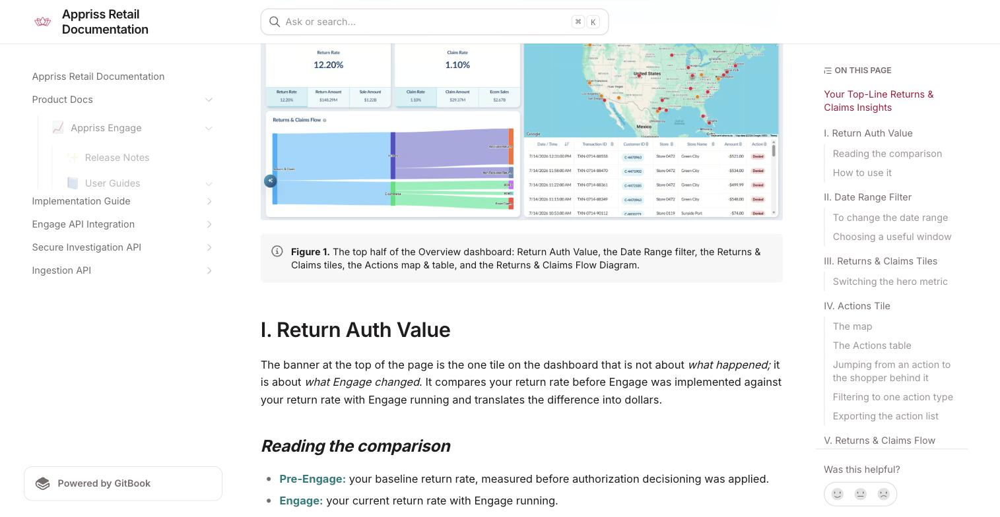
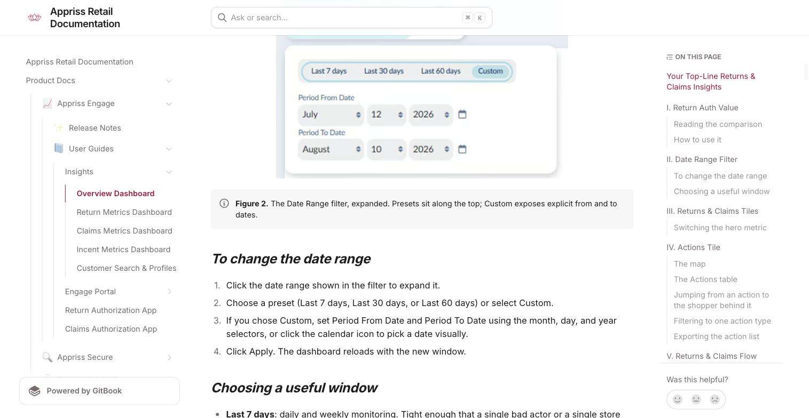
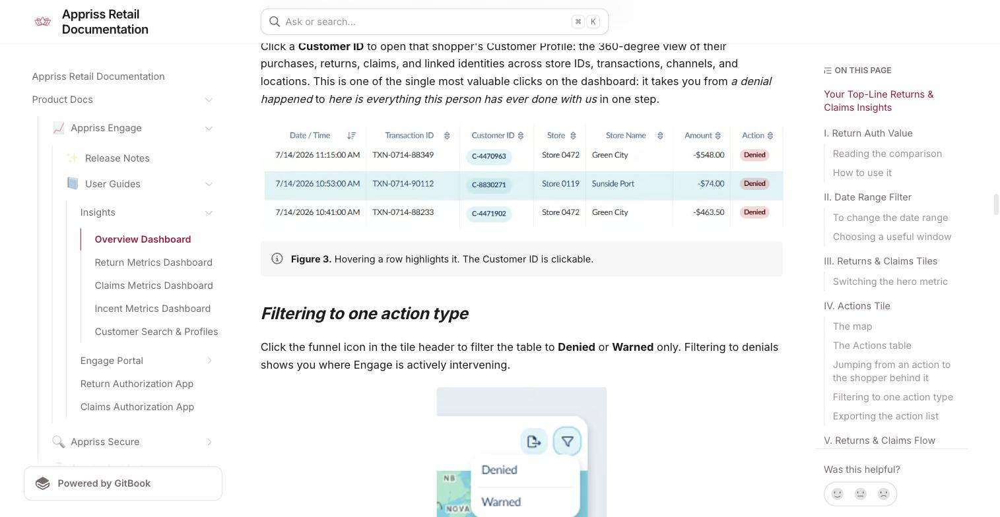
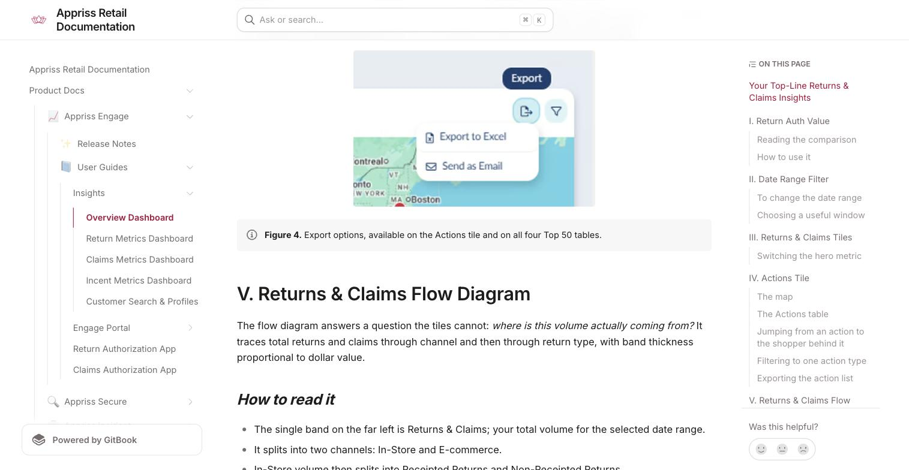
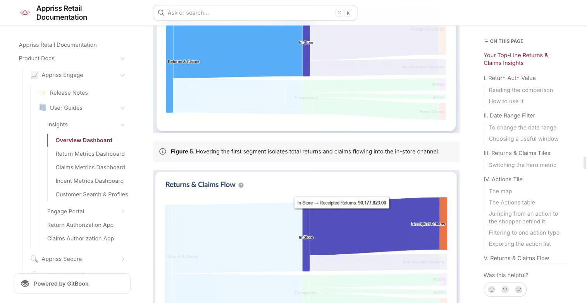
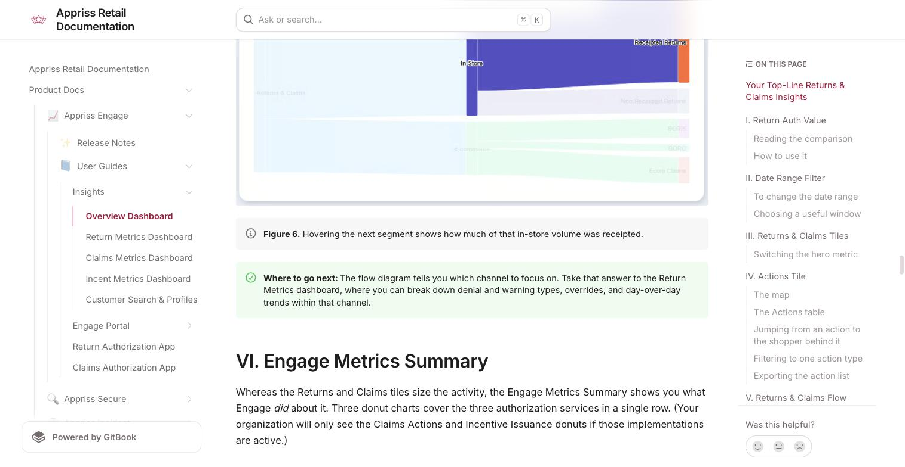
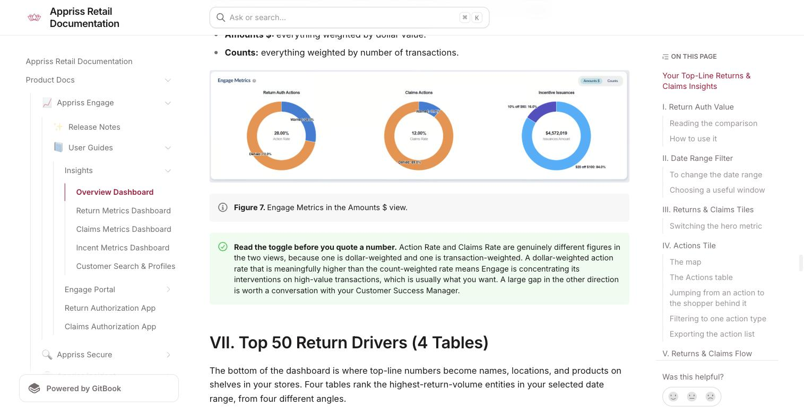
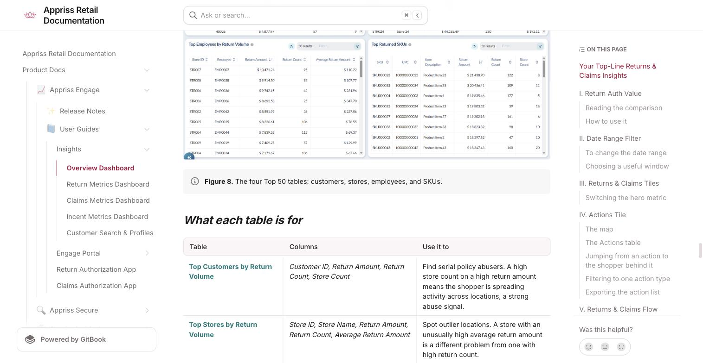
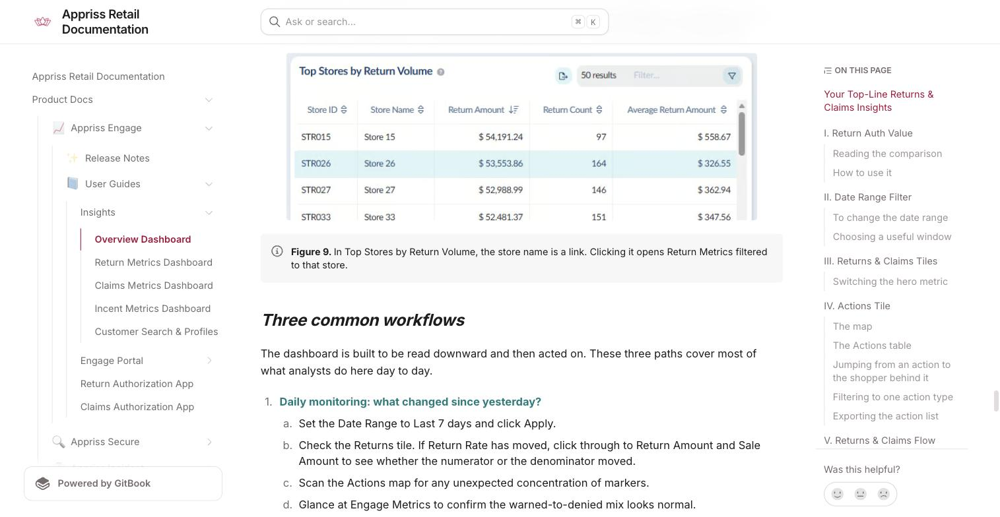

# Overview Dashboard

Source: https://docs.apprissretail.com/products/product-docs/appriss-engage/user-guides/engage-insights/overview-dashboard

**Your Top-Line Returns & Claims Insights**

The Overview Dashboard is your first destination upon entering Engage Insights. It's comprised of 11 distinct tiles, each representing a different lens through which you can analyze your organization's returns & claims behavior.

| Component | What it shows |
|---|---|
| I. Return Auth Value | Is the Engage program working, and what is it worth in dollars to my organization? |
| II. Date Range Filter | What window am I analyzing? |
| III. Returns & Claims Tiles (Requires claims implementation) | How much return/claims activity is there in rate and dollars? |
| IV. Actions | Where and when did denials and warnings most recently occur? |
| V. Returns & Claims Flow Diagram | How is that volume splitting across channel and return type? |
| VI. Engage Metrics Summary (Requires claims & incent implementation) | What is the mix of authorization actions Engage is taking for returns & claims, and what is the spread of incentives? |
| VII. Top 50 Return Drivers: 4 Tables | Which customers, stores, employees, and SKUs are driving returns? |
| VIII. Data Health Tiles | What is the health of my data-feed integrations and how do they benchmark? |

*Figure 1. The top half of the Overview dashboard: Return Auth Value, the Date Range filter, the Returns & Claims tiles, the Actions map & table, and the Returns & Claims Flow Diagram.*

## I. Return Auth Value

The banner at the top of the page is the one tile on the dashboard that is not about what happened; it is about what Engage changed. It compares your return rate before Engage was implemented against your return rate with Engage running and translates the difference into dollars.

**Reading the comparison**

- **Pre-Engage:** your baseline return rate, measured before authorization decisioning was applied.
- **Engage:** your current return rate with Engage running.
- The floating label above the Engage bar shows the change between the two. A 9.55% baseline against a 7.35% current rate produces a −2.20 point reduction (example).
- **Annual Return Amount Reduction:** the estimated annual dollar value of that rate reduction, applied to your sales volume.

**How to use it**

This is the number to bring to a quarterly business review or an executive readout. It is a program-level result, not an investigative starting point; nothing in this tile is clickable, and it will not change day to day. Screenshot it for reporting, then move down the page to do your actual analysis.

This tile has its own timeframe. Return Auth Value is calculated on a fixed trailing window, shown in the pill in the upper-right corner of the tile (Data timeframe last 365 days). It does **not** change when you adjust the Date Range filter below it. That is deliberate; an annualized value measure needs a stable, full-year window to be meaningful.

## II. Date Range Filter

Directly below Return Auth Value sits the Date Range filter. This is the master control for the page: every tile below it (Returns, Claims, Actions, Returns & Claims Flow, Engage Metrics, and all four Top 50 tables) recalculates to the window you set here.

*Figure 2. The Date Range filter, expanded. Presets sit along the top; Custom exposes explicit from and to dates.*

**To change the date range**

1. Click the date range shown in the filter to expand it.
2. Choose a preset (Last 7 days, Last 30 days, or Last 60 days) or select Custom.
3. If you chose Custom, set Period From Date and Period To Date using the month, day, and year selectors, or click the calendar icon to pick a date visually.
4. Click Apply. The dashboard reloads with the new window.

**Choosing a useful window**

- **Last 7 days:** daily and weekly monitoring. Tight enough that a single bad actor or a single store stands out in the Top 50 tables.
- **Last 30 days:** the default working view for most analysts. Long enough to smooth out weekday and weekend swings.
- **Last 60 days:** trend and pattern work, and the right choice when you are trying to confirm that something you spotted last month is still happening.
- **Custom:** promotional periods, the post-holiday return window, a specific incident window, or a period you need to match against another report.

When you are comparing two periods, run the analysis once, export what you need, then change the range and export again. The dashboard shows one window at a time.

> **Nothing updates until you click 'Apply'.** Selecting a preset or editing a custom date does not refresh the page on its own. If a number looks unchanged after you adjusted the range, check that you clicked Apply.

## III. Returns & Claims Tiles

These two tiles give you the headline size of volume for the window you selected. Each has one large hero figure and a strip of selectable metrics beneath it.

**Switching the hero metric:** Click any metric in the strip along the bottom of a tile and it becomes the hero figure, displayed at full precision rather than abbreviated. The selected metric is highlighted in the strip.

| Tile | Metric | What it Measures |
|---|---|---|
| Returns | Return Rate | Return dollars as a percentage of sales dollars for the selected window. The tile's default view. |
| Returns | Return Amount | Total dollar value of returns processed in the window. |
| Returns | Sale Amount | Total sales dollars in the window; the denominator behind Return Rate. |
| Claims | Claim Rate | Claim dollars as a percentage of sales for the window. The tile's default view. |
| Claims | Claim Amount | Total dollar value of appeasement claims in the window. |
| Claims | Ecom Sales | E-commerce sales dollars in the window; the denominator behind Claim Rate. |

> The Claims Tile requires claims data integration. If your organization has not integrated claims data with Engage, this tile will not populate. Contact your Customer Success Manager if you expect to see claims activity and do not.

## IV. Actions Tile

The Actions tile is the most operational thing on the page. It surfaces return authorization actions (denials and warnings) shortly after they happen, plotted on a map and listed in a table. This is where an investigation typically starts from current reality rather than yesterday's report.

**The map:** Each marker represents a store where Engage recently took an action. Markers are colored to match the action type used in the table below, so a cluster of one color in one region is an immediate signal worth pulling on. Pan and zoom with standard map controls.

**The Actions table:** Beneath the map, the table lists individual actions. It is sorted by Date/Time descending by default, so the most recent action is always at the top. Scroll within the table to see more rows; every column header can be clicked to re-sort.

| Column | What it gives you |
|---|---|
| Date / Time | When the action occurred. Default sort, newest first. |
| Transaction ID | The specific transaction the action was applied to. |
| Customer ID | The shopper's linked identity. Shown as a chip and clickable; see below. |
| Store | The store number where the transaction took place. |
| Store Name | The store's name and location. |
| Amount | The dollar value of the attempted return, shown as a negative figure. |
| Action | Denied or Warned, shown as a colored status pill. |

*Figure 3. Hovering a row highlights it. The Customer ID is clickable.*

**Jumping from an action to the shopper behind it:** Click a Customer ID to open that shopper's Customer Profile: the 360-degree view of their purchases, returns, claims, and linked identities across store IDs, transactions, channels, and locations. This is one of the single most valuable clicks on the dashboard: it takes you from "a denial happened" to "here is everything this person has ever done with us" in one step.

**Filtering to one action type:** Click the funnel icon in the tile header to filter the table to Denied or Warned only. Filtering to denials shows you where Engage is actively intervening.

**Exporting the action list:** Click the export icon in the tile header for two options: Export to Excel downloads the current view as a spreadsheet; Send as Email delivers it to a recipient without leaving the dashboard.

*Figure 4. Export options, available on the Actions tile and on all four Top 50 tables.*

## V. Returns & Claims Flow Diagram

The flow diagram answers a question the tiles cannot: where is this volume actually coming from? It traces total returns and claims through channel and then through return type, with band thickness proportional to dollar value.

**How to read it:**
- The single band on the far left is Returns & Claims; your total volume for the selected date range.
- It splits into two channels: In-Store and E-commerce.
- In-Store volume then splits into Receipted Returns and Non-Receipted Returns.
- E-commerce volume splits into BORIS (bought online, returned in store), BORO (bought online, returned online), and Ecom Claims (where integrated).

**Hovering for exact values:** Hover any band to isolate it and read its exact dollar value. The rest of the diagram fades so you can see the single path clearly.

*Figure 5. Hovering the first segment isolates total returns and claims flowing into the in-store channel.*

*Figure 6. Hovering the next segment shows how much of that in-store volume was receipted.*

> **Where to go next:** The flow diagram tells you which channel to focus on. Take that answer to the Return Metrics dashboard, where you can break down denial and warning types, overrides, and day-over-day trends within that channel.

## VI. Engage Metrics Summary

Whereas the Returns and Claims tiles size the activity, the Engage Metrics Summary shows you what Engage did about it. Three donut charts cover the three authorization services in a single row. (Your organization will only see the Claims Actions and Incentive Issuance donuts if those implementations are active.)

**The three charts:**
- **Return Auth Actions:** the center figure is your Action Rate, the share of return transactions on which Engage took an action. The ring splits that into Warned and Denied.
- **Claims Actions:** the center figure is your Claims Rate, with the ring splitting actions on claims requests by type.
- **Incentive Issuances:** the center figure is total incentive value or volume, with the ring showing the mix by offer. Named offers appear alongside a CONTROL segment, which is the holdout group used to measure incremental lift.

**The Amounts / Counts toggle:** The toggle in the upper-right of the tile switches all three charts between two bases:
- **Amounts $:** everything weighted by dollar value.
- **Counts:** everything weighted by number of transactions.

*Figure 7. Engage Metrics in the Amounts $ view.*

> **Read the toggle before you quote a number.** Action Rate and Claims Rate are genuinely different figures in the two views, because one is dollar-weighted and one is transaction-weighted. A dollar-weighted action rate that is meaningfully higher than the count-weighted rate means Engage is concentrating its interventions on high-value transactions, which is usually what you want. A large gap in the other direction is worth a conversation with your Customer Success Manager.

## VII. Top 50 Return Drivers (4 Tables)

The bottom of the dashboard is where top-line numbers become names, locations, and products on shelves in your stores. Four tables rank the highest-return-volume entities in your selected date range, from four different angles.

*Figure 8. The four Top 50 tables: customers, stores, employees, and SKUs.*

| Table | Columns | Use it to |
|---|---|---|
| Top Customers by Return Volume | Customer ID, Return Amount, Return Count, Store Count | Find serial policy abusers. A high store count on a high return amount means the shopper is spreading activity across locations, a strong abuse signal. |
| Top Stores by Return Volume | Store ID, Store Name, Return Amount, Return Count, Average Return Amount | Spot outlier locations. A store with an unusually high average return amount is a different problem from one with high return count. |
| Top Employees by Return Volume | Store ID, Employee, Return Amount, Returns Count, Average Return Amount | Identify associates processing outsized return volume, the starting point for a return-fraud or override review. |
| Top Returned SKUs | SKU, UPC, Item Description, Return Amount, Return Count, Store Count | Catch product quality and fit issues early, before cost and reputational damage escalate. |

**Working with the tables:**
- **Sort:** click any column header to sort by it. Each table opens sorted by Return Amount, highest first, but sorting by count or average often surfaces a different and more interesting set of names.
- **Filter:** type into the Filter box to narrow the list, or use the funnel icon for column-level filtering. Useful when you want to check one specific store, employee, or SKU rather than browse the ranking.
- **Result count:** the "50 results" indicator confirms how many rows are in the current view.
- **Export:** each table has the same export control as the Actions tile: Export to Excel or Send as Email. The export reflects your current sort and filter.

**Click-throughs from the tables:** Two of the four tables hand you off to a deeper view:
- Customer ID in Top Customers opens that shopper's Customer Profile.
- Store Name in Top Stores opens the Return Metrics dashboard pre-filtered to that store, so you go straight to that location's denial and warning breakdown without setting a filter yourself.

*Figure 9. In Top Stores by Return Volume, the store name is a link. Clicking it opens Return Metrics filtered to that store.*

### Three common workflows

**Daily monitoring: what changed since yesterday?**
1. Set the Date Range to Last 7 days and click Apply.
2. Check the Returns tile. If Return Rate has moved, click through to Return Amount and Sale Amount to see whether the numerator or the denominator moved.
3. Scan the Actions map for any unexpected concentration of markers.
4. Glance at Engage Metrics to confirm the warned-to-denied mix looks normal.
5. Skim Top Customers and Top Stores for names that were not there last week.

**Investigating a suspicious shopper**
1. In Top Customers by Return Volume, sort by Store Count to surface shoppers returning across many locations.
2. Cross-check the same customer against the Actions table; filter to Denied and look for their ID.
3. Click the Customer ID to open their Customer Profile and review the full purchase, return, and claims history along with linked identities.
4. Export the supporting rows to Excel, or send them to a store or regional contact directly from the dashboard.

**Preparing a store or regional review**
1. Set a Custom date range that matches the review period.
2. Capture the Return Auth Value banner for the program-level result.
3. Use Returns & Claims Flow to describe the channel mix in plain terms.
4. Export Top Stores by Return Volume sorted by Average Return Amount to identify outliers worth naming in the review.
5. Click the store names you plan to discuss to pull that location's detail from Return Metrics.

## VIII. Data Health

The Data Health section shows the quality of the data flowing into Engage from your POS and Engage feeds, measured against network-wide benchmarks. Each data type is shown as a color-coded score card: green indicates good data quality, orange indicates room for improvement, red indicates a data quality issue that may be affecting Engage's ability to identify consumers accurately, and gray represents further data sources available for integration to further enrich your Engage performance.

**How to interpret it:**

| Colour | Meaning |
|---|---|
| Green | Good Data Quality: This identifier type is well-populated |
| Orange | Room for Improvement: Data quality is below benchmark |
| Red | Data Quality Issue: This may be affecting Engage's ability to identify linked consumers |
| Gray | Available to Integrate: Your organization isn't sending this data today. Reach out to your CSM to learn about how this can further enrich your program's performance. |

**What each data type is measuring:**

| Data Type | What it measures |
|---|---|
| Linkable Transactions | The percentage of transactions Engage can link to a consumer identity |
| Addresses | Coverage of physical address data in your feeds |
| Emails | Coverage of email address data in your feeds |
| IP Addresses | Coverage of IP address data in your feeds |
| Loyalty Accounts | Coverage of loyalty account data in your feeds |
| Phone Numbers | Coverage of phone number data in your feeds |
| Tender Information | Coverage of payment tender data in your feeds |

## Troubleshooting

| What you're seeing | What to check |
|---|---|
| Numbers did not change after I adjusted the date range | Confirm you clicked Apply. Note that Return Auth Value never responds to the date range; it is fixed to a trailing 365-day window. |
| The Claims tile is empty | Claims tiles require claims data integration. Contact your Customer Success Manager to confirm whether it is enabled for your organization. |
| The Claims Metrics or Incentive Issuances chart is missing | This chart requires a Claims or Incentives implementation. Reach out to your CSM to learn more. |
| Action Rate looks different from what I reported last week | Check whether the Engage Metrics tile is set to Amounts $ or Counts. The two produce genuinely different rates. |
| A figure in a tile does not match my finance report | The strip abbreviates values. Click the metric to promote it to the hero position and read the full-precision figure. |
| A recent transaction is not in the Actions table | Actions surface the most recent transactions but there is still a lag depending on how your POS, digital returns portal, or claims portal feeds us data. Expect a 12-hour delay and reach out to your CSM if this creates friction for your daily workflows. |

## Glossary

| Term | Definition |
|---|---|
| Return Rate | Return dollars as a percentage of sales dollars over the selected period. |
| Action Rate | The share of return transactions on which Engage took an action (a warning or a denial). |
| Warned | Engage flagged the transaction and surfaced a warning to the shopper, but allowed the return. |
| Denied | Engage declined the return attempt. |
| Receipted return | A return presented with proof of purchase. |
| Non-receipted return | A return presented without proof of purchase. Where fraud and abuse concentrate. |
| BORIS | Bought online, returned in store. |
| BORO | Bought online, returned online. |
| CONTROL | The holdout group in an incentive program, used to measure incremental lift against. |
| Customer Profile | The 360-degree view of an individual shopper's purchases, returns, claims, and linked identities. |
| Linking | Appriss's identity resolution that connects a shopper's activity across store IDs, transactions, channels, and locations. |

**Need Help?** If you have questions about Engage Insights, your access, or how to apply it to your programs, contact your Customer Success Manager.
