# Return Metrics Dashboard

Source: https://docs.apprissretail.com/products/product-docs/appriss-engage/user-guides/engage-insights/return-metrics-dashboard

**Your detailed return authorization trends & performance analyses**

The Return Metrics Dashboard is the second dashboard in Engage Insights and the one you use when the Overview dashboard has told you that something is happening and you need to understand why, how, when, or where.

Where Overview gives you top-line rates and named entities, Return Metrics gives you the mechanics underneath: which authorization rules fired, how often actions were overridden, how each metric is trending day by day, and how all of it changes when you narrow to a single channel, return type, or store.

It is also the destination for the store-level click-through from Overview. When you click a store name in Top Stores by Return Volume, you land here with the Location filter already applied to that store.

| Component | What it answers |
|---|---|
| I. Filter bar | What slice of the business am I looking at: which dates, channels, return types, and locations? |
| II. Engage Returns | How much return volume is in this slice, and what does an average return look like? |
| III. Actions | Which specific transactions were acted on? |
| IV. Core Metrics | How are my eight-headline metrics performing, and which way are they trending? |
| V. Action Profiles | Which authorization rules are actually firing, and in what mix? |
| VI. Metric Series | How has one metric or one rule moved day by day? |

> **A different job from Overview.** The Overview Dashboard is a monitoring surface; you scan it. Return Metrics is an investigation surface — you configure, filter, and analyze it. Almost every tile has a toggle, a filter, or a drill-in, and the answers you get depend on how you set them.

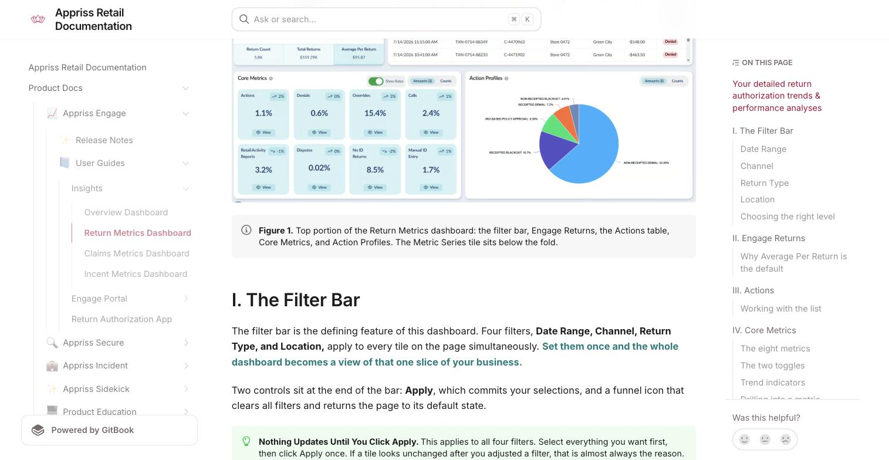
*Figure 1. Top portion of the Return Metrics dashboard: the filter bar, Engage Returns, the Actions table, Core Metrics, and Action Profiles. The Metric Series tile sits below the fold.*

## I. The Filter Bar

The filter bar is the defining feature of this dashboard. Four filters — Date Range, Channel, Return Type, and Location — apply to every tile on the page simultaneously. Set them once and the whole dashboard becomes a view of that one slice of your business.

Two controls sit at the end of the bar: Apply, which commits your selections, and a funnel icon that clears all filters and returns the page to its default state.

> **Nothing updates until you click Apply.** This applies to all four filters. Select everything you want first, then click Apply once. If a tile looks unchanged after you adjusted a filter, that is almost always the reason.

### Date Range

Identical to the Date Range filter on the Overview dashboard. Choose a preset — Last 7 days, Last 30 days, or Last 60 days — or select Custom and set Period 'From Date' and 'Period To Date' with the month, day, and year selectors or the calendar picker.

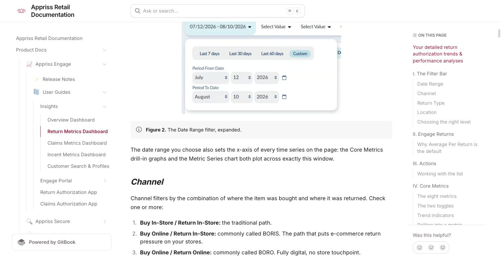
*Figure 2. The Date Range filter, expanded.*

The date range you choose also sets the x-axis of every time series on the page: the Core Metrics drill-in graphs and the Metric Series chart both plot across exactly this window.

### Channel

Channel filters by the combination of where the item was bought and where it was returned. Check one or more:

- **Buy In-Store / Return In-Store:** the traditional path.
- **Buy Online / Return In-Store:** commonly called BORIS. The path that puts e-commerce return pressure on your stores.
- **Buy Online / Return Online:** commonly called BORO. Fully digital, no store touchpoint.

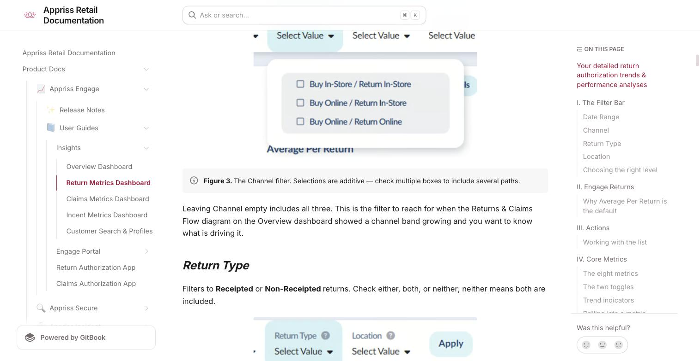
*Figure 3. The Channel filter. Selections are additive — check multiple boxes to include several paths.*

Leaving Channel empty includes all three. This is the filter to reach for when the Returns & Claims Flow diagram on the Overview dashboard showed a channel band growing and you want to know what is driving it.

### Return Type

Filters to Receipted or Non-Receipted returns. Check either, both, or neither; neither means both are included.

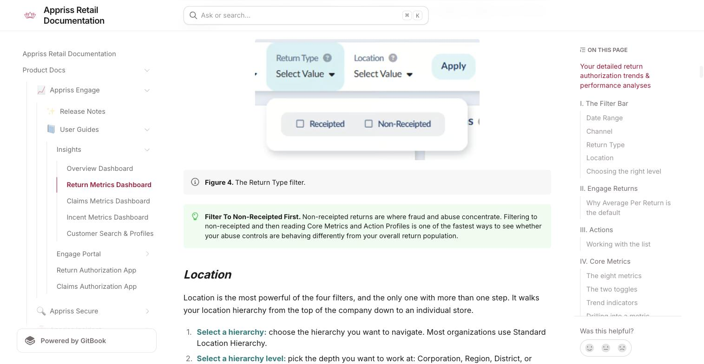
*Figure 4. The Return Type filter.*

> **Filter to non-receipted first.** Non-receipted returns are where fraud and abuse concentrate. Filtering to non-receipted and then reading Core Metrics and Action Profiles is one of the fastest ways to see whether your abuse controls are behaving differently from your overall return population.

### Location

Location is the most powerful of the four filters, and the only one with more than one step. It walks your location hierarchy from the top of the company down to an individual store.

1. **Select a hierarchy:** choose the hierarchy you want to navigate. Most organizations use Standard Location Hierarchy.
2. **Select a hierarchy level:** pick the depth you want to work at: Corporation, Region, District, or Locations.
3. **Choose a location:** pick one or more values at that level. Use the Filter… search box to jump straight to a store rather than scrolling; stores are listed as store number and name.
4. **Click Apply.** Use Clear inside the picker to reset your location selection without touching the other filters.

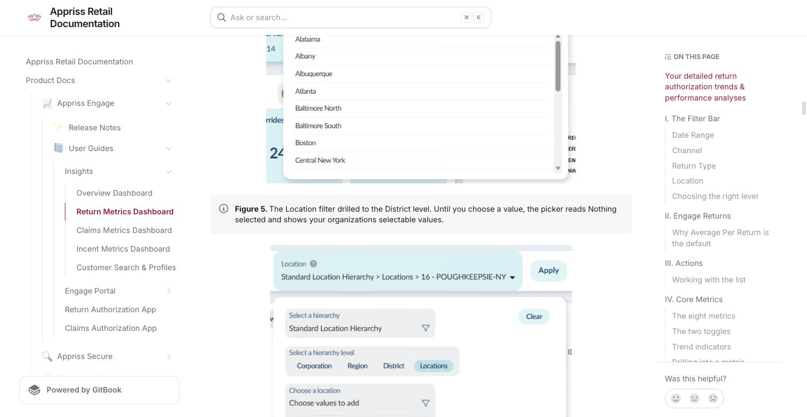
*Figure 5. The Location filter drilled to the District level. Until you choose a value, the picker reads "Nothing selected" and shows your organization's selectable values.*

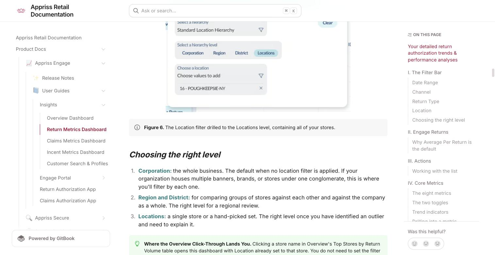
*Figure 6. The Location filter drilled to the Locations level, containing all of your stores.*

**Choosing the right level:**
- **Corporation:** the whole business. The default when no location filter is applied. If your organization houses multiple banners, brands, or stores under one conglomerate, this is where you'll filter by each one.
- **Region and District:** for comparing groups of stores against each other and against the company as a whole. The right level for a regional review.
- **Locations:** a single store or a hand-picked set. The right level once you have identified an outlier and need to explain it.

> **Where the Overview click-through lands you.** Clicking a store name in Overview's Top Stores by Return Volume table opens this dashboard with Location already set to that store. You do not need to set the filter yourself, just confirm what is selected before you read the numbers.

## II. Engage Returns

The first tile sizes the return population inside your current filter selection. It behaves exactly like the Returns and Claims tiles on the Overview dashboard: one hero figure, and a strip of three selectable metrics beneath it.

| Metric | What it measures |
|---|---|
| Return Count | The number of returns in the filtered slice. |
| Total Returns | The total dollar value of those returns. |
| Average Per Return | Total returns divided by return count; the average value of a single return. The tile's default view. |

Click any metric in the strip to promote it to the hero position, where it displays at full precision. The tile also carries a "View Details" control in its header for an expanded view of the same data.

**Why Average Per Return is the default:** Average Per Return is the most diagnostic of the three, and that is why it leads. Return count and total return dollars both move with sales volume, so they tell you relatively little on their own. The average moves when behavior changes: a rising average within a fixed filter usually means higher-value items are being returned, which is a different problem from "more returns."

> **Read it against the filter, not in isolation.** This tile only describes the slice you filtered to. An average per return of $93 across the whole company and an average per return of $93 at one store mean very different things. Always check the filter bar before quoting a figure from this tile.

## III. Actions

The Actions tile lists the individual transactions Engage acted on inside your filter selection. It is the same concept as the Actions table on the Overview dashboard, with two differences: there is no map here, and the list is scoped to your filters rather than to recent activity across the business.

| Column | What it gives you |
|---|---|
| Date / Time | When the action occurred. Default sort, newest first. |
| Transaction ID | The specific transaction the action was applied to. |
| Customer ID | The shopper's linked identity, clickable to their customer profile. |
| Store Name | The store where the return was attempted. May be blank for transactions with no store touchpoint, such as online returns. |
| Amount | The dollar value of the attempted return. |
| Action | Denied or Warned, shown as a colored status pill. |

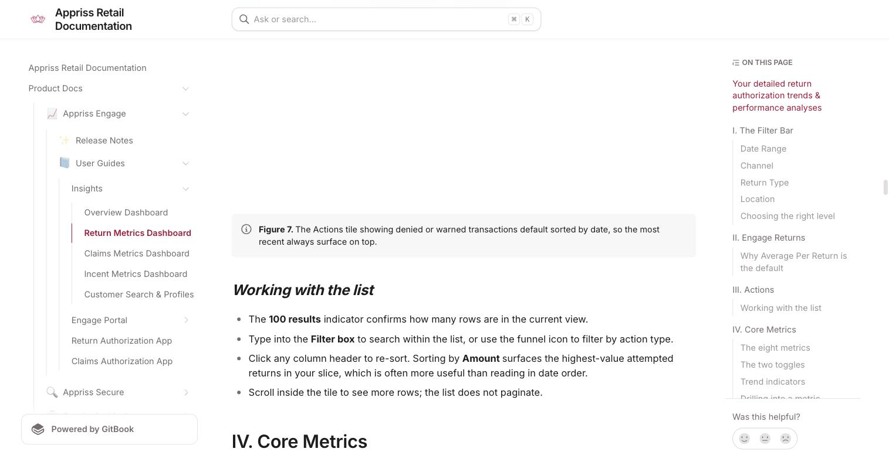
*Figure 7. The Actions tile showing denied or warned transactions default sorted by date, so the most recent always surface on top.*

**Working with the list:**
- The "100 results" indicator confirms how many rows are in the current view.
- Type into the Filter box to search within the list, or use the funnel icon to filter by action type.
- Click any column header to re-sort. Sorting by Amount surfaces the highest-value attempted returns in your slice, which is often more useful than reading in date order.
- Scroll inside the tile to see more rows; the list does not paginate.

## IV. Core Metrics

Core Metrics is the heart of the dashboard: eight cards covering the metrics that describe how your return authorization program is actually operating. Each card shows the metric name, a trend indicator, the current value, and a View control that opens a day-by-day graph.

**The eight metrics:**

| Metric | What it measures | Why it matters |
|---|---|---|
| Actions | Return transactions where Engage took an action: a warning or a denial. | Your overall intervention level via the Engage return authorization decisioning engine. |
| Denials | Returns Engage declined. | The sharp end of the program. Rising denials with flat returns means behavior is deteriorating. |
| Overrides | Actions a store associate or manager reversed. | The clearest governance signal on the page. Reversals concentrated at one store or one associate warrant a closer look. |
| Calls | Escalations placed in connection with a return decision. | An operational load measure. High call volume against low denials suggests friction in the process, not in the policy. |
| Retail Activity Reports | Activity reports generated against returns. | Investigative follow-up volume. Could signal a need to fine-tune the authorization model. |
| Disputes | Shoppers who formally challenged a decision. | A customer-experience early warning. Sustained growth here usually precedes complaints reaching your service channels. |
| No ID Returns | Returns processed without shopper identification. | The blind spot in your data. Every no-ID return is a return Engage cannot link to a shopper. |
| Manual ID Entry | Returns where the associate keyed the ID by hand rather than scanning it. | A data-quality and integrity signal. Concentrated manual entry at one store or one associate is worth a closer look. |

**The two toggles:** Two controls in the tile header change what the eight cards display. Together they produce four distinct views of the same underlying data, and the values in each are genuinely different measures, not different formatting of one number.

- **Show Rates:** when on, every card displays a percentage. When off, every card displays a raw figure.
- **Amounts ($) / Counts:** whether that figure is weighted by dollar value or by number of transactions.

| View | What a card shows | Example (the 'Denials' card) |
|---|---|---|
| Show Rates on, Amounts ($) | Metric dollars as a percentage of return dollars. | 0.67% |
| Show Rates on, Counts | Metric transactions as a percentage of return transactions. | 0.58% |
| Show Rates off, Amounts ($) | Raw dollar value of the metric. | $20,564 |
| Show Rates off, Counts | Raw number of transactions. | 207 |

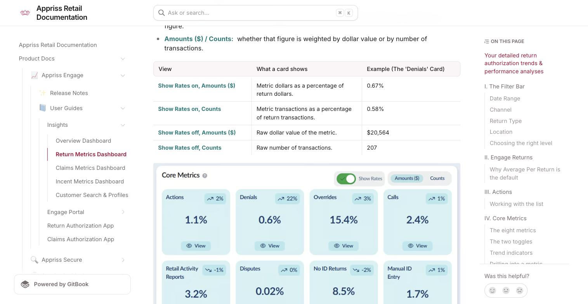
*Figure 8. Core Metrics with Show Rates on and Amounts selected; every card is a dollar-weighted percentage.*

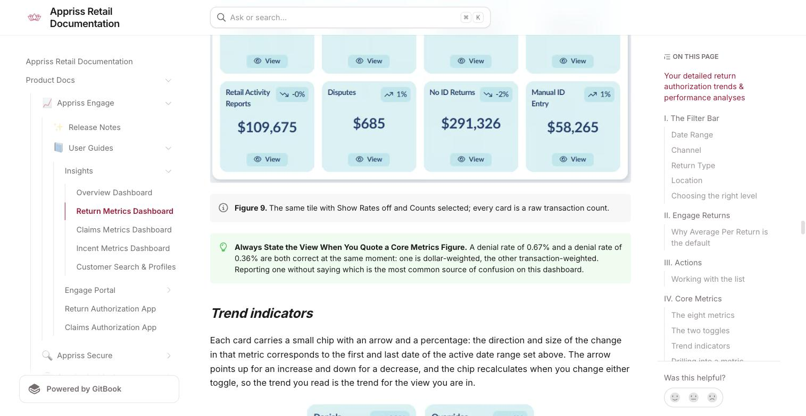
*Figure 9. The same tile with Show Rates off and Counts selected; every card is a raw transaction count.*

> **Always state the view when you quote a Core Metrics figure.** A denial rate of 0.67% and a denial rate of 0.36% are both correct at the same moment: one is dollar-weighted, the other transaction-weighted. Reporting one without saying which is the most common source of confusion on this dashboard.

**Trend indicators:** Each card carries a small chip with an arrow and a percentage: the direction and size of the change in that metric corresponds to the first and last date of the active date range set above. The arrow points up for an increase and down for a decrease, and the chip recalculates when you change either toggle, so the trend you read is the trend for the view you are in.

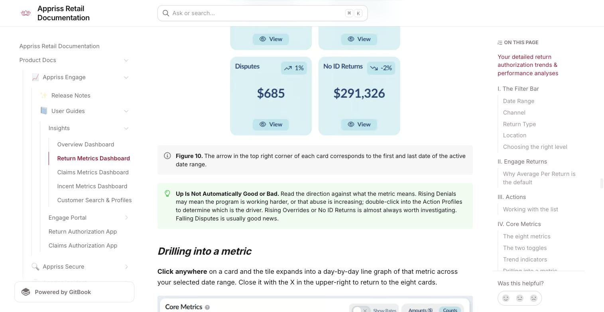
*Figure 10. The arrow in the top right corner of each card corresponds to the first and last date of the active date range.*

> **Up is not automatically good or bad.** Read the direction against what the metric means. Rising Denials may mean the program is working harder, or that abuse is increasing; double-click into the Action Profiles to determine which is the driver. Rising Overrides or No ID Returns is almost always worth investigating. Falling Disputes is usually good news.

**Drilling into a metric:** Click anywhere on a card and the tile expands into a day-by-day line graph of that metric across your selected date range. Close it with the X in the upper-right to return to the eight cards.

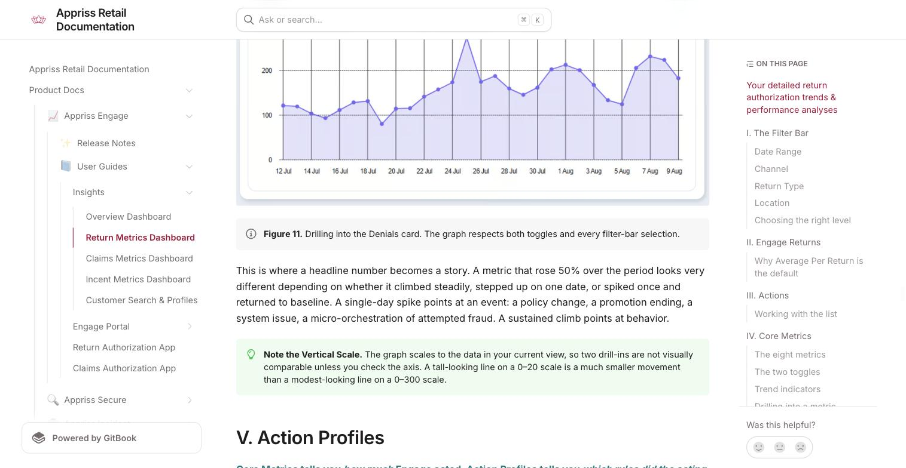
*Figure 11. Drilling into the Denials card. The graph respects both toggles and every filter-bar selection.*

This is where a headline number becomes a story. A metric that rose 50% over the period looks very different depending on whether it climbed steadily, stepped up on one date, or spiked once and returned to baseline. A single-day spike points at an event: a policy change, a promotion ending, a system issue, a micro-orchestration of attempted fraud. A sustained climb points at behavior.

> **Note the vertical scale.** The graph scales to the data in your current view, so two drill-ins are not visually comparable unless you check the axis. A tall-looking line on a 0–20 scale is a much smaller movement than a modest-looking line on a 0–300 scale.

## V. Action Profiles

Core Metrics tells you how much Engage acted. Action Profiles tells you which rules did the acting. The pie chart breaks every action in your filtered slice down by the specific authorization rule that fired, each labeled with its share of the total.

Rule names describe both the condition and the outcome. NON-RECEIPTED DENIAL is a denial triggered on a return without a receipt; SKU BASED POLICY DENIAL is a denial driven by product-level policy; OVERRIDE captures actions that were reversed at the point of sale. Your rule set is configured for your business, so your slices will differ from generic examples.

**The Amounts and Counts toggle:** The same toggle you use in Core Metrics reweights the pie. This is the most revealing comparison on the dashboard, because the two views frequently disagree about which rules matter.

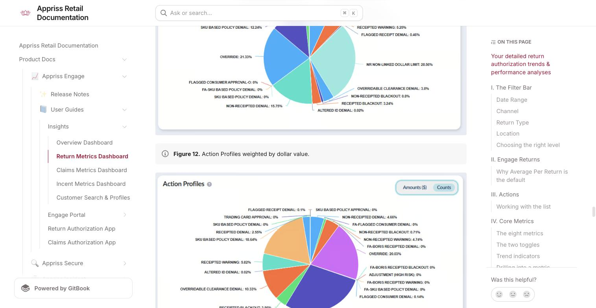
*Figure 12. Action Profiles weighted by dollar value.*

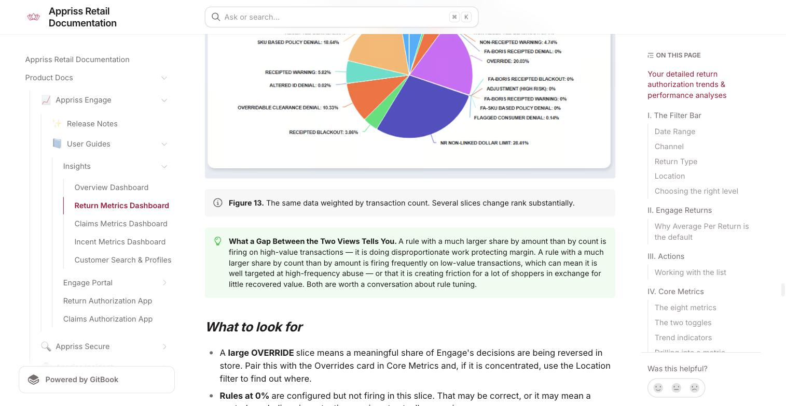
*Figure 13. The same data weighted by transaction count. Several slices change rank substantially.*

> **What a gap between the two views tells you.** A rule with a much larger share by amount than by count is firing on high-value transactions — it is doing disproportionate work protecting margin. A rule with a much larger share by count than by amount is firing frequently on low-value transactions, which can mean it is well targeted at high-frequency abuse — or that it is creating friction for a lot of shoppers in exchange for little recovered value. Both are worth a conversation about rule tuning.

**What to look for:**
- A large OVERRIDE slice means a meaningful share of Engage's decisions are being reversed in store. Pair this with the Overrides card in Core Metrics and, if it is concentrated, use the Location filter to find out where.
- Rules at 0% are configured but not firing in this slice. That may be correct, or it may mean a control you believe is protecting you is not actually engaging.
- Compare the profile with and without a Return Type filter. The rule mix on non-receipted returns should look materially different from the mix on receipted ones.

## VI. Metric Series

Metric Series sits at the bottom of the page and is the most precise tool on the dashboard. Where the Core Metrics drill-in graphs one metric as a whole, Metric Series lets you graph one metric for one or more specific rules, and gives you the underlying daily figures in a table alongside the chart.

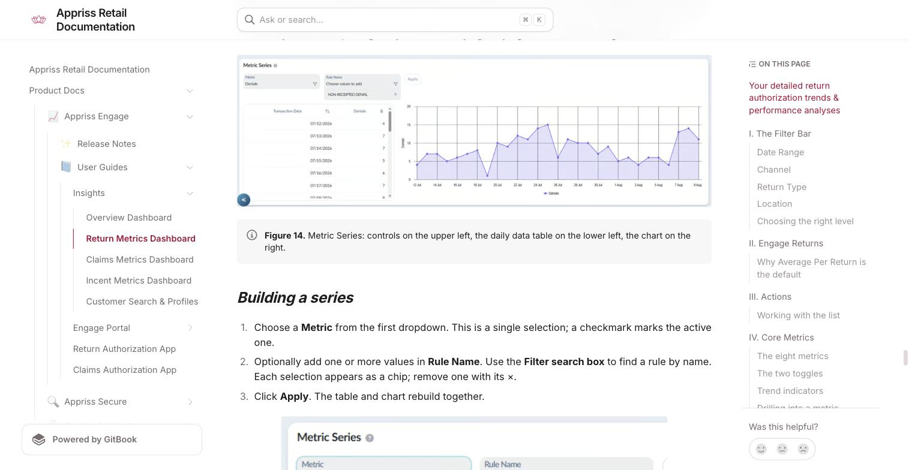
*Figure 14. Metric Series: controls on the upper left, the daily data table on the lower left, the chart on the right.*

**Building a series:**
1. Choose a Metric from the first dropdown. This is a single selection; a checkmark marks the active one.
2. Optionally add one or more values in Rule Name. Use the Filter search box to find a rule by name. Each selection appears as a chip; remove one with its ×.
3. Click Apply. The table and chart rebuild together.

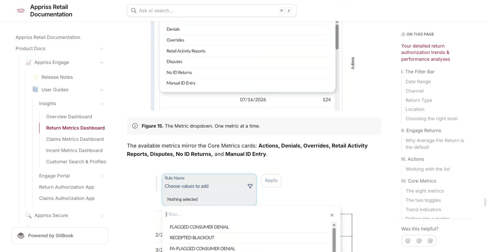
*Figure 15. The Metric dropdown. One metric at a time.*

The available metrics mirror the Core Metrics cards: Actions, Denials, Overrides, Retail Activity Reports, Disputes, No ID Returns, and Manual ID Entry.

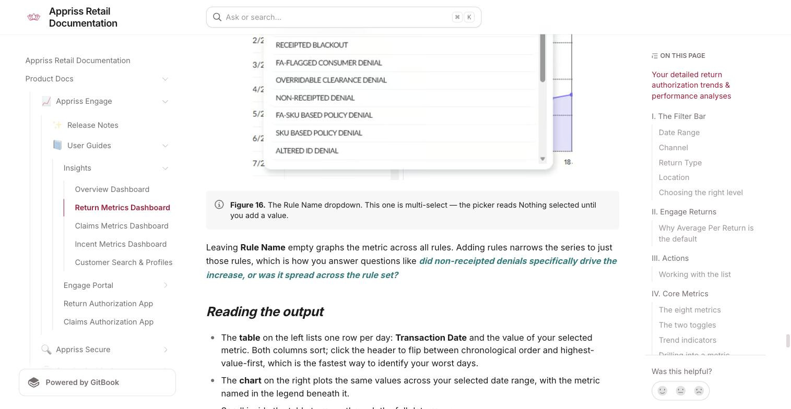
*Figure 16. The Rule Name dropdown. This one is multi-select — the picker reads "Nothing selected" until you add a value.*

Leaving Rule Name empty graphs the metric across all rules. Adding rules narrows the series to just those rules, which is how you answer questions like "did non-receipted denials specifically drive the increase, or was it spread across the rule set?"

**Reading the output:**
- The table on the left lists one row per day: Transaction Date and the value of your selected metric. Both columns sort; click the header to flip between chronological order and highest-value-first, which is the fastest way to identify your worst days.
- The chart on the right plots the same values across your selected date range, with the metric named in the legend beneath it.
- Scroll inside the table to move through the full date range.

> **This is your evidence, not just your visual.** The table gives you exact daily figures next to the chart. When you need to put a date and a number in front of a store manager or a merchant, read them from here rather than estimating from the graph.

### Three common workflows

**Diagnosing a rise in denials**
1. Set the Date Range to cover the period in question. Leave the other filters open. Click Apply.
2. In Core Metrics, turn Show Rates on and note the Denials rate in both Amounts and Counts. If the two moved differently, the change is concentrated in a particular value band.
3. Click View on the Denials card. Decide whether you are looking at a single-day spike or a sustained climb.
4. Read Action Profiles in both weightings to identify which rules are carrying the increase.
5. In Metric Series, set Metric to Denials and add the suspect rule to Rule Name. Confirm the daily pattern matches the overall spike.

**Investigating a store flagged from Overview**
1. Arrive here by clicking the store name in Overview's Top Stores by Return Volume table, or set Location filter to Locations and pick the store manually.
2. Check Engage Returns. A high Average Per Return relative to the company points at high-value returns; a high Return Count points at volume.
3. In Core Metrics, look hardest at Overrides, No ID Returns, and Manual ID Entry. These three separate a store with a returns problem from a store with a process problem.
4. Use Action Profiles to see whether this store's rule mix looks like the company's.
5. Scan the Actions table sorted by Amount for the specific transactions worth naming.

**Reviewing a rule change**
1. Set a Custom date range that spans the change, with comparable time either side.
2. In Metric Series, set Metric to Actions or Denials and add the changed rule to Rule Name.
3. Check Overrides in Core Metrics over the same window. A new rule that is immediately being overridden in store is not landing.
4. Re-run with a Channel or Return Type filter if the rule was scoped to one of them.

## Troubleshooting

| What you're seeing | What to check |
|---|---|
| Nothing changed after I set a filter | Confirm you clicked Apply. All four filters commit together, and none of them refresh the page on their own. |
| A metric looks wrong compared with last week's report | Check both toggles. Show Rates on versus off, and Amounts versus Counts, produce four different figures from the same data. |
| Core Metrics values look far too low | Check whether a Location, Channel, or Return Type filter is still applied from an earlier investigation. Use the funnel icon at the end of the filter bar to clear everything. |
| Some rules show 0% in Action Profiles | The rule is configured but did not fire inside your current filter selection. Widen the filters to confirm whether it fires at all. |
| Metric Series shows nothing after I clicked Apply | Check whether the rule you selected fires for the metric you selected. Clear the Rule Name chips to graph the metric across all rules. |
| The Calls metric is not in the Metric Series dropdown | Calls appears as a Core Metrics card but is not yet among the Metric Series options. Use the View drill-in on the Calls card for its daily trend. |

## Glossary

| Term | Definition |
|---|---|
| Action | Any intervention Engage makes on a return — a warning, a denial, or an approval governed by a rule. |
| Rule | A configured condition that produces an action. Rule names on this dashboard describe both the trigger and the outcome, for example NON-RECEIPTED DENIAL. |
| Override | An Engage decision reversed by a store associate or manager at the point of return. |
| Receipted return | A return presented with proof of purchase. |
| Non-receipted return | A return presented without proof of purchase. Where fraud and abuse concentrate. |
| BORIS | Bought online, returned in store. Shown here as Buy Online / Return In-Store. |
| BORO | Bought online, returned online. Shown here as Buy Online / Return Online. |
| No ID return | A return processed without capturing shopper identification, and therefore not linkable to a shopper history. |
| Manual ID entry | A return where the associate keyed the shopper's ID by hand rather than scanning it. |
| Retail Activity Report | An activity report generated against return behavior for investigative follow-up. |
| Dispute | A formal challenge raised by a shopper against a return decision. |
| Location Hierarchy | The structure that organizes your stores; typically Corporation, Region, District, and Locations. |
| Show Rates | The Core Metrics toggle that switches every card between a percentage and a raw value. |
| Amounts / Counts | The toggle that switches a tile between dollar weighting and transaction weighting. |

**Need Help?** If you have questions about Engage Insights, your access, or how to apply it to your programs, contact your Customer Success Manager.
